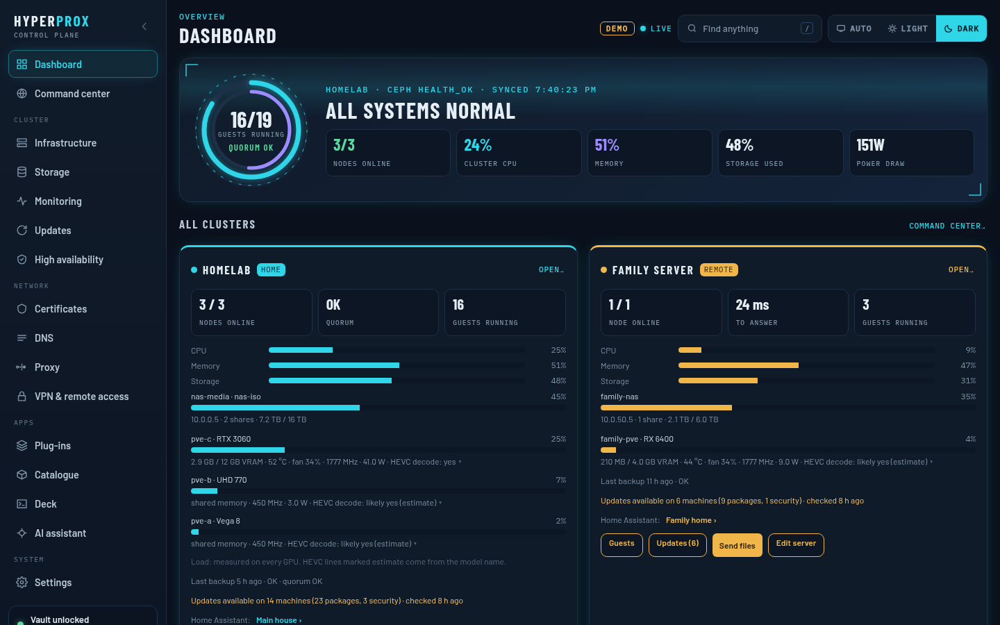
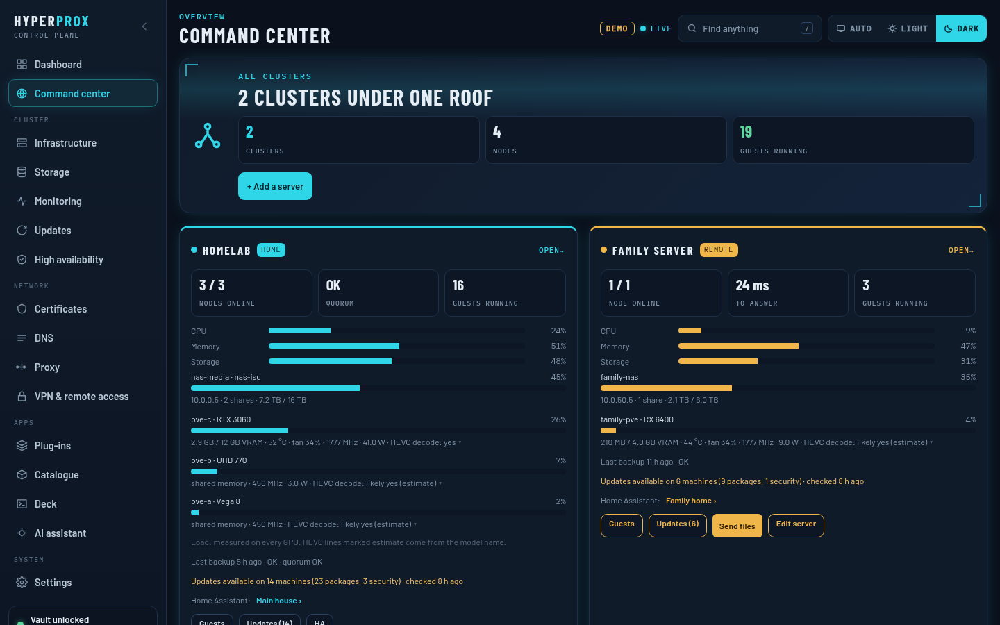
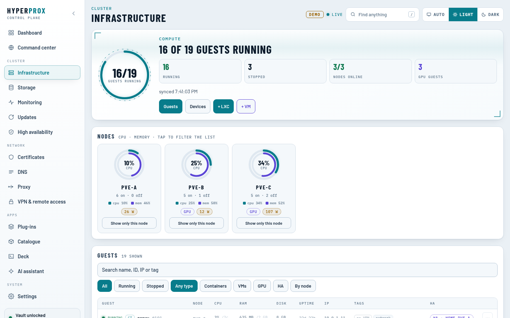
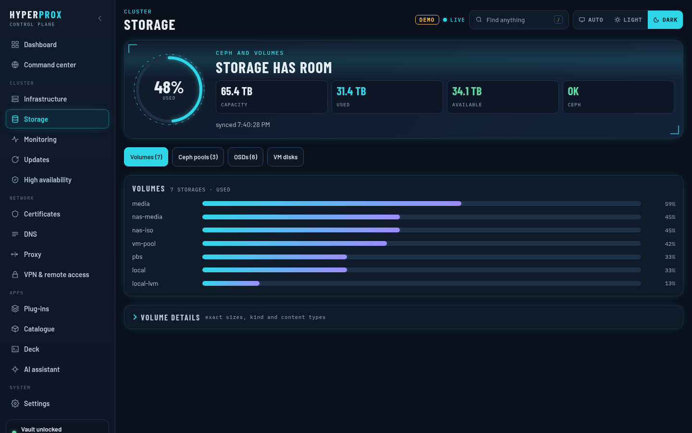
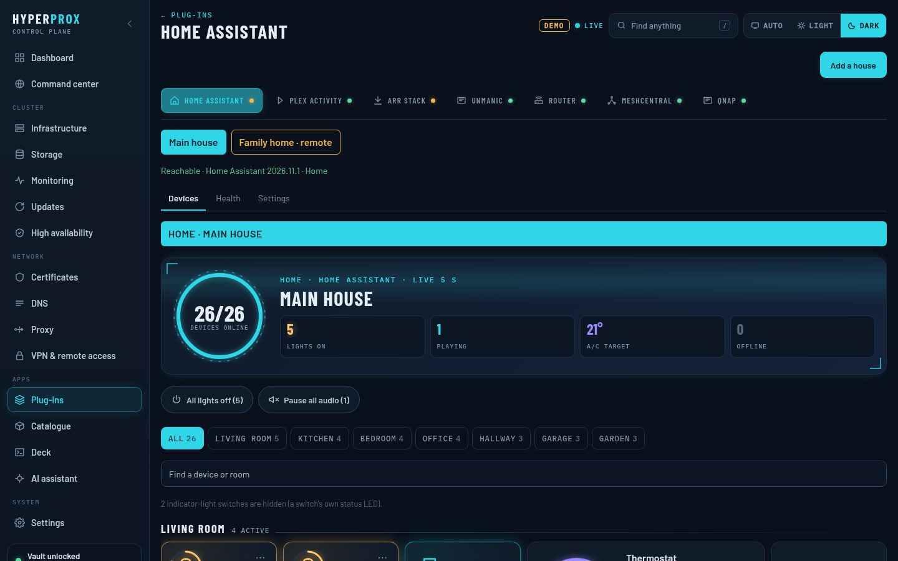
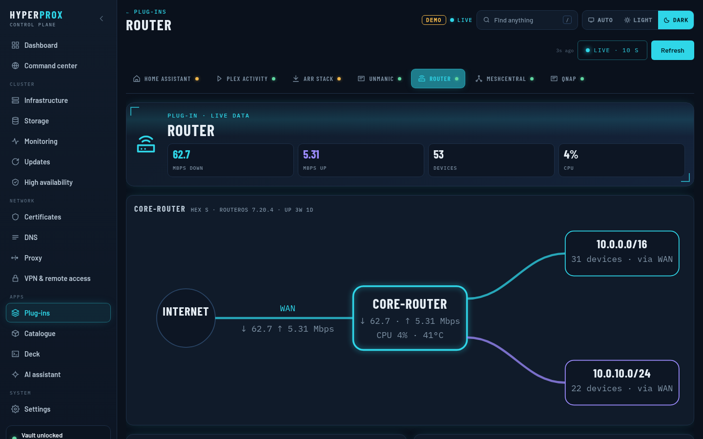
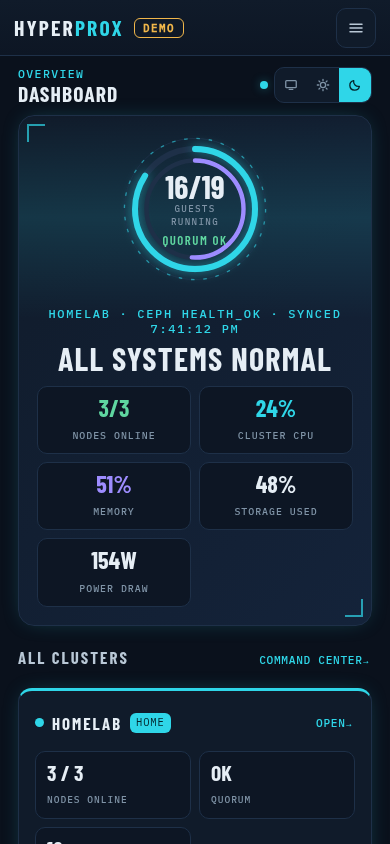
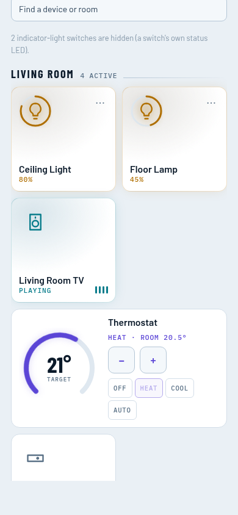
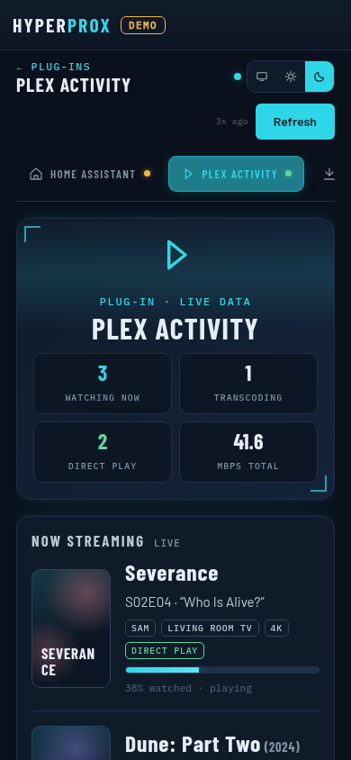
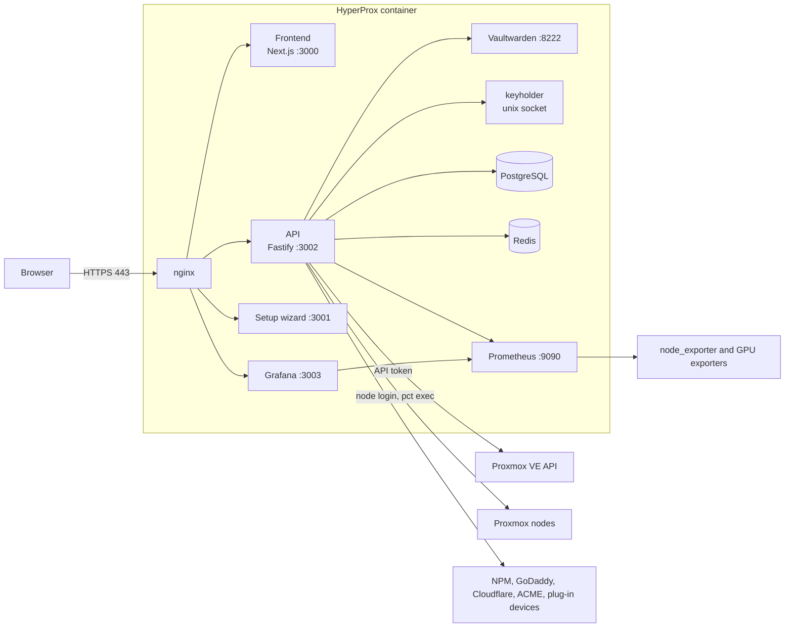

<p align="center">
  
</p>

<p align="center">
  <strong>Your Proxmox infrastructure, hypercharged.</strong>
</p>

<p align="center">
  <a href="https://www.gnu.org/licenses/agpl-3.0"></a>
  <a href="https://github.com/hyperprox/alpha/stargazers"></a>
  <a href="https://hyperprox.dev"></a>
</p>

---

HyperProx is a self-hosted control panel that sits on top of Proxmox VE. It puts the things a
homelab runs around the hypervisor (reverse proxy hosts, DNS records, TLS certificates, monitoring,
updates, SSH access, backups and the services on your network) into one web interface, behind a built-in,
zero-knowledge vault. Its dashboard is a glance: one verdict, a chip for each plug-in and a row for your
websites, with the detail a click away.

It runs in a single container on your cluster, installs with one command, and talks to Proxmox
through its API.

**Website:** [hyperprox.dev](https://hyperprox.dev) has the tour, screenshots, the comparison with other tools and the roadmap.

## Screenshots

<table>
  <tr>
    <td><a href="docs/screenshots/dashboard-desktop-dark.png"></a></td>
    <td><a href="docs/screenshots/command-center-desktop-dark.png"></a></td>
  </tr>
  <tr>
    <td><a href="docs/screenshots/infrastructure-desktop-light.png"></a></td>
    <td><a href="docs/screenshots/storage-desktop-dark.png"></a></td>
  </tr>
  <tr>
    <td><a href="docs/screenshots/plugin-home-assistant-desktop-dark.png"></a></td>
    <td><a href="docs/screenshots/plugin-router-desktop-dark.png"></a></td>
  </tr>
</table>

<p align="center">
  
  
  
</p>

A few more are in [docs/screenshots](docs/screenshots), including the QNAP plug-in. They are taken from
the demo below, so every name, address and number in them is invented. The dashboard pictures show the
layout from before 12 November 2026, with a tile for each node. That detail has moved to
Infrastructure (see [Dashboard](#dashboard)); the pictures will be retaken.

## Try the demo

The demo runs the real frontend against a stand-in API that answers every page from invented data: a
three-node cluster called `homelab`, a remote "Family Server", and the plug-ins with rooms, devices,
streams and downloads. The vault shows as unlocked, and anything that would change, reveal, send or
open something (a save, a power action, a secret, Send files, a terminal) is refused by the API with
"This is a demo".

```bash
git clone https://github.com/hyperprox/alpha.git hyperprox && cd hyperprox
pnpm install
pnpm demo        # first run builds the frontend, then open http://127.0.0.1:3100
```

Sign in with anything. The demo is a separate entrypoint (`apps/api/src/demo`): it never loads a
`.env`, a database, the vault or a credential store, it refuses to start if the environment holds a
real install's settings or if it would take the real ports (3000, 3002), and it keeps its own data
directory. Every page shows a **DEMO** badge.

To retake the screenshots, start the demo, then copy `scripts/screenshots.mjs` into a folder where
Playwright is installed (`npm i playwright && npx playwright install chromium`) and run it there. It
refuses any address that does not answer as the demo. By default it takes only the set kept in
`docs/screenshots`; `--all` takes every main page at desktop and phone size, dark and light, for review.

```bash
node screenshots.mjs http://127.0.0.1:3100 /path/to/hyperprox/docs/screenshots
node screenshots.mjs --all http://127.0.0.1:3100 /tmp/hyperprox-shots
```

## Highlights

| Area | What you get |
|---|---|
| Proxmox | Every VM and container with power actions, snapshots, migration, HA state and an SSH console; create guests from any template or ISO on any node |
| Dashboard | A glance: one cluster verdict, storage and what is happening now, a chip for each plug-in (Active, Needs attention or Off) and a Websites row with people today, bots kept apart, and certificate and alert pills; dials, GPU, network, Ceph and HA are folded away under **More detail** |
| Monitoring | Bundled Prometheus and Grafana with HyperProx dashboards and alert rules |
| Storage | Every storage on every node, Ceph health, OSDs and pools, and per-guest disks |
| Reverse proxy | Nginx Proxy Manager, Traefik, Caddy, HAProxy and Pangolin, several at once in one table; every change previewed, then read back |
| DNS | GoDaddy and Cloudflare records side by side, each domain at the provider that holds it, with guided creation, Cloudflare's proxy (orange cloud) per record, domain expiry, WAN IP mismatch flags and DDNS |
| Certificates | Inventory of every endpoint's certificate, ACME DNS-01 issuance and renewal, delivery into guests |
| Updates | Pending packages everywhere, on every cluster, and a gated update run that respects HA and quorum, restarts Ceph one OSD at a time and refuses any restart or reboot that would take data offline; a daily read-only check tells you when something new needs updating |
| Terminal | Browser SSH with persistent tmux sessions, split panes and saved layouts |
| Catalogue | Guided installs of NPM, Ollama, Tautulli, Nextcloud, Jellyfin, Gitea, Proxmox Backup Server and more: choose resources, see every node's free capacity with a recommended node, pick the ID and address; an app already running on your cluster shows where. The **Arr Stack** recipe installs Sonarr, Radarr and the apps you pick, wired together, with the logins in the vault; **Unmanic** and **Tdarr** install the video converters with the GPU found on the node, the same library layout, and extra workers or nodes on other cluster nodes |
| Websites | Its own section: a New website wizard (static site, WordPress or Ghost) from a domain your DNS provider lists to a live HTTPS site (container, DNS record, proxy host, certificate and a check of the public address), Add existing for the sites HyperProx finds already running, and privacy-friendly metrics from each site's own access log (people counted apart from bots and scanners, with a Security card for probes; LiteSpeed and CyberPanel sites are read-only); then open it, sign in to WordPress with a one-time link or open Ghost's admin, reveal its password, pull it again, check its health |
| AI assistant | Questions about your cluster, and plain-language deploys run end to end after you confirm |
| Plug-ins | Arr Stack, Unmanic, MikroTik, ASUS routers, Plex, Proxmox Backup Server, Home Assistant, QNAP and MeshCentral, with no access to credentials; Home Assistant also controls devices, in more than one house |
| Plex | Works from Plex alone (Tautulli is optional), added with **Sign in with Plex** and a short code; live updates and covers; **Clear-out** lists what nobody watches, with keep rules; **Library** removes shows, seasons, episodes and films through Sonarr, Radarr or Plex, behind a preview and the master password; a message when something new is added |
| Backups | The Proxmox Backup Server plug-in: datastores, stale guests, job health and an optional Verify, read-only unless you turn on managing backups (delete, prune, clean up; protected snapshots are never touched) |
| Notifications | Discord, Slack, Teams, ntfy, Gotify, Telegram and generic webhooks |
| Security | Built-in Vaultwarden sign-in with 2FA, secrets in memory only, auto-lock, roles and API tokens (an owner can let one admin token save plug-in settings without the master password; off by default and audited) |

## Quick start

| Requirement | Details |
|---|---|
| Proxmox VE | Shell access as `root` on one node |
| Container (bootstrap defaults) | 4 cores, 8 GB RAM, 100 GB disk, privileged with nesting and keyctl |
| Network | Outbound internet during install (Debian, Docker, NodeSource and GitHub) |
| Browser | Any current browser on Windows, macOS, Linux, iOS or Android |

Open a shell on a Proxmox node: **Node → Shell** in the Proxmox web interface, or `ssh root@<your-node>`
from Windows PowerShell, macOS Terminal or Linux. Then run:

```bash
curl -fsSL https://raw.githubusercontent.com/hyperprox/alpha/main/bootstrap.sh | bash
```

When it finishes, open the setup link it prints (`https://<container-ip>/setup?k=<setup key>`), finish
the wizard, then create the owner account at `https://<container-ip>/login` (the wizard's last button takes
the setup key with it; the owner account cannot be created without it).

## Installation

### Option 1: bootstrap.sh (recommended)

`bootstrap.sh` sets up everything from one command on a Proxmox node, as root.

First it looks at every node and lists what it found, one line per node, for example:

```
    Found 2 nodes:
      • node-a: NVIDIA GeForce GTX 1070 Ti (dedicated) · health monitoring ✓
      • node-b: Intel UHD Graphics 630 (built in)
```

Then it asks, in this order:

1. **Your container.** Which ID it should have (Enter takes the one offered: the next free ID, or one that fits
   your numbering), and how it gets its address: DHCP, or a static address and its gateway. A taken ID, or an
   address another guest uses or that answers a ping, is refused and asked again.
2. **What to switch on.** A few yes/no questions, only the ones that apply to your hardware (see
   [Monitoring, power, GPUs and more](#monitoring-power-gpus-and-more)). It never asks about something that is
   already there: if health monitoring already runs on every node, it says so and moves on, and if it runs on
   some, it names the nodes the question is about.
3. **Remote access.** How you want to reach HyperProx when you are away from home:
   - **Tailscale**: installed in HyperProx's own container. It shows a sign-in link and a QR code; you sign in
     with your Tailscale account in a browser or on your phone. Nothing to open on your router, and no key to
     paste. The container keeps its own DNS settings (Tailscale's DNS is not switched on in it).
   - **WireGuard**: a small container of its own runs the server. It asks for the tunnel network (the one
     offered does not overlap your network or the cluster's) and the address phones connect to. Forward the
     UDP port it names on your router to that container.
   - **Not now** (the default): add either later on the VPN page.

   Either way it shows up on HyperProx's VPN page after your first sign-in, as an entry HyperProx manages.
   For WireGuard, that is where you add your phone: its key is made in your browser and kept in the vault, and
   a QR code is shown to scan. The installer never makes a phone's key.

Then it shows one table of everything it will create (container ID, address, size, storage, template,
monitoring, VPN, tokens, and the work on each node) and asks before it goes ahead. Nothing is created before
you answer.

The questions work under `curl ... | bash`: they are read from your terminal, not from the pipe. On a terminal
it draws a banner, numbered steps, boxed questions, spinners with a seconds count for every long wait (the
last lines of a failed step's output are shown, never hidden), and a card at the end with the address to open.
Piped into a log, with `NO_COLOR` set, on a basic console or a window narrower than 72 columns, it prints plain
lines (`[step 4/10] …`, `[ ok ] … (6s)`) with no colour codes, so a log stays easy to search.

Then it does the work:

- It creates a **privileged** container from the newest Debian 13 template built for your node's CPU
  (amd64 or arm64; a template for another CPU is never used, even if it is the only one downloaded), with
  `nesting=1` and `keyctl=1` (Docker needs them), the TUN device for Tailscale, and start on boot. The root
  disk goes on block storage (Ceph RBD, ZFS or LVM) with room for it, the one with most free space first,
  and only on a file share if there is nothing else.
- If your guests are numbered by node and address (guest 342 on node 3 at `x.y.z.242`), it offers an ID
  and a static address that fit, and checks that the ID is free, that no guest uses the address and that
  nothing answers a ping on it. Otherwise it offers the next free ID and DHCP. With `-y` or no terminal it
  takes what it offers without asking.
- It makes the API token `root@pam!hyperprox` (privilege separation off, so it has root's rights) and,
  if you want Proxmox's own metrics, a read-only `root@pam!hyperprox-exporter` (`PVEAuditor` on `/`).
  A token named `hyperprox` that already exists is left alone, and the setup wizard makes its own.
- It carries out your answers on each node, one node at a time, over the cluster's own SSH trust, then
  checks them over the network from the node you ran it on: each exporter answers, and power reads above
  zero.
- It installs HyperProx in the container, then prints the address (and the Tailscale address, if you chose
  it), where it saved the root password (a root-only file on the node), and what was done, skipped or failed
  on your nodes, with the reason for each.
- Remote access never changes a Proxmox node: Tailscale goes into HyperProx's container, WireGuard into its
  own. WireGuard needs the `wireguard` kernel module loaded on the node; if it is not, the installer says so
  and skips it rather than load it.

`-y` (or `HYPERPROX_YES=1`) takes every default. Without a terminal and without `-y`, it shows the
defaults and stops before creating anything. `--dry-run` looks and asks, shows the plan, and changes nothing.

If the install stops part-way, because you pressed Ctrl+C or something failed, it removes what this run
created: the container, the tokens it made, a template it downloaded, and built-in graphics or AMD GPU
settings it turned on. Monitoring software it added to a node is left there (it does no harm) and named,
and so is the power-counter rule, with the file to delete to undo it.
Anything that was there before it started is never touched: a container is removed only if it carries
this run's mark in its description. A container cut off while Proxmox was still creating it is not removed;
the commands to remove it are shown instead. `--keep-on-failure` keeps what was made after a
failure, so you can look inside the container.

Pass options through `bash -s --`:

```bash
curl -fsSL https://raw.githubusercontent.com/hyperprox/alpha/main/bootstrap.sh | bash -s -- --ip 192.0.2.50/24 --gateway 192.0.2.1 -y
```

| Option | Default | Meaning |
|---|---|---|
| `--vmid N` | asked; fits your numbering, or next free | Container ID |
| `--hostname NAME` | `hyperprox` | Container hostname |
| `--cores N` | `4` | CPU cores |
| `--memory MB` | `8192` | Memory |
| `--disk GB` | `100` | Root disk |
| `--storage NAME` | block storage with room | Storage for the root disk |
| `--bridge NAME` | `vmbr0` | Network bridge |
| `--ip CIDR` | asked; fits your numbering, or `dhcp` | Static address, for example `192.0.2.50/24` |
| `--gateway IP` | | Gateway, required with `--ip` |
| `--dns IP[,IP]` | the node's own | The container's DNS servers (IPv4 or IPv6, up to three). When the node's resolver is one a container cannot reach (Tailscale's 100.100.100.100 or anything in 100.64.0.0/10, a local 127.x or `::1` stub), the container gets 1.1.1.1 and the summary says so. With `HPX_API_URL` (https only) and `HPX_API_TOKEN` (a read-only viewer token) pointing at an existing HyperProx, the DNS saved in its Naming & addresses is used instead; its certificate is checked, or pinned with `HPX_API_PINNEDPUBKEY=sha256//...` for a self-signed one |
| `--ref REF` | `main` | Install a release tag, branch or commit |
| `--password PASS` | generated | Container root password |
| `--skip-exporter` | | Answer no to watching node health |
| `--skip-rapl` | | Answer no to power monitoring |
| `--skip-gpu-exporter` | | Answer no to GPU monitoring |
| `--no-charts` | | Answer no to Prometheus and Grafana |
| `--no-pve-metrics` | | Answer no to reading Proxmox's own metrics |
| `--ai`, `--no-ai` | | Answer yes or no to a local AI assistant |
| `--igpu`, `--no-igpu` | | Answer yes or no to letting containers use the nodes' built-in graphics |
| `--vpn KIND` | asked; `none` with `-y` | Remote access: `tailscale`, `wireguard` or `none` |
| `--tailscale-authkey KEY` | | Join Tailscale without a browser sign-in, for unattended installs. Better: set `TS_AUTHKEY` in the environment, which keeps the key off the command line. Never printed or written to a log |
| `--wg-subnet CIDR` | a free one, such as `10.99.0.1/24` | WireGuard tunnel network |
| `--wg-endpoint HOST` | the VPN container's LAN address | Public address or DNS name phones connect to (change it later on the VPN page) |
| `--dry-run` | | Look and ask, then show what would be done; change nothing |
| `--keep-on-failure` | | After a failure, keep what was made so you can look inside |
| `-y`, `--yes` | | Take every default and do not ask (or set `HYPERPROX_YES=1`) |

### Option 2: install.sh on a machine you already have

Use this for your own container, a VM or bare metal. Supported systems are Debian 12 or 13 and
Ubuntu 22.04 or 24.04. As root:

```bash
apt update && apt install -y git curl
git clone https://github.com/hyperprox/alpha.git /opt/hyperprox
bash /opt/hyperprox/install.sh
```

The installer sets everything up in `/opt/hyperprox`: it installs what HyperProx runs on (Docker,
Node.js 20 and pnpm 9), builds HyperProx, creates its built-in vault and starts its services. If the
machine gets its address by DHCP, it offers to give it a fixed one. It asks first if you run it
directly on a Proxmox node rather than in a container. Inside a container it turns AppArmor off for
that container, because Docker cannot run there with it on.

Your credentials (Proxmox, node logins, proxies, DNS, app logins and everything else you add) are kept
in the vault, never in a file. The installer also writes `/opt/hyperprox/.env`, readable only by root. It
holds only the start-up keys HyperProx's own services need before anyone signs in: the database and cache
passwords, the vault's admin key, Grafana's encryption key and the key Prometheus uses to read plug-in
metrics.

Two more keys are there only for a short while. The setup key is removed when you create the owner account. Grafana's
first admin password moves into the vault when you create the owner account. Until then there is no
vault to hold anything, so the access key HyperProx makes for itself in Proxmox waits in `.env` and also
moves into the vault at that first sign-in. Anything you type during setup, such as a node login or a DNS
key, is held in memory only until then. [docs/security.md](docs/security.md) lists every key and why.

If you create the container yourself, it must be privileged with nesting and keyctl, or Docker fails
with an overlay error:

```bash
pct create <ctid> <template-storage>:vztmpl/<debian-template>.tar.zst \
  --hostname hyperprox --cores 4 --memory 8192 --rootfs <storage>:100 \
  --net0 name=eth0,bridge=vmbr0,ip=dhcp \
  --unprivileged 0 --features keyctl=1,nesting=1 --onboot 1 --start 1
```

No API token is needed for this path: the setup wizard makes one from your Proxmox login. Re-running
`install.sh` is safe; it keeps an existing `.env`, certificates and data.

### HTTPS

HyperProx is served by its own nginx on `https://<container-ip>/`, and port 80 redirects there. The
API, frontend, setup wizard, Prometheus and Grafana listen on loopback only. nginx also serves
WebSockets and Grafana (at `/grafana/`) on the same origin, and lets a request through to Grafana only
with a valid HyperProx session while HyperProx is unlocked.

The installer makes a self-signed certificate, so the browser warns until you either accept it or
replace it. To use your own, put the full chain in `/opt/hyperprox/certs/cert.pem` and the key in
`/opt/hyperprox/certs/key.pem`, then run `docker restart hyperprox-nginx`. The Certificates page can
also issue and install a real certificate for HyperProx itself (see [Certificates](#certificates)).

To trust the self-signed certificate instead, copy it to your computer
(`scp root@<container-ip>:/opt/hyperprox/certs/cert.pem .` works on Windows, macOS and Linux) and:

| System | Command |
|---|---|
| Windows (admin PowerShell) | `certutil -addstore -f Root cert.pem` |
| macOS | `sudo security add-trusted-cert -d -r trustRoot -k /Library/Keychains/System.keychain cert.pem` |
| Debian or Ubuntu | `sudo cp cert.pem /usr/local/share/ca-certificates/hyperprox.crt && sudo update-ca-certificates` |
| Firefox (any system) | Settings → Privacy & Security → Certificates → Import |

**Behind another reverse proxy.** If a proxy such as Nginx Proxy Manager terminates TLS in front of
HyperProx, point it at `http://<container-ip>:80` and tell nginx to trust it. nginx believes
`X-Forwarded-Proto: https` only from loopback and the addresses you list:

```bash
echo '192.0.2.10 1;' > /opt/hyperprox/data/nginx/trusted-proxies/proxies.conf   # your proxy's address or CIDR
docker restart hyperprox-nginx
```

HSTS is not sent. With a real domain and certificate you can add a `Strict-Transport-Security`
header to the `:443` server in `config/nginx/conf.d/hyperprox.conf`.

### First-run setup

The installer prints a wizard link with a setup key: `https://<container-ip>/setup?k=<key>`. Keep it
private. If you lose it before setup is done, run `grep SETUP_SECRET /opt/hyperprox/.env` on the
HyperProx machine. The same key is needed to create the owner account, so it stays until the owner's first
sign-in removes it. The wizard saves its progress, so reloading it resumes at the step you reached.

1. **Connect your Proxmox.** Sign in with your Proxmox web login (two-factor codes are supported).
   HyperProx uses it once to create its own API token, `hyperprox-<hostname>-<install id>`, and a
   read-only one for the PVE exporter (`<that token>-exporter`, `PVEAuditor` on `/`), and never stores
   the password. You can paste an existing token under **Advanced** instead. If bootstrap already
   configured a token, this step is skipped.
2. **Cluster detected.** Nodes, version, quorum, running guests and Ceph, and a line on what each node
   has: its GPUs, built in or dedicated.
3. **Services.** Finds Nginx Proxy Manager, Ollama and Proxmox Backup Server already on your network,
   and asks whether you want charts and dashboards (Prometheus and Grafana). To run Nginx Proxy Manager,
   install it from the [Catalogue](#catalogue) after setup.
4. **Options.** The same yes/no questions as `bootstrap.sh`, only those that apply (see
   [Monitoring, power, GPUs and more](#monitoring-power-gpus-and-more)). If you say yes to anything on
   your nodes, it asks once for the login you use to SSH to them (usually root), tests it on every node,
   then does the work one node at a time and shows what it did. If you ran `bootstrap.sh`, this step shows
   what it already did instead.
5. **Done.** The wizard starts your chosen services, writes Prometheus's list of nodes and GPUs, checks
   in Prometheus that each answer worked, restarts HyperProx, and exits for good. It ends with a list of
   what was done, skipped or failed, and why.

Then open `https://<container-ip>/login` and **create the owner account**: the setup key (filled in when you
come from the wizard's last button), an email, a master password and an authenticator app (two-factor is
required for the owner). Without the setup key nobody can claim the owner account, even someone who reaches
the sign-in page first. HyperProx has no password of its own;
you sign in with this vault account from now on.

> There is no recovery for a lost owner master password or two-factor device. Store both safely.

### When an install only half works

Run the diagnostics script and read what it finds. It changes nothing, and it blanks passwords, tokens and keys:

```bash
curl -fsSL https://raw.githubusercontent.com/hyperprox/alpha/main/scripts/diagnose.sh | sudo bash
```

It checks the services and containers, the local health endpoints, DNS and HTTPS to everything the install
downloads from (GitHub, Docker Hub, npm, NodeSource, Debian), whether HTTPS is being intercepted by a corporate
proxy or firewall, proxy settings, Proxmox reachability, the firewall, and the install log. The report is saved
to `/tmp/hyperprox-diagnose-<time>.txt`; read it before you share it.

### Updating HyperProx

**From the app.** Updates → **HyperProx** shows the version you run (also in Settings and at the foot of the
sidebar), and whether a newer one is out. A small **Update available** chip appears in the top bar when there
is. HyperProx checks every 6 hours, and when you press **Check now**.

- **Channel.** *Stable* (the default) offers GitHub Releases newer than your version that contain the commit you
  run (never an older one, whatever its tag says). Pre-releases are included while **Include pre-releases** is
  on, which it is by default because every HyperProx release is an `-alpha` for now. *Alpha* follows every
  commit on `main`. Before you install you see the version, its date, the release notes (or, on alpha, the
  commits since yours in plain words), and flags for breaking changes, database migrations, and a keyholder
  change (which locks HyperProx once, so you sign in again).
- **Install.** Admins only, with your master password re-entered; an API token can never do it. **Preview**
  lists what will happen and anything that stops it. The update runs in a process of its own, so it carries on
  while HyperProx restarts, and the page picks the progress up again when it comes back:
  1. check the disk space; refuse if the install has local changes, another update or a `deploy.sh` is running,
     or HyperProx is locked;
  2. back up the database to `/root/hyperprox-backups/hyperprox-pre-update-<version>-<commit>.sql` (a 0700
     directory of its own; the newest 3 are kept) and note the current commit;
  3. fetch the new version from the configured upstream only, check it is the commit you were shown, that it
     is on the release tag (a tag made under another name is refused) or on `main`, that it contains the commit
     you run, that its version is the one offered, and its signature when the tag is signed; look it over in a
     staging copy, then check it out. A version that does not contain yours (upstream rewrote its history)
     installs only after you type its name;
  4. run `deploy.sh` from the new version: dependencies, build, migrations, restart (you stay signed in);
  5. check that the API runs the new commit, the web app answers, and the sign-in page loads through nginx.

  If anything after the checkout fails, it rolls back by itself: the previous commit is checked out, rebuilt and
  restarted. Migrations only go forward, so if the database's record of applied migrations changed, it is
  restored from the backup as well, and the page says so (anything written in between is lost). If that restore
  fails, the API is left stopped on purpose and the page gives the exact commands to recover by hand. Every update is audited at the
  start and at the end, and the end result goes to your notification channels.
- **Settings** (Updates → HyperProx → Settings): channel, how often to check, a notification when an update is
  out (off by default), **Require signed releases** (off by default; always on when trusted keys are configured),
  **Include pre-releases**, and **Automatic install** (off by default; stable releases only, inside the
  maintenance window you set, only with trusted keys configured, never from the mirror, and never retried for a
  version that did not succeed).
- **Where updates come from** is set in `.env`, not in the app: `HYPERPROX_UPDATE_REPO` (default
  `https://github.com/hyperprox/alpha.git`), `HYPERPROX_UPDATE_MIRROR` (a GitLab mirror, tried when GitHub does
  not answer or its hourly limit for requests without a token is used up), and `HYPERPROX_UPDATE_TRUSTED_KEYS`
  (an SSH `allowed_signers` file or a GPG key file, for signed releases). The self-update needs an install made
  by `install.sh` (a git checkout); it only ever updates HyperProx itself.

How releases are made: [RELEASING.md](RELEASING.md). To install a particular version in the first place:
`bootstrap.sh --ref v0.3.0` (or `install.sh --ref=v0.3.0`).

**By hand**, as before:

```bash
cd /opt/hyperprox && git pull && bash deploy.sh
```

Only one `deploy.sh` (or in-app update) runs at a time; a second one stops at once and says why.
`deploy.sh` brings per-install settings up to date (`bin/hyperprox-config`, the same step the
installer runs), checks the nginx config, installs dependencies and builds everything **before** it
applies database migrations, so a failed build leaves the database and the running HyperProx as they
were. It then restarts the API and frontend, reloads nginx, checks that `/grafana/` is gated (if it is
not, it stops Grafana and fails), and applies any changed Prometheus and Grafana container settings.
Sessions survive it because the keyholder keeps the unlocked state. If it says the install has no vault
yet, re-run `install.sh` first.

## Monitoring, power, GPUs and more

You do not set any of this up by hand. The installer asks a few plain questions, does what you say yes
to, and checks that it worked. Each question appears only when it applies to your hardware.

| Question | What saying yes does |
|---|---|
| Do you want HyperProx to watch the health of each of your nodes (CPU, memory, disks)? | Installs node_exporter on every node. |
| Do you want HyperProx to monitor the power on each of your nodes? | Lets HyperProx read the CPU energy counters. The trade-off: any local user on that node can then read energy use. Asked only if a node has power counters. |
| Do you want HyperProx to monitor your GPUs? | Intel and NVIDIA GPUs get a small exporter. AMD GPUs, built in or cards, are read by node_exporter, which HyperProx tells to collect them (so on those nodes this also needs the health question). It only reads the GPU; drivers are never touched. Asked only if a GPU was found. The dashboards show a vendor's GPU panels only when the cluster has that vendor. |
| Do you want containers on these nodes to be able to use their built-in graphics (for video transcoding)? | Lets any container on a node with built-in Intel or AMD graphics use them. The trade-off: any container on that node can then use its built-in graphics. Offered only on those nodes; the answer defaults to no. |
| Do you want charts and dashboards (Prometheus and Grafana)? | Runs Prometheus and Grafana on the HyperProx machine, reachable only through HyperProx. |
| Do you want HyperProx to read Proxmox's own metrics? | Makes a read-only Proxmox token for the metrics exporter. |
| Do you manage your domains at GoDaddy? Paste a key to let HyperProx manage DNS. | Tests the key and keeps it in the vault. You can skip it. |
| Do you want a local AI assistant? | Runs a small one (Ollama) on the HyperProx machine and downloads its model, about 2 GB. Or connect one later on the AI Assistant page. |

HyperProx also keeps Prometheus's list of nodes and GPUs up to date by itself, after setup and whenever a
node joins. There is nothing to ask.

**Changing an answer later.** Open **Settings → Setup checklist**. It shows each question, whether it is
done on each node right now, and a button to do it. Work on your nodes needs a login for them: you enter
it once, HyperProx tests it on every node and keeps it in the vault. Each node's identity (SSH host) key is
shown there too, as **verified automatically** with how. When you install with `bootstrap.sh` on a node, it reads
your cluster's own record of its nodes' keys right there, and HyperProx checks every key against it after you
first sign in; nodes added later are checked against the same record read through nodes already verified. Nodes
reached over Tailscale or WireGuard are checked by the tunnel instead. It does this after you sign in and whenever
it meets a new node, and **Verify automatically** runs it on demand. There is nothing to press when a key shows
verified. If HyperProx was not installed from a node, the checklist shows one command to run on any node's own
console (its screen, IPMI or iKVM, or an SSH session you already trust): paste what it prints (public keys only)
and it does the rest. Only a key it found no evidence for offers **Compare by
hand and confirm**. VPN installs on a node and maintenance mode only run
against a node whose key is verified or confirmed. How this works, and what it cannot check, is in
[docs/security.md](docs/security.md).

**What the node work changes.** It only adds packages and never upgrades or removes one. It does not touch
kernels, drivers or apt holds, so a node that pins its kernel for a GPU driver is safe. It runs one node at
a time and leaves alone anything already set up. Power figures are CPU and GPU draw, not wall power: drives,
fans and power-supply losses are not measured, and a node with nothing to read shows `no meter` rather than
zero. If you want to see or do the steps yourself, [docs/manual-setup.md](docs/manual-setup.md) has them.

### AI providers

Configure providers on the **AI Assistant** page. Keys are stored in the vault and never sent to the
browser.

| Provider | Needs | Default model |
|---|---|---|
| Anthropic | API key | `claude-opus-5-5` |
| OpenAI or compatible | API key, optional base URL (OpenRouter, Groq and similar) | `gpt-4o` |
| Ollama | A reachable Ollama server | `llama3.2:3b` |

Small local models answer more weakly; 8B models plan noticeably better than 3B ones. The bundled
Ollama (3 CPUs, 4 GB, bound to `127.0.0.1:11434`) is what the installer's local AI question starts, with
`llama3.2:3b`, and it is connected for you. HyperProx sets Ollama's thread count
from the container's CPU limit (`OLLAMA_CPUS`); `OLLAMA_NUM_THREAD` overrides it and
`OLLAMA_TIMEOUT_S` (default 300) sets how long a call may take.

### Plug-in metrics in Prometheus

Plug-ins publish metrics at `/api/plugins/metrics`, and a **HyperProx — Plug-ins** Grafana dashboard
is provisioned for them. The endpoint asks for a bearer token, `METRICS_TOKEN` in `.env`. The installer
generates it once and gives Prometheus the same value in `config/prometheus/secrets/metrics_token`;
an existing install gets it on its next `deploy.sh`. It is never rotated.

## Using HyperProx

### Finding your way around

A rail on the left groups the pages: Dashboard and Command center first, then **Cluster**
(Infrastructure, Storage, Monitoring, Updates, High availability), **Network** (Certificates, DNS,
Proxy, VPN & remote access), **Web** (Websites), **Apps** (Plug-ins, Catalogue, Deck, AI assistant) and **System**
(Settings). Its foot shows the vault state, who is signed in with their role, and **Lock now** for
owners and admins. On a wide screen the rail folds to icons; under 900 px it becomes a bar with a menu
button that opens the same rail as a drawer. The top bar names the page, shows a live dot (whether your
browser can reach HyperProx), a **Find anything** box (press **/**) that jumps to any page by name or
topic, and the theme switch: Auto (follow your system), Light or Dark.

### Dashboard

The dashboard is for a quick look. It opens with a status header: guests running on the outer ring and
memory on the inner, a verdict in words (quorum, or nodes online when HA status cannot be read), and the
numbers people look for first (nodes online, CPU, memory, storage, and power or HA). The verdict reads
"All systems normal" or says how many things need attention, and names them (a node offline, no quorum,
a Ceph error, storage at 85% or more, HA guests not started). With more than one cluster, every cluster
sits beside it (see Command center below).

Under the header are each Proxmox storage as a bar and what is happening now (firing alerts, offline
nodes, Ceph checks, HA guests not started, services not answering). Then a row of **plug-in chips**, one
for each plug-in: **Active**, **Needs attention** with the reason, or **Off** when it is not set up. Each
chip opens that plug-in. Then a **Websites** row: how many sites, how many are up, **people today** across
all of them, with bots and unconfirmed visitors counted apart in smaller type, and a pill for each
certificate under 14 days and each site alert. Each site, its chart and the scanner detail stay on the
[Websites](#websites) page.

Everything else is folded under **More detail** and opens when you ask: the capacity dials and trend
lines, GPU use and VRAM, connected services, bandwidth, network throughput, Ceph capacity and OSDs, and HA
quorum, fencing and resources. If a plug-in reports bandwidth (MikroTik does), WAN and LAN dials show it,
scaled to your plan speed when you set one in the plug-in's settings. The node tiles (CPU and memory rings,
threads, disk, uptime, GPU, power and guests) are on **Infrastructure** now, and so is the full list of
guests.

### Command center: more than one cluster

**Command center** shows every cluster HyperProx manages side by side: your home cluster in teal and
each remote server or cluster in amber. Each panel has nodes online, quorum, guests running, CPU,
memory and storage bars (with one more bar for each NAS server: its Proxmox NFS and CIFS storages, named by their storage ids, plus any NFS, CIFS or SSHFS mount on the nodes that Proxmox does not list, which needs monitoring installed on that server; shares of one volume count once, and it shows how many shares and volumes there are and how full they are), a row for every GPU on every node, the last backup, and quick links. Each GPU
row starts with its node ("node2 · HD Graphics 630") and shows its load; under it, one short line:
video memory (or "shared memory" for built-in graphics, which use the system's memory), temperature,
fan, clock and power where monitoring reports them, and one line on HEVC, for example "HEVC decode:
likely yes (estimate)". Tap a row for the full name and the longer explanation. A GPU with no figures
says why instead: "not monitored · set up monitoring" (a link), "not supported on this GPU", "figures
stopped arriving" or "exporter not answering". One line under the rows says how many GPUs have measured
load, and that the HEVC lines are estimates from the model name (the hardware scan can check them with
vainfo). One
**Needs attention** list collects problems from every cluster, each tagged with where it came from.
Once a remote is added, the Dashboard shows the same panels at the top; with none, nothing changes.

A remote is never joined to your cluster. HyperProx talks to its Proxmox API at any address it can
reach: a Tailscale name or IP, a WireGuard address, or anything else routable.

**Add a server** (admin) is one form and one master password:

1. A name and its address (its Tailscale IP, owned by your own tailnet account, or a WireGuard address lets
   HyperProx verify it by itself, when the HyperProx machine runs Tailscale with its normal kernel interface).
   HyperProx looks at that address straight away, and before you press Connect
   the form says "Connecting to <device> owned by <owner>" and lists what monitoring would install.
2. Three `pveum` commands to paste into that server's Shell: they make a `hyperprox@pve` user with the
   Administrator role and an API token for it.
3. Paste the token. It goes straight into the vault when you press Connect.
4. Optionally, the login for its nodes (usually root), and two ticks, on by default: install monitoring,
   and check Send files.

Then **Connect** (your master password, once) does the rest, in the background while the page waits:

- **The certificate.** When the address is a Tailscale IP that `tailscale whois` says is an online device owned
  by the same account as the HyperProx machine (not shared in, not tagged), or a WireGuard peer on a link
  HyperProx set up, the tunnel to exactly that address proves which device answers. HyperProx then accepts the
  certificate if it is for that device, and, after the token, if the server's own API names itself as a node the
  certificate is for. On any other address it has nothing to check the certificate against, so nothing is saved:
  it shows the SHA-256 fingerprint and says so in one sentence, and you compare it once with the server's own
  page (the node, then System, then Certificates). From then on HyperProx accepts only that certificate; one
  that changes is never accepted by itself. If anything you were shown changed before Connect, nothing is done.
- **The token.** HyperProx checks it really has administrator rights. Your home cluster (or one of its nodes)
  cannot be added again as a remote.
- **The nodes.** The node that answered gets the address you typed. Another node gets an address only when the
  server's own cluster status reports a Tailscale IP for it that your account owns; its internal cluster
  addresses are never filled in (enter the rest on the Edit page). With a login given, every node's SSH host key
  is verified (over the private link, or against the cluster's record read through nodes already verified), and
  the login is tested and saved only for nodes whose key is verified. No login is sent to a node whose key is not
  verified. For a server reached over plain addresses, run the one-line command its Edit page shows on one of its
  nodes and paste the output; that is what its keys are checked against.
- **Monitoring and Send files**, if ticked: with a node login saved, monitoring installs exactly what the form
  showed (node_exporter only, nothing upgraded or removed), and Send files is checked and its answer shown.
- Pressing Connect again for the same server while it works joins the same run; after a stop part way it picks
  up where it stopped.
- Then the hardware scan (read-only). Anything left (a node with no evidence for its key, say) is on the
  server's **Edit** page.

**Opening a remote** turns the page amber, with "You are managing" and its name on every part of it.
There you can start, shut down, stop and restart guests, take snapshots, back up now, edit a guest's
settings with the same preview-and-check editor as at home, and delete a guest (type its name; it must
be stopped and not under HA). Every action is read back from Proxmox afterwards and the answer says
what Proxmox reported. Storage and recent tasks are listed too. **Updates** works on a remote too (see
Updates below). High availability and GPU sharing still work on the home cluster only, and are
labelled so.

**Edit server** holds its name, its address (a new address has its certificate verified again: by itself
over a private link, otherwise you compare it), the token (tested before it replaces the old one), node addresses and node logins, the folders
file copies may write into, its Plex (a Plex token is only ever sent to the address it was saved for;
plain http only to a private address), and Remove. Changing the address, node addresses or folders asks
for your master password; a rename does not. Remove (type its name) forgets the server and its secrets,
takes its sending keys off the nodes they were installed on (or shows the command to run where a node
cannot be reached), stops Prometheus collecting from it, and shows the two commands that delete the
token on the server too. Below the admin role, people see only each cluster's name and how it is doing,
never its addresses.

- **Node logins.** For the full hardware scan, monitoring and file copies, give the nodes' root login once
  and press **Verify keys**: HyperProx verifies each node's SSH host key by itself and saves the login for each
  node whose key is verified. When it has nothing trusted to check against yet, it shows one command to run on
  any of that server's nodes; paste the output and press Verify keys again. Only for a node it still found no
  evidence for does it show the key to compare with `ssh-keygen -lf` on the node. Only a verified or confirmed host key is used. Changing a node's address removes
  its saved login and pin, so the new address's key is verified before a login is sent there.
- **Hardware scan.** With the token alone: GPUs from Proxmox's PCI list and exporters asked over the
  network. With a node login: the full read-only probe, and `vainfo` (if it is installed there) to say
  what the GPU really decodes and encodes. Without vainfo the answer is an estimate, and says so. One
  line under the scan says which it is and what to do to check it (press Full scan, or install the
  vainfo package on the node).
- **Monitoring** (the Edit page). HyperProx scans first, asks yes or no questions, shows every step, and only
  then installs. Ticked on Add a server, it installs the same node_exporter step with no GPU extras, without
  asking (you ticked it), and the result lists what it did. It installs `prometheus-node-exporter` from the server's own packages (nothing is
  upgraded or removed), listening only on the address HyperProx reaches the node on, and only if that
  address is on a Tailscale or WireGuard interface; the setting is written before the package is
  installed, so it never listens on the home network. For an AMD GPU it switches on the GPU collector.
  For an Intel GPU (asked separately, and only where the node has python3) it adds `intel-gpu-tools`
  and a small root service that runs `intel_gpu_top` for each Intel GPU and writes the busy engines
  (3D, video, blitter, video enhance), clock and power into node_exporter's textfile folder, so
  node_exporter serves them on the same private address and no new port opens. Root is needed for the
  GPU's counters; `kernel.perf_event_paranoid` is not changed. apt is asked first and the package is
  installed only if that adds new packages and nothing else: no upgrade, no removal, no list refresh,
  and never a kernel, header, firmware, NVIDIA or Proxmox package. HyperProx refuses to send any
  monitoring script that would upgrade packages, change apt holds or boot kernels, install with dpkg,
  or name a kernel, header, firmware, NVIDIA or Proxmox package in an install. One sample is taken
  before the service is turned on: if `intel_gpu_top` does not support the GPU (an older tool on the
  newer xe driver, for example), nothing is left installed and the Command center says "not supported
  on this GPU".
  HyperProx's Prometheus then collects from it, and the result is checked from HyperProx's side. If
  HyperProx cannot reach the server, the scan says so and why: this HyperProx machine must be on the
  same tailnet (the VPN page can add Tailscale to it) or have a route. **Remove monitoring** puts
  everything back: the Intel service, script and figures go, and the packages HyperProx added are
  removed only if apt would remove nothing else with them (otherwise they stay, and the answer says
  why). The remote's nodes appear in Grafana under their own names (`node@cluster`); its Intel GPUs
  appear in the cluster board's Intel row, which also has a table saying, per Intel GPU, whether the
  collector is measuring and why not when it is not.
  Proxmox figures in Grafana for a remote (its own PVE exporter) are not built yet; the Command center
  reads them through the token.
- **Send files.** One **Send files** button on each remote server's panel in the Command center and at
  the top of that server's page (admins only). It asks two things, then you press Send:
  1. **What do you want to send?** Your home library, folder by folder, with sizes. Tick as many
     folders and files as you like (up to 20 at once), or search by name.
  2. **Where?** The other server's libraries by name ("Movies", "TV Shows"), with free space and how
     long the copy should take. HyperProx finds them itself: folders on the other server's node that
     sit on a writable network or local disk (never its system disk) and that a running container
     with Plex uses, each named after the Plex library that shows it. When Plex there cannot be asked,
     the folder's own name is used, and Proxmox storage folders are never offered. Your home library is
     found the same way on your home nodes, plus any folder you already allowed for copies. A folder that
     is really a link to somewhere else, or to a system folder, is left out.

  A preview line follows ("3 items, 14.2 GB, about 32 min; 1 already there and will be skipped").
  Files whose names are already there are skipped. Times use the speed of the last copies to that
  server, or 7.5 MB/s until one has finished. A copy that would not fit in the free space is refused.

  **The first time** for a library, Send says what it will set up, with the real folder paths, and asks
  for your master password once. In that one step HyperProx allows copies from the home libraries that
  hold what you picked and into the one library you picked, picks a home node that reaches the other
  server on port 22 at a private address (its Tailscale, WireGuard or NetBird address first), and makes
  that library's sending key. The setup is tied to what the preview showed: if anything changed since,
  it is refused and nothing is changed. If the other node's identity key was
  never confirmed, it is shown in the same dialog with the command to check it, and confirming it is
  part of that step. An API token cannot do this setup.

  After a copy has finished and been checked, Plex on the other server is asked to scan just that
  folder in that library, and the copy shows "Added to Movies". To do that HyperProx runs a command on
  that node: it reads the Plex token from Plex's own settings file in its container at that moment
  and hands it to `curl` inside the container on standard input. The token is not stored in
  HyperProx, is not part of any command line, and only the answer code comes back. Reading Plex's
  library names while looking for libraries works the same way, and the token is cut out of anything
  the node prints. Containers listed under Edit server, "Never look inside", on the Remote access
  exclusions, or tagged `hyperprox-ignore`, are not entered (see `docs/security.md` for every command
  this runs on your nodes). Copies show
  progress, speed and time left, can be cancelled and resumed, and explain failures in plain words.
  A finished copy (`files.copy.finished`) and a failed one (`files.copy.failed`) go to notification
  channels that take job messages.

  How a copy runs: rsync goes straight from a node of one cluster to a node of the other, never
  through HyperProx. It retries a dropped connection, resumes half-sent files, and checks every copied
  file by size and checksum afterwards (copying it again on a mismatch). A copy only adds files:
  HyperProx never replaces or deletes a file that was already there (the one exception is a file this
  same copy wrote that failed its check, which is copied again). Both ends must be inside that
  cluster's allowed folders, checked with links resolved at preview, at start and at resume (and the
  source again right before rsync runs). Each sending key is kept in the vault, installed on the
  destination restricted to rsync in its one folder (write-only, and it cannot delete), and put on the
  source node only while a copy runs. The key itself could overwrite files inside its folder;
  HyperProx's copy never asks it to.

  The **Files** tab on a server's page is the advanced way: any allowed folder on any node of any
  cluster, a speed limit, the allowed folders and keys set by hand, and a scan of every Plex library
  through a Plex address and token you save under Edit server (the token goes into the vault). Sync and Move are not built
  yet. Copying has not yet been tried against real servers: try a small folder first.

### Infrastructure

Each node is a tile at the top (CPU and memory rings, threads, disk, uptime, how many guests are on and
off, and GPU and power pills). Below them, every VM and container in one list: status, node, CPU, memory
and disk, address, tags, HA state, and a GPU tag on guests that have graphics passed through. Filter, search, or group by node; it works on a
phone too. **Create** builds a container from a template or a VM from an ISO. Deleting a guest asks for
your master password again.

Open a guest for its overview, snapshots, network, terminal, high availability and its **Config**:

- **Change settings on the fly**: cores, memory, swap, start-up order, tags, DNS, network cards, disks
  and mount points (a folder shared from the host is only marked as available on every node once
  HyperProx has checked it really exists on every node). Every change shows you exactly what will
  change first, is refused if someone else changed the guest in the meantime, and is checked
  afterwards. Changes that only apply after a restart say so, and offer the restart.
- **History and undo**: every change HyperProx makes is kept, and any earlier version can be put back
  in one click. Passwords and keys in a guest's settings are hidden in the history.
- **GPUs and other devices**: give a container a GPU, or switch its GPU access off and back on with one
  switch. **Portable GPU** lets a container use whichever node's graphics it ends up on, so a guest that
  moves to another node during a failover picks up that node's GPU by itself, and HyperProx tells you
  which one it is using. Settings Proxmox's own tools cannot change are written with extra checks, and
  only for real graphics and device entries.

Each node's **Devices** list shows its graphics cards, USB devices (Zigbee sticks, tuners and the like),
serial ports and cards that can be passed to a VM, each named in plain words, with who uses it now and
whether it can be shared.

### High availability

**High availability** keeps your guests running when a node fails. On each guest you choose, in plain
words:

- **Restart this on another node if its node fails.** One switch turns protection on or off, and says what
  turning it off means.
- **Its home**: "prefer this node, but run anywhere if needed", or "only ever run on this node, even if that
  means staying off". The strict choice is shown in red and needs a second confirmation.
- **Keep apart from** or **keep together with** other guests.

Each guest shows where it runs now and where it would go if its node failed, taking memory, CPUs and
devices into account. A grid shows which nodes it could move to and, for each one that it can't, why: a
local folder, a rule, missing storage, not enough memory, or a device only one node has.

The High availability page shows whether HA is armed, which guests are not protected (each with a
one-click **Protect**), guests with no home that may not come back after a failover, and guests that need
a node's GPU or other hardware. Its rule editor explains each rule by what it does and catches Proxmox's
rule conflicts before Proxmox refuses them. Maintenance mode moves a node's guests away before you work
on it.

Every change is previewed first, including what would move straight away. It is refused if the cluster
has lost quorum or the HA setup changed since the preview, and it goes through Proxmox's own HA tools.
Applying a change asks for your master password again.

### Terminal (the Deck)

SSH in the browser to every guest (addresses come from Proxmox) and to hosts you add by hand, such as
a router or a NAS. One shared login can cover every cluster guest that has none of its own (not hand-added
hosts or plug-in devices). Sessions run in tmux on the target, so they survive closing the tab; a host
without tmux gets a plain shell and an offer to install it. The **Sessions** menu opens a host's existing
tmux sessions in their own panes. Installing tmux and listing sessions run only on a host whose key is
already pinned (open it in a pane first).

HyperProx decides where a saved login is sent: the address comes from Proxmox, the address saved with the
login, the hand-added host or the plug-in's settings, never from the browser. Node logins (the root logins
HyperProx keeps for its own node work) are not Terminal logins: no pane can open one, and the Terminal
cannot list, replace or remove them (Settings → Setup checklist manages them).

Open hosts from the palette (**+** or **Ctrl+K** on Windows and Linux, **Cmd+K** on macOS). Panes can
be tabs, columns, rows or a grid, and layouts can be saved by name. Host keys are pinned on first
connect, and a changed key is refused: no login is sent.

When a guest's key has changed, you do not have to compare fingerprints. HyperProx works out which guest
uses that address (a container from its network settings, a VM from what its guest agent reports) and
asks Proxmox for that guest's own SSH keys, read on its node, never over the network from the address
itself. Then it tells you what it found:

- **The key belongs to the guest.** It was most likely rebuilt, restored or renumbered. **Trust the new key
  and connect** pins exactly that key and reconnects.
- **The key does not belong to the guest.** Something else is answering at its address. Don't connect.
  An admin can still trust the key, but only by typing a confirmation.
- **HyperProx could not check.** No running guest has that address, more than one might, it belongs to a
  different guest from the one the pane is for, or the VM's guest agent is not running. The panel says why
  and shows the fingerprints, and an admin can still trust the key by typing a confirmation.

"Belongs to the guest" means the guest itself reports this key through Proxmox; it does not prove the
guest has not been compromised.

The panel also mentions a stopped guest that is set up with the same address. Every new pin is recorded
in the audit log with what HyperProx found, and API tokens cannot check or trust keys.

### Proxy and DNS

**Proxy** shows the hosts of every proxy you connect, in one table, each marked with the proxy that
serves it: Nginx Proxy Manager, Traefik (its dynamic file over SFTP, host key pinned), Caddy (admin
API), HAProxy (Data Plane API, config checked before every reload) and Pangolin (its API). Several at
once are fine, two of the same kind included. The first Nginx Proxy Manager login lives under
**Settings → Proxy**; add the others with **Add proxy** on the Proxy page. Each proxy is either one you
already run (bring your own) or one HyperProx installed (managed).

Every change is a preview first: it lists each setting that would change, in words, and warns when a
certificate, force-HTTPS, HSTS or HTTP/2 is being taken off. Applying it changes only what you edited,
refuses if the host changed since the preview, and reads the proxy back to confirm. Hosts that another
tool made on Traefik, Caddy, HAProxy or Pangolin are shown read-only. Scripts use the same preview and
apply calls (see [docs/proxy.md](docs/proxy.md)).

**DNS** lists the domains of every DNS provider you connect, GoDaddy and Cloudflare, each with a badge
for its provider, and every record. A card per provider says whether it answered and how many domains
it has; a Cloudflare account with no domains yet says so instead of disappearing. When a domain shows at
both (registered at GoDaddy, DNS moved to Cloudflare), the provider where the zone is active serves it,
and an active Cloudflare zone wins. **Add record** starts from what you want to do (point at this server,
a subdomain, email, verification) or a custom record. A records that differ from your current WAN IP are
flagged, and **DDNS Update** rewrites them to it.

Cloudflare takes a scoped **API token** with Zone: Read and DNS: Edit (Settings → DNS → Cloudflare). A
legacy Global API Key also works if you paste it in the token field and fill in the email; beside an
ordinary token the email is ignored. **Test** checks the token, then lists the zones it can see: "Token
works: 2 zones", or "Token works, but this account has no domains yet" for a fresh account. Records the
wizards create at Cloudflare are always **DNS only** (grey cloud), and so is a record you add on the DNS
page unless you tick **Proxy through Cloudflare**: proxying hides your address but breaks Let's Encrypt's
HTTP check in the proxy and any port that is not web. Editing a proxied record keeps it proxied unless you
untick it, and a wizard that finds its record proxied stops before asking Let's Encrypt and says why.
Adding, editing or deleting a record on the DNS page needs the admin role, at either provider, and leaves
an audit row.

### Certificates

Probes every endpoint HyperProx knows the way a client would, issues and renews certificates over ACME
DNS-01 through GoDaddy or Cloudflare, delivers them into guests or to HyperProx's own nginx, and checks each delivery
by fingerprint. Configure it in `config/certs.yaml` (copy `config/certs.example.yaml`), start with
`acme.directory: staging`, and press **Issue**. Admin-only. See [docs/certificates.md](docs/certificates.md).

### VPN

Installs and manages **Tailscale** or **NetBird** (cloud or self-hosted) on nodes, containers and VMs, so
you can reach them without opening a port. Add the provider under **Settings → Credentials → Remote
access** and press **Test**, then press **Install** on a machine (one click, with your defaults) or pick
several and **Install on selected**. Each machine's panel changes DNS, routes, SSH and exit nodes with a
preview, and new devices and sign-in links arrive as notifications. WireGuard is a third option: servers in a
container, phones and laptops by QR code (keys made in the browser and kept in the vault), machines as
clients, and the MikroTik router's WireGuard peers. On the router HyperProx only adds and removes WireGuard peers it created itself, using a separate router login you create for it; it never changes the router's firewall, addresses or routes, and shows you the exact command when a firewall rule is missing. Each install gets its own
single-use key, which is revoked when it is done. On a Proxmox node the client never takes over DNS or
routes; HyperProx checks the default route, resolver and quorum before and after, and undoes the install
if anything changed. Clients that are already installed are found with no API key. Each machine shows
whether it is connected, signed out or not installed, and **Manage it here** adopts a client HyperProx did not
install. The API key is needed only for installs, uninstalls, routing and approvals. Guests listed under **Never look inside
these guests**, or tagged `hyperprox-ignore` in Proxmox, are never checked or changed. Viewers see status; changes are
admin-only. See [docs/remote-access.md](docs/remote-access.md).

### Storage and Monitoring

**Storage** shows every storage on every node, including shared NFS and CIFS, Ceph health, OSDs (with
latency) and pools, and the disks of each guest. **Monitoring** shows node health, active Prometheus
alerts (node down, CPU, memory, disk, Ceph, GPU and hardware rules) and the embedded Grafana dashboards. If the
PVE exporter has no read-only token yet (an install from before this release), an admin can make one
from the Grafana tab with **Set up Proxmox metrics**, or with `hyperprox pve-exporter`.
Prometheus keeps 90 days or 40 GB, whichever comes first (`PROMETHEUS_RETENTION` and
`PROMETHEUS_RETENTION_SIZE` in `.env`).

**Alerts reach you as notifications.** Once a minute HyperProx asks Prometheus which alerts are firing.
When one starts, your notification channels get one message (the **Cluster health** family): what is
wrong in plain words, on which server (with the cluster's name for a server in another cluster), and
since when. When it clears, one more message says so. Nothing is repeated while an alert lasts, and a
restart of HyperProx does not send again what it already sent. If Prometheus does not answer for 5
minutes you get one "Monitoring is down" warning, and one message when it answers again (an install
without Prometheus never gets this one). This works while HyperProx is locked; channels whose secret
is in the vault get their messages after the next sign-in, as usual.

Alerts named in `ALERTS_NOT_FORWARDED` in `.env` (comma-separated) stay on the Monitoring page and are
never sent. If it is not set, that is `CephHealthWarning`, because a Ceph cluster can stay in
HEALTH_WARN on purpose (a pool kept at one copy, for example). Set it empty to send everything.

The hardware rules read each server's sensors through node_exporter:

| Alert | When | Severity |
|---|---|---|
| GPUNotResponding | an AMD or nouveau graphics card reads above 150 °C for 1 minute: no card runs that hot, so it has hung | critical |
| GPUHot | an AMD graphics card above 90 °C for 5 minutes | warning |
| CPUHot | a processor above 90 °C for 5 minutes | warning |
| FanStuckAtMax | a fan at full speed for 15 minutes | warning |
| MonitoringTargetDown | Prometheus cannot read a source (Proxmox, Ceph, GPU exporters) for 5 minutes; a node that stops answering is NodeDown | warning |

Intel's GPU exporter reports no temperature; a built-in Intel GPU shares the processor's sensor, so
CPUHot covers it. The plug-in metrics source is left out of MonitoringTargetDown: HyperProx refuses it
while locked, so it would alert on every lock.

### Updates

Shows pending packages and kernel pins on every node and guest, and runs a full update round: preflight
checks, guests in batches with a snapshot first, Ceph packages levelled across nodes, then nodes one at
a time with HA maintenance mode and `noout` around any reboot. It stops at the first failure.

Ceph is handled with care. OSDs restart one at a time, each checked healthy before the next. Before
restarting an OSD or rebooting a node, HyperProx asks Ceph whether it is safe to stop and checks every
pool's copies: if a pool has only one copy on that node, or a restart would leave too few copies, the
step is skipped for safety and says what would have gone offline. The plan shows this decision before
you run it, and it is checked again right before a reboot. If a restart fails, `noout` stays set and
you get an urgent notification, so Ceph never starts moving data because of it. A node update never upgrades Ceph by itself: HyperProx tries the update first without installing anything, and if any Ceph package would change, it stops and leaves Ceph to its own careful step. Rules
such as "this node only gets `apt upgrade`" or "check these package holds" go in
`config/updates.yaml` (copy `config/updates.example.yaml`). Without a policy file you get dry runs only.
Plug-ins can add app updates for software installed outside apt and Docker; MeshCentral is bundled.

**On a remote server or cluster** (its own Updates page, amber, with its name on every card): the
preview is apt's own simulation of the node upgrade (`dist-upgrade` by default, as Proxmox recommends),
showing versions, removals, kernel, firmware and Proxmox VE changes, held packages (never offered) and
whether a reboot will follow. Applying asks for your master password, and every package is read back
afterwards. A remote node is never rebooted on its own: **Reboot** is a separate action that first shows
which guests will stop. A guest that cannot be snapshotted is updated only when you tick "update without
a snapshot", which shows its newest backup. A remote's rules go in its own `clusters:` section of the
same policy file; without one, safe defaults apply.

**Daily check.** Once a day, and on **Check now**, HyperProx checks every cluster read-only (it refreshes
package lists and asks apt to simulate; nothing is installed) and sends one message to the channels that
take Updates events when it finds something new: per cluster, security fixes first, then package counts
and kernel or reboot flags. The same list is not repeated, except as a weekly reminder. Each Command
center panel shows the last check's count. The check stops for an Updates job, gives each cluster at most
20 minutes, and reads nothing while the policy file is rejected.

A node seen with held packages or a pinned kernel always gets `apt-get upgrade`, never `dist-upgrade`,
unless its policy names it for `dist-upgrade` by name, on every cluster.

Admin-only. See [docs/updates.md](docs/updates.md).

### AI Assistant

Type a question ("how many containers are running?") or a request ("deploy Gitea at
git.example.com"). Questions are answered from live summaries of the cluster, DNS, proxy, certificates
and plug-ins, and common ones are answered without calling a model. Requests become a plan built from
the real cluster (nodes, free memory, storage, DNS zones, free IDs) and checked before you see it; the
assistant asks for anything it is missing. After you confirm, it creates the container, installs the
service, adds the proxy host and DNS record, waits for DNS and requests the certificate through
Nginx Proxy Manager (using `LETSENCRYPT_EMAIL` from `.env`, or the NPM account email).

The assistant can install Nextcloud, Jellyfin, Gitea, Uptime Kuma and Homepage. Installing needs a
node login (see Catalogue); without one, it does everything else and shows the commands to run. When
[Naming & addresses](#naming--addresses) is saved, a deploy you give no address gets the next free ID and
address from it; DHCP when it says never, or an address outside the range, is refused with the address that
fits (the wizards are where you can confirm an exception).

**More than one cluster.** The assistant answers about the cluster picked at the top of its page (the
home cluster unless you pick a remote, or open the page with `?cluster=<id>`). A question can name
another cluster ("how is Remote server doing?", "restart plex on the remote") or all of them ("what
GPUs does each cluster have?"). Each cluster's facts are read through that cluster's own connection and
labelled with its name, and an answer that is not about the home cluster alone starts with a line
saying which clusters it is about. For each cluster it knows the nodes, guests, storage, HA and Ceph,
the last backup run, the GPUs (whether load is measured, and whether the video line was checked with
vainfo or estimated from the model name), monitoring, Send files copy jobs and the hardware scan. DNS,
proxy hosts, certificates, plug-ins, updates and deploying a service belong to the home cluster; asked
about them on a remote, it says so. A cluster name it does not know, or "the remote" when you have
more than one, gets a question back listing your clusters.

**What else it reads.** Each source is read-only and labelled with the NAS, house or site it is about:

- **QNAP**: each NAS's health, disks with SMART and their last test, volumes and how full they are,
  temperatures and fans, firmware and whether an update is available, and the alerts the QNAP plug-in
  raises. A NAS beside a remote cluster is labelled with that cluster. A disk's serial number is given only
  for a disk with a SMART warning; host names, addresses and MACs never.
- **Proxmox Backup Server**: each backup server's health and its reasons, each datastore's use,
  deduplication and last GC, the stale backup groups, the prune, GC, verify and sync jobs with their last
  and next run, and the failed tasks of the last day. Never an address or a token.
- **Network storage** on every cluster: each NFS or CIFS server the nodes mount, named by its Proxmox storage
  ids (never its address), with shares, volumes and how full it is.
- **Alerts**: what Prometheus has firing and pending now, in each rule's plain words, including the hardware
  ones (graphics card not responding, graphics card or processor hot, fan stuck at full speed), and whether
  each was sent to notifications or is on the not-forwarded list. When Prometheus does not answer, it says so.
- **Notifications** (admins only): each channel, on or off, what it receives (severity and kinds of event),
  quiet hours, whether it is private, and its last delivery result as a code. Never a URL, chat id or token.
- **Home Assistant**: every house, its devices by room and their state. Locks, alarm panels, garage doors and
  other security devices are given as their state word only (locked, unlocked, armed, disarmed, open,
  closed).
- **Websites** (admins only): each site HyperProx made, its kind, public address, container and node, whether
  the public address and the container answer, its certificate's expiry, and what the six-point standard
  covers for it today and what is not automatic yet.
- **Site metrics**: visitors, page views, error rate, p95 response time, top pages and referrers, and uptime
  per site, for today, this week or this month. Nothing collects these yet, so the assistant says the figures
  are not collected; the source plugs into the site-metrics module when it is added.
- **Plug-in pages**: for Plex, the Arr Stack, Unmanic, MikroTik and MeshCentral, the figures their pages
  show (now playing, the download pipeline, encoding workers, the router's traffic), in words.
- **Plex Clear-out and Library**: read only. How far back Plex's history goes, how much of each library has
  never been played, what the never-watched and idle lists add up to and their largest items, what the keep
  rules held back, how big the library is and how much of it Sonarr and Radarr manage. It cannot remove
  anything.

Using the assistant needs the admin role, and its sources also follow each page's own viewer rules (no
serial numbers or security device states for a viewer, and notification channels, websites and
certificates for admins only), so an answer never shows more than the same page would.

Common questions about these are answered by code: "is my NAS healthy", "which disk is failing", "what
alerts are firing", "why is the fan loud on node2", "is my website up", "when does my certificate expire",
"which lights are on in the living room", "how many visitors did blog.example.com get this week".

**New website, pull now, SMART test.** "Create a WordPress website at blog.example.com" asks for whatever
is missing, one question at a time (static site, WordPress or Ghost, the public name or LAN only, the site title,
for WordPress the admin email, and for Ghost the owner's email and name; Ghost's mail is set in the wizard), then plans it with the New website wizard's own code: the name is
checked against your DNS provider and proxy, the node, storage, bridge, ID and fixed address are the wizard's
recommendation (from [Naming & addresses](#naming--addresses), each address pinged from the node first), and
the plan is held for you for 10 minutes. The assistant installs nothing: **Review in
New website** opens that plan in the wizard, and Install there asks for your master password, as it does by
hand. "Pull docs.example.com now" prepares the Websites section's Pull now for a static site (admin), and "run a
quick SMART test on disk 3 of nas1" prepares the QNAP page's quick SMART test (operator); each is a confirm
card, and an API token can never apply one. Restarting or shutting down a NAS, signing in to WordPress admin
and switching Home Assistant devices (security ones above all) are not offered: asked, the assistant says
they are done by hand, on their own pages. A request with a deploy verb and "static site" ("deploy a static
site at docs.example.com") still goes through the deploy planner above.

**Actions on any cluster.** The assistant can prepare: start, stop, shut down, restart, snapshot,
back up now or delete a guest; install or remove monitoring on a remote; and start a Send files copy.
It reads the request with code, not the model, and asks for anything missing or not exact (which
guest, which backup storage, which node, which folder), offering the real choices; it never picks a
guest whose name only partly matches. Preparing only reads (a copy
runs its dry run, monitoring scans the nodes); nothing changes until you confirm the card, which names
the cluster (amber, marked REMOTE, for a remote). The server then runs its own copy of the plan through
the same code as the Command center's buttons and reads the result back. A plan works only on the
cluster it was made for: confirmed for another cluster, after that server's address, port, certificate
or API token changed, or after the guest's settings changed, it does nothing. Your role and the master-password
check are exactly what the same action needs by hand (deleting a guest and installing or removing
monitoring ask for the password; deleting also asks for the guest's name, typed, or its ID for a VM
with no name), the audit log records who did what on which cluster, including every refusal, and while
HyperProx is locked it does nothing. Editing a guest's
settings is not offered by the assistant: use the guest's Settings tab. Using the assistant needs the
admin role.

**What reaches the AI provider.** For a general question, the short summaries the assistant picks can
be sent to the AI provider you configured, which may be a cloud service: guest, node and storage names
of every cluster asked about, backup results, DNS zone and proxy host names, certificate names and
plug-in summaries, and for the sources above: NAS models, disk models and states (with a failing disk's
serial number for operators and above), alert titles and their plain lines, notification channel names and
results, Home Assistant room and device names with their states, website names and public addresses, and
site figures. Status, GPU, monitoring, copy and hardware-scan answers are worked out by code, and
those summaries are not sent. API tokens, passwords, certificate fingerprints, the remote servers' addresses and the
copy folders HyperProx stores are never sent. A reason Proxmox gives for a failed backup, and what a plug-in
reports, are passed on as they were written.

### Catalogue

Installs a service you do not run yet into a new unprivileged container, checks that it answers, and
connects it to HyperProx: Nginx Proxy Manager, Ollama, Tautulli, Nextcloud, Jellyfin, Vaultwarden,
Gitea, Uptime Kuma, Homepage, Grafana, Proxmox Backup Server, the Arr Stack, Unmanic and Tdarr (below). Websites are not listed here: they have their own section,
[Websites](#websites), and a banner on the Catalogue page links to it.

**Already running?** For admins, the Catalogue page looks for each app on your cluster before offering it.
It asks the places HyperProx already knows serve the web (every enabled proxy host's forward target, and
running containers listening on port 80 or 443, the same list as [Add an existing site](#add-an-existing-site))
one read-only question per app: Nextcloud's `/status.php`, Jellyfin's `/System/Info/Public`, Gitea's
`/api/v1/version`, Vaultwarden's `/api/config` (or `/alive`), Grafana's `/api/health`, Uptime Kuma's
`/api/entry-page`, Homepage's start page, Ollama's `/api/tags`, Tautulli's sign-in page, Nginx Proxy
Manager's `/api/`, Proxmox Backup Server's web page, Unmanic's worker list and Tdarr's start page. Each is a plain GET with no login, no cookies and no redirects followed, a 3-second
timeout and at most 64 KiB read; a proxy target is asked with the public name as its Host header, as the
proxy would, and an internal certificate is not checked. A recipe found this way says **Running on** the
guest and its public name (with the version when the app shows one) and offers **Open**; **Install another…**
then asks before it starts the wizard. The answer is kept five minutes (**Look again** asks now). A recipe whose
integration already has an address (Settings) still counts as **configured**, as before.

#### Arr Stack

Sonarr, Radarr and the apps around them, in one container, set up and connected to each other for you. When the
install finishes, every app has a sign-in, knows where the library is, and talks to the others. There is no
checklist of settings to copy between six web pages.

**Pick the apps.** The first step of the wizard shows one card per app, with one line on what it does:

| App | What it does | Ticked to start with |
|---|---|---|
| Sonarr | Finds and downloads TV shows | yes |
| Radarr | Finds and downloads films | yes |
| Prowlarr | Keeps your list of indexers (the sites that list releases) and shares it with the others | yes |
| qBittorrent | Downloads torrents | yes |
| SABnzbd | Downloads from Usenet, if you have a Usenet provider | no |
| Bazarr | Fetches subtitles for what Sonarr and Radarr download | no |
| Lidarr | Finds and downloads music | no |
| Seerr | A page where family and friends ask for films and shows (it follows on from Overseerr and Jellyseerr) | no |
| FlareSolverr | Gets Prowlarr past the "checking your browser" page some indexers show | no |

Prowlarr stays ticked while Sonarr, Radarr or Lidarr is, because they find releases through it. Bazarr and Seerr
need Sonarr or Radarr, and FlareSolverr needs Prowlarr. A strip at the top adds up the CPU, RAM and disk the
picked apps need, and the size step starts from those numbers (you can still change them). The server checks every
one of these rules again, whatever sends the request.

**A VPN for qBittorrent (optional).** Under qBittorrent you can send it through a VPN, using Gluetun. qBittorrent
then shares Gluetun's network, so if the tunnel drops it has no network at all. The VPN covers qBittorrent only.
Pick your provider from the list, then WireGuard (the private key, and the address if your provider gives one) or
OpenVPN (its user name and password). The login goes into the vault when the plan is checked, in an item of its own for that plan. It is never kept
in the plan or written into the compose file. A plan nobody installs has its login deleted by the next plan with a
VPN that is checked half an hour or more later. At install it moves to the stack's own vault item and into
`/opt/arr/.env` inside the container (readable by root only), where Docker Compose reads it. Every value there
is in single quotes, so a `$` or a quote in a password reaches the VPN exactly as typed. Good torrent speeds need
port forwarding, so other people can connect to you. For Proton VPN, Private Internet Access, PrivateVPN and Perfect
Privacy, HyperProx turns it on and tells qBittorrent each new port. Other providers get a warning that many torrents
will be slow.

**The container.** It is unprivileged and runs Docker Compose in `/opt/arr`, made from the newest Debian template
the node has (or one it downloads first, as for every recipe). The Proxmox API creates it with nesting, as it does for every recipe. An API token cannot set keyctl, a
device or a folder from the node, so HyperProx then does that over the node's saved login: it stops the new
container, gives it keyctl (Docker wants it), the `/dev/net/tun` device when the VPN is on, and the library, then
starts it again and reads its settings back. Every image is pinned to one release, never `latest`, and every app
runs as the same user and group (1000:1000), so all the files in the library have one owner. Gluetun is the one
exception: it runs as root because it changes the network. All the images except Gluetun's (Docker Hub) come
straight from GitHub's registry (`ghcr.io`). They are downloaded one at a time and retried, because registries
turn away a burst of downloads at once. FlareSolverr
gets no port on the container's address at all: only Prowlarr uses it, inside Docker.

**Where the files go.** Everything lives under one `/data` folder, laid out the way the TRaSH guides suggest:
`/data/torrents`, `/data/usenet` and `/data/media/{tv,movies,music}`. Downloads and the library share one
filesystem, so a finished download moves into the library instantly, with no second copy. The library can be:

- **A new disk** on the storage you pick for the container. It is left out of Proxmox backups, because media is
  too big to back up every night.
- **A NAS, over NFS.** The export is mounted on the container's node only (never on every node) with
  `rw,vers=3,hard,timeo=600,retrans=2,_netdev,nofail`, then passed into the container. The fstab line ends with
  `# hyperprox-arr <id>`, so it can be removed again and container 101 never touches 1010's line. fstab is
  rewritten to a temporary file beside it (keeping its mode) and renamed into place; if fstab cannot be read,
  nothing is changed. An SMB/Windows share is refused: turn on NFS for that share.
  NFS storages your cluster already mounts are offered as one-click choices.
- **A folder that already exists on the node,** such as `/mnt/media`. The node resolves it first (following
  symlinks), and what it resolves to is checked: the root folder and anything under `/etc`, `/root`, `/boot`,
  `/dev`, `/proc`, `/sys`, `/run`, `/var` (so also `/var/lib/vz`, `/var/lib/ceph`, `/var/lib/pve-cluster`),
  `/usr`, `/bin`, `/sbin`, `/lib*`, `/tmp` or `/opt` is refused, as is another container's `/mnt/hyperprox-…`
  mount. This is checked when the plan is checked and again on the node just before the folder is handed in, and
  the container gets the resolved path, not a symlink.

For a NAS or a folder, the check before anything is made looks at it from the node (a read-only test mount for a
NAS). The apps write as uid 1000 inside the container, which is uid 101000 on the node and the NAS, so that user
must be allowed to write there. A container that uses a NAS mount or a node folder cannot be moved to another node.
You can also keep downloads on the container's own disk (useful when the NAS is slow). The wizard then warns that
downloads and the library are on different filesystems, so every finished download is copied, not moved, and takes
twice the space until the torrent is removed.

**What setup does.** Each step makes its change, then reads it back from the app itself. A step only counts as done
when the read-back agrees. The steps:

1. Waits up to five minutes for every app to answer.
2. Checks that the downloads and the library are on one filesystem and that the apps can write there.
3. Reads each app's API key from the file it writes on first start (Sonarr, Radarr, Prowlarr and Lidarr's
   `config.xml`, Bazarr's `config.yaml`, SABnzbd's `sabnzbd.ini`), proves the key opens the app, and saves it in the
   vault item `apps/arr-stack-<id>`.
4. Turns on sign-in everywhere, with one user name for every app (made up as `media-` plus six letters and digits,
   unless you choose one) and a generated password. Sonarr, Radarr, Prowlarr and Lidarr get forms sign-in, required
   for every address; Bazarr gets form sign-in. Each app is then asked something with no key and no cookie, and must
   turn the request away. Bazarr's API always wants its key, so for Bazarr the test is its page instead: with sign-in
   off it hands its API key to anyone who opens it, and signed out it must not. One restart is allowed for an app that needs it; if it is still open, the install fails.
5. qBittorrent: reads the one-time password it prints in its log on first start and replaces it, saves downloads to
   `/data/torrents`, adds the categories `tv`, `movies` and `music`, and binds it to the VPN when there is one.
   Only HyperProx's own address may read it without the password (so the Arr Stack plug-in can show downloads);
   a request from anywhere else is checked to be turned away.
6. SABnzbd: turns on sign-in, saves downloads to `/data/usenet`, adds the same categories, and lets the other apps
   call it by its name inside Docker. Its key and the new password are sent in the body of the request, never in
   an address, which logs keep.
7. Adds the library folders: `/data/media/tv` to Sonarr, `/data/media/movies` to Radarr, `/data/media/music` to Lidarr.
8. Adds qBittorrent and SABnzbd to each of those apps with its category. Each app tests the connection before it
   saves it, and it is tested again after.
9. Adds Sonarr, Radarr and Lidarr to Prowlarr, so every indexer you add there reaches them. FlareSolverr, if picked,
   is added as an indexer proxy for indexers tagged `flaresolverr`.
10. Connects Bazarr to Sonarr and Radarr.
11. Seerr: only when the Plex plug-in has a Plex server address and token. Then Seerr starts, signs in with that Plex
    account (which becomes its owner), turns on the Plex libraries, adds Sonarr and Radarr, and finishes its own
    setup. Without one, Seerr is installed but not started, because a Seerr nobody has signed in to belongs to
    whoever opens it first. Connect Plex in HyperProx (the Plex plug-in's server and token), then press
    **Finish Seerr** on the Catalogue page. That does the same start and sign-in at once, and needs an admin and
    the master password again. If it fails, Seerr is stopped again.
12. Points HyperProx's Arr Stack plug-in at the new Sonarr, Radarr, Lidarr (if picked), Prowlarr and qBittorrent. If
    the plug-in already reads a stack, it is left as it is, except that a Lidarr you picked is added to it when the
    plug-in has no Lidarr address or key yet (an address or key already there is never replaced). The Plex plug-in has no Arr setting of its own: where it reaches
    Sonarr or Radarr, it does so through the Arr Stack plug-in, so it follows this step.

**If setup fails at any step,** every app is stopped (`docker compose stop`, or the whole container when that does
not work) before the install is marked failed, and the message says so: a half set up app may have no sign-in
yet. The message carries only what failed and the app's answer code, never the page the app sent back, and any
password, key or VPN login is blanked out of it.

The finished page shows the sign-in once and a button for each app. The password, the API keys and the VPN login
stay in the vault.

**Public names (optional, off to start with).** You can give apps a public name each, under one of your domains and
through one of your proxies. Each name is checked like a website's (no existing DNS record, a proxy that can get a
certificate) when the plan is checked and again just before install. Then HyperProx makes the proxy host, the DNS
record and the certificate, and checks the public address. qBittorrent, SABnzbd and FlareSolverr are never given a
public name: download clients stay on your own network. Every published app keeps its own sign-in.

**What is left for you,** because only you have it: your indexers (add them once in Prowlarr), your Usenet
provider's server and login in SABnzbd, and the subtitle languages you want in Bazarr.

**Already running?** A Sonarr, Radarr or Prowlarr behind a proxy host shows the Arr Stack as **Running on** that
guest. HyperProx reads its sign-in page (`/login`), whose title names the app, or its start page when sign-in is
off. One reached only on its own port, with no proxy host, is found by the Arr Stack plug-in's own discovery
instead. Once that plug-in has a Sonarr address, the Arr Stack counts as **configured**.

**Clean-up.** Removing a failed install also removes the public names it made and its NAS mount on the node (the
mount and its fstab line; the files on the NAS are not touched).

#### Unmanic and Tdarr from the Catalogue

Two apps that convert your video library to a smaller format (for example HEVC) using a GPU, each with a second
entry for adding more machines. Both are installed with the same picker, the same library layout as the Arr Stack
and the same safety rules; they differ in how the work is shared.

| Entry | What it is |
|---|---|
| **Unmanic** | One container with Unmanic in it. Your library is mounted in it. |
| **Unmanic worker** | An extra Unmanic on another node that takes jobs from the first. |
| **Tdarr** | One container with the Tdarr server and one Tdarr node beside it. |
| **Tdarr node** | An extra Tdarr node on another node, for a server you already run. |

**Hardware.** HyperProx looks at the node you pick in step 3 (the same read-only look the Infrastructure page
uses) and shows what it has: Intel or AMD graphics (VAAPI), an NVIDIA card whose driver is already loaded on the
node, or nothing. The picker offers **Automatic** (Intel or AMD first, then NVIDIA, then the CPU), **Intel / AMD**,
**NVIDIA** and **CPU only**. A choice the node cannot honour is refused in the preview; it is never swapped for
another one quietly. Intel and AMD graphics are shared (the render device only) with Proxmox's own `dev` setting, together with the node's
render group number (read from the node, not assumed), so the app's user may open the device. NVIDIA is shared
the same way (the control node, the compute node and the first card only), and the container gets NVIDIA's user-space libraries at exactly the node's driver version (they must
match). NVIDIA's installer runs as root, so it is checked against a SHA-256 pinned in HyperProx first: only listed driver versions are accepted, and any other is refused in the preview with a plain sentence. HyperProx never installs or changes a driver on a node. On the CPU the preview warns that it is much
slower and that more than one worker only makes each one slower.

**The library.** The same three choices as the Arr Stack: a new disk, a NAS over NFS (mounted on the container's
node only, with the same fstab line that carries the container's id), or a folder that already exists on the node.
Inside the container the library is `/data/media`, the folder the Arr Stack fills, so both work on the same files at
the same paths. Unlike the Arr Stack, these apps replace files in place, so the container's user (uid 1000 inside,
101000 on the node and a NAS) must be able to write there. For a folder the preview writes one empty file there as
that user and removes it; the install tests a write again and stops with a plain message if it fails. Tdarr's
server and every node must see the library at exactly the same text path, which is why every Tdarr container
gets `/data/media`.

**Scratch space.** Unmanic's cache and Tdarr's `/temp` are on the container's own disk, never in your library: a
conversion writes its whole output there first. Size the disk in step 2 to at least twice your largest file. A
Tdarr server and its node share one `/temp`.

**Unmanic.** After the install HyperProx waits for Unmanic, points its first library at `/data/media` under the name
Media (scanned once a day if you leave that on) with **no plug-in enabled**, so nothing about your files changes
until you choose what to do in Unmanic, sets the worker count (two suits a GPU), and connects HyperProx's own Unmanic
plug-in: the first empty worker address in the plug-in is filled, a taken one is never replaced. Each change is read
back from Unmanic. Unmanic's free tier allows two libraries; this uses one.

**More Unmanic workers.** Unmanic calls them remote installations. Your main Unmanic sends a file to the worker, the
worker converts it on its own hardware and the result comes back, so a worker needs no library of its own but every
file crosses the network twice. On a 1 Gb network that can be the limit. HyperProx links both sides: the main one
sends tasks to the worker and the worker accepts them. The main Unmanic is changed once, to add that link; if the
main one already had it, it is left exactly as it was. Removing a worker later does not remove its link on the main Unmanic: delete it there, under Settings, Link remote installation.

**Tdarr.** The server (web page on port 8265, nodes connect on 8266) does no encoding itself. After the install
HyperProx waits for the server and for its node to register, and shows the server's address. HyperProx has no Tdarr
plug-in yet, so it only links to Tdarr: add your library folders (for example `/data/media/tv`) under Libraries
in Tdarr. When Tdarr's node list cannot be read, the step says so instead of failing.

**More Tdarr nodes.** Add a **Tdarr node** on another cluster node, with that node's own hardware detected. The
preview asks the server to answer, reads its version and runs the node of the same version (Tdarr refuses a node of
another version without saying why), and checks from the new node that the server's node port (8266) is reachable.
The node uses its container's own network so the server can call it back. Give it the same library source as the
server: the same NAS export, or a folder at the same place on that node.

**Safety.** Neither app has a sign-in here, so each is reachable by anyone on your network. HyperProx gives them no
public name and no port forward, and nothing is put in the vault because nothing is generated. A clean-up of a failed
install removes only what that install made: its container, its NAS mount line (matched exactly by the container's
id at the end of the line, so 101 never matches 1010) and, for an Unmanic worker, the one link it added to the main
Unmanic. A file or folder that existed before is never removed. Neither entry can be installed into an existing
container, because only the wizard sets up the node-side devices and mounts.

**Already running?** Unmanic is found by its worker list (`/unmanic/api/v2/workers/status`) and Tdarr by its start
page; the worker and node entries are not looked for, since they look like the app they join.

#### Proxmox Backup Server from the Catalogue

**Proxmox Backup Server** installs into a new unprivileged Debian 13 container (2 cores, 2 GB of memory
and a 10 GB root disk suggested). The script fetches the Proxmox archive key over `https`, checks it
against its published SHA-256 before apt trusts it (it stops if the file differs), and installs
`proxmox-backup-server` from Proxmox's `pbs-no-subscription` repository for trixie. The package adds
Proxmox's enterprise repository, which refuses updates without a subscription; the install switches it off
(`Enabled: no`), so later updates in that container work.

A backup server on the same cluster it backs up is not an off-site copy: if the cluster is lost, its
backups go with it. So the wizard's first step asks where the backups live:

- **On a NAS** (recommended, and the default): an NFS export on a NAS or another machine, the only
  choice that survives losing the cluster. A NAS HyperProx already knows is listed (each NAS the QNAP
  plug-in reads, and each NFS server the cluster already uses as storage); pick one and its NFS exports
  are read from a node with `showmount`, or type the address and export. **NFS only, never SMB/CIFS**: PBS
  names every snapshot after its time, which contains `:`, and SMB cannot store that, so the datastore
  breaks. An SMB address or share is refused.
- **A disk on this cluster**: a new disk of the size you give, on the same storage as the container,
  mounted at `/mnt/datastore/<name>` and left out of the container's own backups. The review repeats
  that this is not an off-site copy.

For a NAS, the review (preview) mounts the export read-only on the chosen node for a moment and checks
that it can be reached, that it has at least the free space you asked for, and whether it already holds
a PBS datastore. An existing datastore is never wiped or re-initialised: tick **Re-attach the existing
datastore** to use it as it is, with its backups, or pick an empty export. An export with other files in
it is refused. On install, the export is mounted on **that node only**, at `/mnt/hyperprox-pbs/<id>`, by
one line in its `/etc/fstab` (`rw,vers=3,hard,timeo=600,retrans=2,_netdev,nofail`; `nofail` means a NAS
that is off when the node starts does not hang its boot), marked `# hyperprox-pbs <id>`, and passed into
the container at `/mnt/datastore/<name>`. The container is unprivileged, and an unprivileged container
cannot mount NFS itself, so the node mounts it. Removing a failed install takes the line, the mount and
the folder away again, and so does deleting that container later from HyperProx (a guest's **Delete**); the
NAS's files are never touched, and another container with the same ID is never changed. The fstab line is
matched exactly (CT 100's line never matches CT 1000's) and fstab is replaced in one step, never rewritten in
place. Because the mount is on one node, that container cannot be migrated to another node as it is; the
wizard says so.

**Permissions on the NAS.** PBS writes as the user `backup` (uid 34) inside the container. The container
is unprivileged, so on the node and on the NAS that user is uid 100034 (34 + 100000), group 100034. The
export must let uid 100034 create files and folders, or squash every user to one that can. PBS sets
0755 on the datastore folder and 0750 on `.chunks` itself, so the export must not rewrite modes. The
install tests a write as `backup` before it creates anything, and stops with this explanation if the
write fails.

The datastore is created with `proxmox-backup-manager datastore create`, with default jobs you can change
later in PBS: prune every day (keep the last 3, 7 daily, 4 weekly, 6 monthly), garbage collection every
Saturday, and a verify every Sunday. Then setup does the chores, each step reported and read back:

1. **Pin the server's certificate**: the fingerprint the server reports from inside the container must be
   the one port 8007 presents; it is pinned.
2. **Check :8007 answers and the datastore is readable**: a sign-in as `root@pam` with the generated
   password, and the datastore's status.
3. **Make the backup token for Proxmox VE**: a user `pve-backup@pbs` with a token `pve`, given
   `DatastoreBackup` on that datastore only.
4. **Make HyperProx's read-only token**: a user `hyperprox@pbs` with a token `readonly`, given `Audit`
   on `/`.
5. **Connect the PBS plug-in**: the server is added to the plug-in with the read-only token and the pin,
   and read through it.
6. **Add it as storage on the cluster**: only if you ticked it (off by default). Proxmox VE gets a `pbs`
   storage for the server with the backup token and the certificate fingerprint, so backup jobs can use
   it. Nothing is backed up to it until you add it to a backup job.

The `root@pam` password is generated, kept in the vault and shown to you once; both tokens are kept in
the same vault item (`apps/proxmox-backup-server-<id>`) and never shown on the page. A backup server the
PBS plug-in already reads shows as configured; one behind a proxy host is found by its web page.

### Websites

Websites have their own section in the rail (**Web → Websites**, at `/sites`), with four tabs: **Sites**
(each site with its kind, address, container, today's visitors and a 24-hour sparkline), **New website**,
**Add existing** and **Metrics** (every site at once: visitors and page views today, how many are up and
down, the worst error rate, certificates with under 14 days left, alerts firing, and a row per site that
opens its own Metrics tab). A site's own page is `/sites/<id>`. The three recipes behind New website:

- **Static site**: nginx serving `/var/www/site`, optionally pulled from a public https git repository (a
  branch and a folder in it), with `site-pull` to pull now and an optional timer every N minutes. Security
  headers, gzip, 30-day caching for assets and none for HTML. Health check: `/`.
- **WordPress**: nginx, PHP-FPM, MariaDB in the same container, WP-CLI and an optional Redis object cache,
  installed with your site title and admin user. The admin and database passwords are generated and saved
  in the vault before anything installs; they never appear on a command line. File editing is off, minor
  core releases update themselves, the salts are generated and XML-RPC is blocked. Health check:
  `/wp-login.php` must show the login form, which needs PHP and the database.
- **Ghost**: a blog and newsletter. The official `ghost` Docker image with MySQL 8 beside it, in Compose
  (`/opt/ghost`), both pinned to one release by tag and digest (Ghost 6.77.0, MySQL 8.4.13; an upgrade is a
  changed tag and digest, then `docker compose up -d`). Docker is used because Ghost supports only MySQL 8 in production, which Debian 13
  does not ship, and Ghost-CLI expects Ubuntu, a non-root user and prompts. Ghost listens on `127.0.0.1` only;
  until HyperProx has made the owner and read it back, the container's nginx serves only a 503 holding page and
  does not reach Ghost at all. Only then is the Ghost site turned on in nginx (checked with `nginx -t` and read
  back over port 80), and from then on nginx refuses every write to Ghost's setup endpoint in any form (any case,
  any API version, with or without a trailing slash), so nobody on the network can ever claim the site. Its `url` is the public `https://` name when the site is
  published, or the container's own address when it is on your network only. The wizard asks for the site
  title, an optional description and the owner's name and email; the owner password and both database
  passwords are generated and saved in the vault before anything installs. The database passwords are files
  only root can open, read by Ghost and MySQL as Docker secrets (never in a settings file or on a command
  line). After the install HyperProx finishes Ghost's first run itself, over the container's loopback: it
  creates the owner through Ghost's setup API (with the title and description) and reads it back, opens the site
  in nginx and reads that back (the site answers; `POST` and `PUT` to every form of the setup endpoint get 403), signs in
  once to make a "HyperProx" integration whose Admin API key goes into the same vault item (read back by
  fetching the title with it), and ends that session. If any step fails, Ghost and nginx are stopped and the
  job says why. **Mail** is optional: give an SMTP server (and its user and password, which goes straight into
  the vault, never into the plan) for staff invites, password resets, member sign-up and sign-in links and
  newsletters, and Ghost's new-device sign-in codes are turned on after setup. Without SMTP none of that mail
  is sent, sign-in codes stay off (so the owner cannot be locked out by a code that never arrives), and the
  owner signs in with the password from the vault. Health check: `/ghost/api/admin/site/` must answer
  Ghost's JSON with its version. Sizes: small 1 core, 1.5 GB, 8 GB; medium 2 cores, 2 GB, 10 GB; large 4
  cores, 4 GB, 30 GB.

All three log in nginx's combined format plus the request time and the proxy's `X-Forwarded-For`
(`log_format hyperprox_metrics`), which is what a site's **Metrics** tab reads (see below). Monitoring
with alerts is therefore automatic for all three. Not automatic yet: a backup job, a place under the update policy
and a plug-in panel.

Every Catalogue install is a short wizard:

1. **The app**: what it is, what it needs, and its first login.
2. **Resources**: cores, memory, swap and disk, filled in from the app's recommended size, with a warning
   below its minimum.
3. **Placement**: every node with its CPU load, memory in use and memory already promised to its guests,
   and free space on each storage that can hold a container. HyperProx recommends a node and says why
   (for example, most memory left after the install, on shared storage, keeping the GPU node free). You
   can pick any node it has not ruled out; ruled-out nodes say why.
4. **Identity and network**: HyperProx fills in the container ID and a fixed address and says where they
   came from, for example "CT 3xx ↔ 192.0.2.2xx (your numbering)". They come from
   [Settings → Naming & addresses](#naming--addresses) when it is saved; otherwise from the numbering your
   guests already follow, if most of them do; otherwise from a free address at the top of the node's own
   network. Each candidate address is in no guest config (stopped guests included), no running guest
   reports it, it is not a node's address or the gateway, and nothing answers a ping or ARP from the node.
   You can change the ID, hostname, bridge, address, DNS and VLAN tag. DHCP is used only when no address
   can be picked safely, and then with a warning, since a bridge can carry more than one network. An
   address outside your range, or DHCP when your settings say never, needs you to type it to confirm,
   and is written to the audit log at install. If something about an address could not be checked, you
   are asked to confirm that too. The Arr Stack and Proxmox Backup Server use this same step.
5. **Review**: the exact plan, with the address it will have (never a silent DHCP: a DHCP plan says so
   and carries the warning). Installing it asks for your master password again.

The wizard's frame always fits the screen: the step strip and the Back / Install buttons stay in view and
only the middle scrolls, and on a phone it is a full-screen sheet.

Installs run with `pct exec` from the node, so they need one **node login** per node, entered at the
top of the Catalogue page. It is tested before it is stored, kept in the vault, and never borrowed from
the Terminal's shared guest login. An SSH key is better than a password. If an install fails, the
wizard offers to remove only the container it made. See [docs/catalogue-wizard.md](docs/catalogue-wizard.md).

#### New website

**New website** (a tab of Websites) is the Catalogue's install wizard with a public name: pick the kind, then a domain
your DNS provider lists and a name in it (or the domain itself), and the proxy. HyperProx refuses a name
that already has an A, AAAA or CNAME record and shows the exact record it will create. Placement, ID and
address come from the same rules as the Catalogue ([Naming & addresses](#naming--addresses), the numbering your
guests follow, or the node's own network, with the same typed confirmation to go outside them), with small,
medium and large sizes. The review shows the
container, the DNS record, the proxy host, the certificate and the vault item; Install asks for your master
password. The run creates the container, installs the site, creates the proxy host and the record, waits
for the name to resolve, gets the certificate and checks the public `https://` address. If it fails, the
clean-up removes only what that run made: the container, the proxy host and the record (only while it still
points where the run set it). The certificate is left on the proxy.

Each site then has **Open site**, **Open WordPress admin** (a sign-in link that works once, for 60 seconds,
POSTed so no access log keeps it; admin only, master password again, audited), **Open Ghost admin** (its
`/ghost/` page; sign in with the owner email and the password from the vault), **Reveal password** (through
the vault), **Pull now** for a static site, **Health** for the container and the public address, and
**Metrics**. Each card also shows today's visitors and a sparkline of the last 24 hours. A Ghost site's card
also shows its Ghost version, published posts and members, read with the Admin API key from the vault (the
key never reaches the browser; kept for five minutes, **Refresh** reads again).

#### Metrics: privacy-friendly analytics from the site's own log

Every 5 minutes HyperProx reads the new lines of each site's access log (nginx's, or LiteSpeed's) and turns them into counts.
Nothing is added to the site: no JavaScript, no tracking pixel, no cookies, and nothing is sent to anyone
else. The reading is one fixed, read-only script run in the container through the same `pct exec` path as
the rest of the Websites section, given only a checked log path (absolute, under `/var/log`, no `..`; for LiteSpeed also `/usr/local/lsws/logs/<file>`
and CyberPanel's `/home/<site>/logs/<name>.access_log`) and a position. It remembers the file's inode and offset,
so it carries on where it stopped, follows logrotate (the rest of `access.log.1`, then the new file) and LiteSpeed's
dated roll (`<log>.YYYY_MM_DD`), and starts again when a log is cut in place.

**What is counted, per hour:** requests; people, unconfirmed visitors and bots, each apart (see below); page
views by people (opening a page, not CSS, images or scripts); responses by class (2xx, 3xx, 4xx, 5xx); bytes
served; the top pages (paths only, the query string is dropped); the top referring sites (the host name only,
not the page, and not the site itself); broken links, the missing pages people asked for; browser, operating
system and kind of device of people (from a small built-in User-Agent reader); scanner probes by kind; and
the median and 95th-percentile response time when the log has `$request_time`.

**What counts as a person:** someone whose browser behaved like a browser. A visitor is a person when they
opened a page and, within two minutes, their browser fetched something the page needs from the site: an
image, a stylesheet, a script or a font (an answer of "not modified", from the browser's cache, counts too).
Someone who comes back to a page they loaded earlier that day and gets "not modified" also counts. Once
confirmed, they count as a person for the rest of the UTC day. Visitors who open pages but never fetch
anything else are shown apart as **unconfirmed**: most of them are scripts and scanners that pretend to be
a browser, though a person with images turned off would land here too. **Bots** are known by name
(crawlers, AI crawlers, uptime and certificate monitors, security scanners such as LeakIX, and HTTP tools
such as curl, python-requests, Node and Go clients), by a User-Agent no real browser sends (missing, too
short, years out of date, or one of the fakes scanners copy from each other; Chrome on Android's "Android
10; K" is real and is not one of them), and by behaviour: asking for `robots.txt`, a request that is not
HTTP, or a scanner's path makes the visitor a bot for that whole hour, page views and images included.

**HyperProx's own requests are never counted.** Its checks and detection say `HyperProx-…` in the
User-Agent, and the Metrics tab only shows how many there were ("HyperProx checks"). The name is public, so it
is believed only when the request also comes from one of HyperProx's own addresses: its own network interfaces,
the public address its requests to a site's public name leave from (read from the DNS provider's WAN lookup and
kept an hour), and any listed in `HYPERPROX_OWN_ADDRESSES` (comma-separated; for a HyperProx behind NAT, such as
in Docker, whose sites see the host's address). Even then it is believed only for ordinary requests and the few
paths HyperProx itself asks for. A request with HyperProx's name from any other address, or asking for a secret
file, an admin panel or anything else a scanner wants, is counted as a scanner.

**Scanner probes** are requests for things a website should not have or this one does not: secret files
(`.env`, `.git`, keys, backups), admin panels and consoles (`/phpmyadmin`, `/actuator`, WordPress's admin on
a site that is not WordPress), PHP files (`info.php`, and every `.php` on a static site), and APIs on a
static site. They are counted by kind on the **Security** card, not as broken links. If the site answered
one with anything other than a refusal, the card turns red and names the path (operators and up), because
that could be a file given away; an answer that is just the home page again (a catch-all) is shown apart.

**How visitors are counted without being known:** each request's address and User-Agent are hashed
(SHA-256) together with the site and a random key made for that day. People are counted once a day by that
hash. The key is deleted after two days, with the hashes, and nobody, HyperProx included, can then tell
whose hash it was; the same person on two days, or on two of your sites, cannot be linked. **Addresses are
never stored**, and no log line, address or salt is ever sent to the browser. Behind a proxy, the address
comes from the last public entry of `X-Forwarded-For`, believed only when the request came from a private
address (the proxy), so a visitor cannot choose it. When every request in the log comes from the proxy and
there is no visitor address to read, the Metrics tab says so: requests, page views, responses and pages are exact,
but **visitors are approximated**, because people using the same browser cannot be told apart.

**Kept for:** hourly counts 30 days, daily counts 13 months. Days are UTC days. Counts made before this way
of telling people apart (when everyone who was not a known bot counted as a person, and HyperProx's own checks
were counted too) are kept as they were and marked on the Metrics tab as **counted before the accuracy fix**;
they are not compared with newer ones for the trend or the traffic-spike alert.

**Also on the Metrics tab:** an uptime ring from HyperProx's own check of the public address every 5
minutes (with its latency), the certificate's days left (read from the public name every 6 hours), the
container's CPU, memory and disk now and its network over the last week (from Proxmox), and for WordPress,
read once an hour through WP-CLI with plug-ins and themes not loaded: the WordPress and PHP versions,
whether PHP-FPM runs, what has an update waiting, and the last PHP errors from the logs with addresses,
e-mail addresses and the site's folders taken out. HyperProx never updates WordPress from here.

**Who sees what:** every signed-in role can open the Metrics tab. A viewer sees totals only; operators and
up also see pages, referrers, missing pages, the paths of scanner probes, WordPress and which container it is. Changing anything is admin.

**Alerts** go through **Settings → Notifications** (the *resources* family, beside Prometheus's alerts), one
message when a problem starts and one when it clears: the site is **down** (2 failed checks in a row), **server
errors** above 5% of the requests in the hour so far, or the last hour while this one is quiet (from 20 requests), the **certificate** has under 14 days left,
and a **traffic spike** of 10 times the usual hour of people's requests (the week before, from 100 requests).
Bots and scanners never make a traffic spike: when they burst instead, the Metrics tab shows a **scanner burst**
note, and nothing is sent. Both need a day of hours counted the new way, so after this update they stay quiet for
about the first day. Each limit can be
changed or turned off per site on its **Alerts** tab. The Monitoring page shows a **Websites** panel and the
site alerts in its feed. Prometheus scrapes `hyperprox_site_*` gauges (up, check latency, people, unconfirmed visitors,
page views, requests by class, bot requests, scanner probes and probes answered, p95, certificate days), labelled by site name only, through the existing
`/api/plugins/metrics` endpoint and its token, and Grafana has a **Websites** dashboard.

#### Add an existing site

For a website you built by hand in a container. The **Add existing** tab of Websites (admins only) opens on
a list of the websites HyperProx found, built without changing anything:

- every enabled host on every proxy instance, with its names, matched to the guest it forwards to by that
  guest's own network config (or, for a guest without a fixed address, the address it reports while
  running). Hosts that forward to the same guest and port are one site. A host that forwards to a node, a
  VM or an address that is not a guest is listed but cannot be added: only a container can;
- running containers that listen on port 80 or 443 with no proxy host, looked at for up to 25 seconds in
  all (the list says when time ran out; **Refresh** looks again);
- for each container, one read-only script: the listening ports, which of nginx, Apache, LiteSpeed or Caddy is
  installed, the lines of `nginx -T` (or Apache's site files, or LiteSpeed's configuration) that place a site and
  its log, and whether a `wp-config.php` (or any `.php` file) sits in a site's root. From those HyperProx picks the access log of the server block
  whose `server_name` matches the site (else the one it inherits, else nginx's default), reads whether its
  format has the request time and `X-Forwarded-For`, and calls the site **WordPress** (a `wp-config.php` in
  its root), **Static** (nginx serving a plain root), **Ghost** (nginx proxying to a Ghost: a running `ghost` image or a Ghost-CLI install; added as Ghost, with metrics like any other site) or **Other**. Only paths and yes/no facts leave the
  script's answer: no configuration text, header or log line is returned or kept.

**LiteSpeed and CyberPanel** sites are supported read-only, and HyperProx offers no changes for them. Discovery
reads OpenLiteSpeed's `httpd_config.conf` (the listeners and their domain → virtual host maps, each virtual host's
`vhRoot`, the server's access log and `useIpInProxyHeader`) and each `conf/vhosts/<vhost>/vhost.conf` (its
`docRoot`, `vhDomain`/`vhAliases`, `accesslog` with its `logFormat`, `errorlog` and lsphp), filtered in the
container to the lines that place a site, so keys, passwords and rewrite rules stay there. The proxy's name is
matched to its virtual host and log (CyberPanel's is `/home/<site>/logs/<site>.access_log`, in the combined format
wrapped in an extra pair of quotes, which is read as it is), and the site is **WordPress** (a `wp-config.php` in
its `docRoot`), **Static** (plain files) or **Other**, with the server shown as **LiteSpeed**. For WordPress, WP-CLI
runs with the site's own lsphp (`/usr/local/lsws/lsphpNN/bin/php`), since the container's `php` is often another
version. If LiteSpeed logs only the proxy's address ("Use Client IP in Header" is off), the site can still be
added; the tile, the check and the Metrics tab say that visitors are approximated, and that you can turn that
setting on yourself in LiteSpeed WebAdmin (Server Configuration → General) for exact visitors. HyperProx never
changes LiteSpeed, CyberPanel or their log format: the logging change below is nginx-only.

Each tile shows the name, the guest, the kind, whether the public address answers, and **Already added**
for a site HyperProx knows. Picking one fills in the container, address, log and kind, shown read-only
with **Edit** to change them, and runs **Check**: the log exists and can be read, the format of its last
lines, whether nginx and WP-CLI are there, and whether every request seems to come from the proxy with no
`X-Forwarded-For` (then visitors cannot be told apart). **Enter manually** gives the empty form instead.
The list is kept a minute. **Add site** asks for your master password and records it like a site
HyperProx made, but HyperProx only reads from it: there is no Pull now or admin sign-in for it, and
**Stop tracking** (master password again, see below) removes only HyperProx's record and numbers. When the log has no
request time (or, behind a proxy, no `X-Forwarded-For`), the next screen offers that logging change
straight away.

A hand-built nginx usually logs in the combined format, with no response times. That offer (**Show the
logging change**) and the site's **Alerts** tab later (**Preview the change**) open the same preview: HyperProx reads nginx's configuration and shows the exact lines it would
change: a plain `access_log <log>;` becomes `access_log <log> hyperprox_metrics;`, and one `include` line after
`http {` brings in a new file with the format. A line with its own options or format is left alone and listed.
**Make this change** asks for your master password, refuses if any file changed since the preview, backs each
file up beside itself (`.hyperprox-bak-<time>`), runs `nginx -t`, and reloads nginx only if the test passes;
otherwise every file is put back. Nothing in a site is ever changed without this.

#### Deleting a website

**Delete** on a site's card (or on its own page) shows exactly what would be removed, one checkbox per thing,
and changes nothing until you confirm:

- **The site record**, with its metrics history and the collector's state. Always included.
- **Its DNS record**, at whichever provider serves the zone. Ticked only when HyperProx recorded making it
  when it published the site, and it still points where HyperProx pointed it. Otherwise it starts unticked,
  says why, and can only be ticked with the site's name typed out. Other records with the same name (a TXT,
  say) are listed and left alone.
- **Its proxy host**, and on Nginx Proxy Manager **its certificate** when no other proxy host, redirection,
  404 host or stream uses it. The same rules decide what is ticked and what needs the name typed. A host that also serves other names
  starts unticked. The certificate goes together with its host, or on its own once the host is already gone.
- **Its container**, only for a site HyperProx installed, and never ticked for you: it deletes the container and
  its disk, permanently, and you type the container's hostname to confirm. HyperProx refuses if the container's
  hostname or its install mark no longer match the site. It takes the container out of HA, stops it, deletes it with `purge` (never older disks that happen
  to carry its ID), takes its ID out of every backup job (a job that listed only it is deleted, so no dead ID
  fails the job on every node), and removes a backup-server NAS mount it made for it. That clean-up finds the
  node on your home cluster and signs in with its saved login only to a pinned host key, whichever cluster
  the page is showing.
- **Its vault item**: the logins the install generated (the admin and database passwords, and for Ghost its
  Admin API key and mail password).
  Ticked when the container is being deleted too (it follows the container's checkbox) or is already gone,
  unticked otherwise. An item that existed before the install is kept. If the container does not go, the
  vault item is kept as well.

Something already gone shows as **already gone** and is skipped, never an error. A site whose container was
deleted outside HyperProx shows **Container gone** on its card; deleting it removes what is left, plus its ID
from any backup job that still lists it. For an adopted site the only default is **Stop tracking**: its
container is never offered, and its DNS record or proxy host is removed only if you tick it and type the
site's name, because HyperProx did not make them.

The delete is admin-only, needs your master password, and refuses API tokens. The preview is yours, for that
site, works once and lasts ten minutes. Each item is written to the audit log before it is touched (if the
log cannot be written, the item is not touched) and after, re-read just before it changes (if it changed
since the preview it is left alone), and read back afterwards. If something fails, every item says what
happened and the site record stays, so **Preview again** offers only what is left.

### Plug-ins

| Plug-in | What it shows |
|---|---|
| Arr Stack | Sonarr, Radarr, Prowlarr and qBittorrent (and Lidarr for music, if you run it) as one pipeline (search, grabbed, downloading, import, library) with live counts; a live **Queue** grouped by show and season, and by artist and album for music; imports that need a person as alert cards; download progress; indexer status dots and health warnings; what is coming up, music releases included |
| Unmanic | One ring per worker with its slots, a caught-up (or stalled) banner, and what is encoding now with its progress |
| MikroTik | A live map of internet, uplinks, router and subnets; CPU, memory, temperature and input-voltage rings; top talkers; port forwards; the log with errors highlighted. Also the per-device and per-interface tables, firewall, WireGuard and neighbours; feeds the bandwidth dials and offers an SSH console |
| Plex activity | Read from Plex itself: what is streaming now with each title's cover (progress, direct play, direct stream or transcode), local and remote bandwidth gauges, who watches most, what is watched most, recent history and your libraries. Tautulli is optional and adds hours watched. Plus **Clear-out** (what nobody watches), **Library** (remove shows, seasons, episodes or films) and an optional message when something new is added (see below) |
| Home Assistant | Your house as tiles by room, with quick actions, a light dial and a climate dial; plus unavailable entities, low batteries, pending updates and log errors, for each of your Home Assistant instances (see below) |
| QNAP | Each NAS's drive bays with SMART health and temperature, volume rings, shares, temperature and load gauges, fans and firmware, with a quick SMART test, and restart and shut down behind the confirm step, for each of your NAS, a remote one included (see below) |
| ASUS router | Stock Asuswrt or Merlin, without Home Assistant: model, firmware, uptime, CPU and RAM; internet status with live down and up rates; each Wi-Fi band with its network name, channel and clients; connected devices with connection, signal and time online; what needs attention; reboot behind the confirm step (see below) |
| Proxmox Backup Server | Each backup server's datastores as gauges (used, deduplication, GC), every backup group as a tile that turns red when its newest snapshot is older than you allow, the prune, GC, verify and sync jobs, failed tasks of the last day, and which cluster guests have no backup there, with verify now behind the master password; read-only unless you turn on backup management, which adds deleting, pruning and clean-up (see below) |
| MeshCentral | Finds npm installs in guests and adds them to Updates. Its page says what it would need to show your devices; it holds no MeshCentral login, so it shows none |

Each plug-in page opens with a summary header and a bar to jump between plug-ins (each with a health
dot), then the plug-in's own picture of what is happening. Every table it has always had is still there,
folded into **Details** at the bottom, filterable. The pages follow your light or dark theme, work on a
phone, and stop animating when your system asks for reduced motion. Names on the router page come from
the router (DHCP leases, ARP comments) and, where it has none, from HyperProx's own list of which cluster
guest has which address. On the Arr Stack page, an import blocked because the filenames carry no season
and episode offers **Map by filename**, the same rescue as before.

**Arr Stack queue.** The Arr Stack page opens on a **Queue** tab (next to Overview and Upcoming) that
updates by itself, like the Plex page: the queue about every 4 seconds and the rest of the page every 30
seconds. Both stop while the browser tab is hidden and catch up when you come back. The **pause** button
turns it off, and **Refresh** is now a small extra for when you want a reading right away. Behind the page, HyperProx
reads the queue once and shares that reading with every open page for 3 seconds after it finishes (a slow reading is
shared while it runs, and given up after 45 seconds), so extra tabs do not cost Sonarr and Radarr extra requests.

- **Every download, not 200 rows.** HyperProx reads every page of the Sonarr and Radarr queues. Sonarr
  lists a queue row for each episode, so a 23-episode season pack arrives as 23 rows. HyperProx folds the
  rows that share a download ID into one download, then groups them **show, then season, then download**.
  A pack that spans several seasons gets its own group, such as S03–S04. Movies are a flat list.
- **What each download shows.** A progress bar and percentage, how much is left of the total size, the time
  left (or "no ETA"), its state, its quality, protocol (torrent or usenet), download client and indexer,
  and for a show the episode count and range, such as "E01–E23". The size is the pack's size, counted once.
- **Problems come first.** A download is marked Failed, Import blocked, Stalled (Sonarr or Radarr say it is
  stalled) or Warning, and the message Sonarr or Radarr gave is printed under it. Groups and downloads are
  sorted with problems first, then the soonest to finish. The **Problems** button hides everything else: a show
  appears only if it has a real problem, and under it you see only its problem seasons and downloads (the show's own
  totals still count the whole show, and the line under its name says so).
- **Done is not a problem.** A download that is at 100% and import-blocked (or import-pending) is shown as **Done:
  nothing left to import**, in a calm colour, when every message Sonarr or Radarr gave is "already imported", "Not an
  upgrade for existing ...", "Not a quality revision upgrade for existing ...", "Not a Custom Format upgrade for
  existing ..." or the top-line "One or more episodes expected in this release were not imported or
  missing", **and** every episode (or the film) it covers now has a file in the library. It means everything the
  download covers is already in your library (imported, or kept as a better copy). If any other message is there (no files eligible, a wrong match, permissions, a sample, a missing file), or the
  download is not at 100%, it stays a real problem. Done downloads are not counted as needs-you, stalled or warnings;
  they have their own **ready to clear** count in the summary, they sort after the real problems, and they never turn
  a season or a show red. The raw messages stay under a collapsed **Details**.
- **Sample clip.** When the only thing Sonarr or Radarr said about a download is "Sample", it took the file for a
  preview clip, not the episode or film. That is a real problem (red, counted under needs you), never done. It says,
  for example: "Sonarr thinks this is a preview clip, not the episode: episodes of this show run about 11 min, and this
  download is only 64 MB." (If the queue gives no runtime, it says how small the download is.) The main button is
  **Find another**. There is no "import anyway", and Retry import is hidden.
- **Incomplete pack.** Sometimes a release is named as a whole season, so Sonarr queues every episode of it, but the
  torrent held only a few files. Every message then says "already imported", yet many of the episodes it claims still
  have no file, and Sonarr never searches for episodes that sit in the queue. That is a real problem, shown in red as
  **Incomplete pack** (and counted under needs you), never as done. It says, for example: "This release claims S02
  (E01–E58) but only contained E01–E10; 40 episodes are still missing and won't be searched while it sits here." The
  main button is **Find another**: it blocklists the release and searches the season again. If HyperProx cannot look
  the episodes up, it cannot vouch for a download, so a finished import-blocked download stays an ordinary blocked
  import rather than being called done.
- **Why this download.** Each download carries one line saying why it exists and what it will do. For a show,
  HyperProx looks at each episode the download covers and the file you have for it now: no file means it **fills**
  the episode, a lower-quality file means it **upgrades** it (a new resolution, such as 720p to 1080p) or **may
  replace** it (the same resolution from a better source, such as WEB-DL to Bluray; Sonarr makes the final call),
  and the same or better file means you **already have** it and it will be skipped. HyperProx reads the show's (or
  film's, or artist's) own quality profile, because Sonarr, Radarr and Lidarr only upgrade a file that is below the
  profile's cutoff, and only to something that ranks higher in the profile's own order, with upgrades switched on.
  So a file at or above the cutoff reads "already have ... (meets your quality target, will be skipped)", even when
  the new release is a nicer source. Profiles are kept for five minutes. Only if the profile cannot be read does it
  fall back to a general ranking: Remux, Bluray, WEB-DL, WEBRip, HDTV at the same resolution, and a higher resolution
  beats any source. Consecutive episodes are grouped
  ("Fills E01 · upgrades E02 (720p → 1080p) · may replace E03–E10 (WEB-DL → Bluray)"). For a film it is one line:
  missing film, "Upgrades 1080p WEB-DL → 2160p Bluray", or already have it. For a done download the line tells the
  outcome from the files you have now: "Imported 9 · kept 4 better copies; nothing left to import." Episodes that stay because they already meet your quality target are counted apart:
  "Imported 1 · kept 21 (already at your quality target); nothing left to import." (HyperProx cannot
  tell afterwards whether an imported episode was new or an upgrade, so it says imported.) This costs a few
  batched requests inside the shared reading, never one per queue row, and the lookups of file qualities are kept
  for 60 seconds. If Sonarr or Radarr cannot answer them, the line is simply left out.
- **Collapsible.** Click a show or a season to fold it. Seasons start open. Shows with a problem start open, and so
  does every show when there are three shows or fewer; **Expand all** and **Collapse all** override that.
- **The summary.** Tiles at the top and chips in the page header show how many downloads and shows are
  queued, how much is left to fetch, and how many are stalled or have warnings. The Arr Stack tile on the
  plug-ins page shows the same in its Queue row.

**What you can do about a problem.** Admins get buttons in the Queue tab; viewers and operators see none.
They act on queue downloads only. They never delete anything in your library. Before anything is removed, the
page shows a confirm step that lists exactly which downloads will go (the server reads the queue fresh and says
what it found), and you click to confirm. There is no master password, because nothing permanent is lost.
Every action is written to the audit log (who, which downloads, whether it was blocklisted) before it runs; if the
log cannot be written, nothing happens. Actions are limited to 30 requests a minute per person. API tokens cannot
use them. The result shows right under the buttons, and the queue refreshes itself straight away.

- **Find another** (on any download). Removes it from the download client and the queue, blocklists the
  release, then asks Sonarr or Radarr to search again for exactly what it covered: the episode (or the few
  episodes named in the release), the whole season when it was a season pack, or the movie. A download Sonarr or
  Radarr never matched to an episode or movie is refused, because there is nothing to search for; use Remove.
- **Remove.** The same removal with a "Blocklist this release" box (off by default) and no search.
- **Retry import** (on a blocked or failed import). Asks Sonarr or Radarr to check its downloads again and shows
  the import messages. If a message looks like a permissions problem, HyperProx adds a line of advice and nothing
  more: it does not change permissions. A wrong match just shows the message; there is no manual mapping here.
- **Move to top** (torrents, and only when the qBittorrent address is saved in the plug-in's settings; the
  button is hidden otherwise). Moves the torrent to the top of qBittorrent's queue. qBittorrent has to have
  queueing switched on for the order to matter.
- **Swap singles for a season pack** (on a season with two or more single-episode downloads still going).
  Removes those singles without blocklisting them, so they can come back, then searches for the season. About
  20 seconds later it looks at the queue and says either which season pack was grabbed, or "no season pack
  found; singles will be re-grabbed". Finished downloads waiting to import are left alone.
- **Fix all stalled** (above the list, and per show). Find another over every stalled download. The confirm lists
  each one; any that stopped being stalled before you confirmed are skipped and named.
- **Clear from queue** (on a done download; it replaces the other buttons, which are hidden for done downloads).
  Removes it from the queue and the download client without blocklisting it and without searching: the same
  Remove, with the same confirm, admin-only rule and audit entry.
- **Clear all done (N)** (next to Fix all stalled). The same, for every done download at once. The confirm lists them.
  The server reads the queue fresh and checks each one is still done before it removes it; any that is not (or has
  left the queue) is skipped and named, and if none is still done nothing is changed. Never blocklisted.

The page sends only a download's ID, never a queue row number; the server re-reads the whole queue and picks the
rows itself, and checks every one belongs to that download before it removes anything (a 23-episode pack is
removed as all 23 of its rows, and nothing else).

The queue uses the keys already saved in the plug-in's settings, which stay on the server; the page never receives a key, an address or the download folder. Messages are passed on as Sonarr and Radarr wrote them, except that any folder path in one is replaced with "the download folder". If a reading fails the page waits longer before asking again (up to 30 seconds), and goes back to every 4 seconds after one works.
If Sonarr or Radarr does not answer, its half is greyed with the reason and the other still shows.

**Music (Lidarr).** Lidarr is optional and is treated like Sonarr and Radarr everywhere on the Arr Stack page. Its API
is version 1 (`/api/v1/...`) where Sonarr's and Radarr's is version 3, and HyperProx only ever asks it for that. With
no Lidarr saved, the page shows nothing about music: no tab, no button, no count. The only trace is a hint under the
Lidarr address in the plug-in's settings, which says to leave it blank if you do not run Lidarr.

- **Settings.** The plug-in's settings have an optional **Lidarr address** and **Lidarr API key**. The key is kept in
  the vault like the Sonarr and Radarr keys and is never sent back to the browser (the form only says it is set). Like
  the others, moving the address to another host needs the key entered again in the same save. Once an address and key
  are saved, a **Test Lidarr** button appears in the settings. It reads Lidarr's system status with the
  saved key, so it only ever tests what is saved, and answers with Lidarr's version or a plain reason ("Lidarr refused
  the API key", "could not be reached at the saved address", "did not answer in time"). If you install Lidarr from the
  Catalogue's Arr Stack recipe, the address and key are filled in for you (step 12 above); **Scan for services** also
  finds a Lidarr on port 8686 and fills in the address.
- **Overview.** Lidarr is listed with the other apps, so it greys out when it does not answer and its health warnings
  sit with theirs. A **Music** panel shows artists, albums and tracks with files, how much disk they use, and how many
  monitored albums are still missing. The artist list is a big reading, so these numbers are kept for two minutes.
- **Queue.** Lidarr's queue is read page by page, like the others, and grouped **artist, then
  album, then download**. Lidarr lists one queue row per album, so a discography release arrives as several rows;
  HyperProx folds the rows that share a download ID into one download, sized once, and shows "3 albums" and the track
  count. The summary counts artists as well as downloads. Failed, Import blocked, Stalled and Warning work as for TV,
  and **Problems** cuts the list down to artists, albums and downloads that really have one.
- **Done and incomplete, in Lidarr's words.** A finished, import-blocked download is **Done: nothing left to import**
  when every message is "Track file already imported", "Not an upgrade for existing track file(s)" or the top line
  "One or more albums expected in this release were not imported or missing", **and** every album it covers now has
  all its tracks on disk. If the messages say so but some tracks of the album still have no file, it is an
  **Incomplete pack** in red, with "This release claims "Example Album" (12 tracks) but only 8 have files; 4 tracks are
  still missing and won't be searched while it sits here." Any other message keeps it an ordinary problem.
- **Why this download.** One line from the album's track count and its track files: "Fills 4 of 12 tracks · upgrades MP3 320 → FLAC".
  Any lossless format (FLAC, ALAC, WAV and so on) beats any lossy one, then a higher bitrate wins (MP3 VBR V0 counts
  as about 245 kbit/s). A release no better than what you have reads "Already have FLAC (will be skipped)", and a
  done download reads "Kept your better copy (FLAC); nothing left to import." The albums and their track files are
  read in batches inside the shared reading, never one request per row, and the file qualities are kept for 60 seconds
  (and read again as soon as the album's file count or size on disk changes). If Lidarr cannot answer, the line is left out.
- **Actions.** The same buttons with the same rules: admin only, API tokens refused, no master password, written to
  the audit log before they run, 30 a minute, a confirm step, and the queue read fresh by the server. **Find another**
  removes the download, blocklists the release (without letting Lidarr start its own search) and then asks Lidarr to
  run an album search for exactly the albums it covered; **Remove**, **Retry import**, **Move to top** (qBittorrent, torrents
  only), **Clear from queue** (done downloads only, never blocklisted, rechecked on a fresh reading) and **Fix all
  stalled** work as they do for TV. Swapping singles for a season pack is a TV idea, so it is not offered for music.
- **Upcoming.** A **Music** button joins TV and Films. It lists albums with a release date in the range you pick, from
  Lidarr's calendar, with the cover, artist and kind (Album, EP, Single): **Have it** when every track is on disk,
  **Downloading** with its progress when it is in the queue, **Waiting** on the day it comes out when tracks are
  still missing, and **Scheduled** before that. An album's release is a calendar date and is shown as written, not
  shifted by your time zone. **Missing, searching** gains a Music column of monitored albums already out with no
  files. The cover is fetched by HyperProx with the stored key, like the TV posters.

**Plex** needs only your Plex server. There are two ways to add it, both in the plug-in's settings.

- **Sign in with Plex** (the easy way). HyperProx shows a 4-character code: go to plex.tv/link on any
  device signed in to Plex and type it in. On a computer you can instead use **Or sign in to Plex in a
  new tab**. HyperProx waits for Plex to confirm, then lists the servers your Plex account owns, with
  their version and addresses. It picks the one on your own network, or the one **Scan for services**
  already found. Choose **Use this server**: HyperProx checks it answers at that address (and, if not,
  at the server's other addresses plex.tv lists, except plain http over the internet, which would send
  the token unencrypted: that is used only if you pick it yourself), then saves the address and the
  server's own token in the vault. It needs the admin role and your master password again, like any
  settings change, and an API token cannot do it. Your Plex account sign-in itself is never stored or
  logged and never reaches your browser: HyperProx uses it only to read your server list, then drops it.
  The server's token is held in memory only while you choose, and is forgotten when the sign-in ends,
  runs out or HyperProx locks. The audit log says who signed in to Plex and which server was chosen. If
  the code runs out, if the account owns no server, or if the server does not answer at any of its
  addresses (each one tried is listed), the page says so and you can try again.
- **By hand**: enter the server's address and token. The token goes into the vault and is only ever sent
  to that address. To find the token, open any item in Plex Web, choose Get Info, then View XML: it is
  the `X-Plex-Token` at the end of the address. **Scan for services** finds a Plex server on your cluster
  and fills in the address for you. Use https if Plex is on another network.

- From Plex itself: who is watching what, on which player, whether it plays directly, streams directly
  or transcodes, local and remote bandwidth, and how far through it they are. Also plays from Plex's own
  history (who watches most, what is watched most, recently watched) and how big each library is.
- Plex keeps no watch time, so "who watches most" counts plays. **Add Tautulli for richer stats
  (optional)**: with its address and API key, the page shows hours watched instead, and Tautulli's
  wording for stream quality. Everything else still comes from Plex.
- An install set up before this, with only Tautulli, keeps working and shows everything it showed
  before. Its page says **Needs attention: add your Plex server for live data** until a Plex address and
  token are saved, with a **Sign in with Plex** button. Nothing has to be entered again.
- **Tell me when something new is added** is a switch in the settings, off by default. When it is on,
  HyperProx checks Plex's recently added list every 5 minutes and sends one message per batch, with each
  title and year, to the notification channels that take **Plex: new in the library** at the
  "Everything" level. Nothing is ever announced twice, and turning it on does not announce what is
  already there. Covers are not attached: they would need a public picture address, and HyperProx's
  covers need a sign-in. If Tautulli already sends you these, you will get them twice.

**Plex Clear-out** shows what nobody watches. It reads your Plex server itself, because Plex's own play
history covers every account. That history only goes back as far as Plex's records, so the page says "history since"
that date. Plays count by title as well as by Plex's item number, so a film you downloaded again still
has its old plays. A show counts every episode's plays.

The history misses anything watched before it starts, and anything someone **marked as watched**. So
Clear-out also counts what Plex itself has as watched, for every account on the server:

- **The owner** (the server token): read with the library.
- **Everyone the server is shared with**, friends and Plex Home users alike. plex.tv lists them, each with
  their own key for this server, when asked with the owner's Plex account token (what **Sign in with Plex**
  saves). HyperProx then reads each person's watched marks with their own key. Those keys are kept in
  memory only: never saved, logged or shown, and forgotten when HyperProx locks. If plex.tv does not accept
  the token in the settings as the owner's account token, only the owner's marks count. The page says so,
  and so does every Clear-out removal preview.
- This reading takes a while on a big server (each person times each library), so it runs in the
  background, at most every 10 minutes, and the page shows its progress. Until the first one is done,
  nothing can be removed from Clear-out.

Something counts as watched when anyone has a play in the history, has it marked as watched, has watched
any episode of a show, or has a last-watched date for it.

- **Never watched**: nobody has watched it in any of those ways, and it has been in Plex longer than 6
  months. **Idle**: watched before, but not in 6 months. "Last watched" is the latest date from the history
  or any account. Both numbers are settings.
- Each row shows the size, plays, how many people watched it, when it was last watched and when it was
  added, with its cover. Operators and admins also see who watched it; viewers see only how many. A
  **marked watched** badge shows when someone has it as watched with no play in the history. Tick rows to
  see roughly how much space they would free. Movies and TV have their own tabs, with filters for the list,
  the library and a title search.
- Sizes come from Plex. If the Arr Stack plug-in is set up, they come from Sonarr and Radarr instead,
  which also add genres, the folder and whether a show is anime.
- **Keep rules** take things off the lists, and **Kept off this list** counts what each rule held back.
  By default it keeps anything released before 2000, anime, anything in a folder whose path contains
  "complete series", the Science Fiction genre, and anything added in the last 90 days. You can also list
  folders to keep and names to keep, each as a comma list. A name keeps every title that starts with it, so
  "Night Desk" keeps every Night Desk show. Case and punctuation do not matter: "K*O*B*A" and "KOBA" are the
  same, and "Bench & Gavel" keeps "Bench & Gavel: NSU". A name of three letters or fewer must match the whole
  title, so "OR" never keeps "Oriel Lane". A name that starts with "The" keeps only titles that start with it
  too, so "The Spire" keeps "The Spire" and not "Spire in the Mist" (before, the "The" was ignored, so a name
  written as "The X" also kept titles starting with just "X"; write "X" to keep both). A kept folder keeps
  everything under it.
  Kept items are left off the lists entirely and counted in **Kept off this list**. Change the rules in the
  plug-in's settings. Leave a setting blank for the default, or write "none" to turn that rule off.
- In a library that is mostly films, most films are watched once. So the Movies tab says what share of
  your films nobody has watched, and lists the largest files first.
- **Removing** works the same way here and in the Library (below).

**Plex Library** lists every show and film with its cover, size, plays, how many people watched it and
when it was last watched, with search, a library filter, and sorting by size, date added or last watched.
Open a show to see its seasons and episodes. Each episode shows its size, quality, plays, who watched it,
whether it has been watched, and whether it is partly watched. Like Clear-out, "watched" and "next up"
count every account's watched marks as well as the play history. You can remove a whole show, one season, the
episodes you tick, or a film. Quick picks tick a season's watched episodes, or everything before the
next unwatched one.

How removing works, in the Library and in Clear-out:

- **Which way.** If Sonarr or Radarr manages the item (matched by its tvdb or tmdb id, never by its
  title), the removal goes through them. That way it is not downloaded again. An episode is only removed
  through Sonarr when Sonarr's file for it has the same name (and size) as Plex's, so shows numbered
  differently (anime in absolute order, DVD order, specials) never lose the wrong file; an episode that
  does not match is left alone:
  - a show or film is deleted with its files and added to the import-list exclusions;
  - episodes or a season have their files deleted, and those episodes (and the season) are set to
    unmonitored. In the preview you can tick **Keep monitored so a better copy downloads** instead,
    which is handy for replacing a bad file.

  Plex itself removes an item only when no Sonarr (for TV) or Radarr (for films) is set up, or when it
  answered and does not have the item. If it did not answer, or has something with the same title but
  other ids, or Plex has no id to check, nothing is removed and the page says why. The preview then says: "Removed from disk by Plex. If
  something else downloads your media, it may come back." Plex only allows this with **Allow media
  deletion** on (Plex: Settings → Server → Library). If it is off, the page says so and how to turn it
  on. HyperProx does not change that setting. When an episode or film has more than one version, you can
  remove just one of them, through Plex. Just before Plex deletes something, HyperProx checks it is still
  the same item, and that a season has not gained episodes since the preview.
- **The preview** comes first, and lists each item, which way it goes, exactly which files go, and the
  total size. It warns when an episode is someone's next one (they watched the episode before it in the
  last 14 days and not this one) or is partly watched. A **kept by rule** badge shows when a keep rule
  would normally keep it; keep rules do not stop a removal you choose yourself.
- **Never while someone is watching.** Anything being played right now is left alone, checked again at
  the moment of removing.
- **Guards.** Removing needs the operator role or higher and your master password again. A preview
  can be used once, only by the person who made it, only on the page that made it, within 10 minutes.
  API tokens can never remove anything. With Sonarr, episodes are unmonitored before their files are
  deleted. If the audit log cannot be written, the removal stops and says what was already done.
- **Afterwards** HyperProx reads each item back and reports it as removed only once it is really gone.
  It then asks Plex to rescan just that folder, so it leaves Plex straight away. Every item is written to
  the audit log before and after it is removed.

The Plex page updates itself. What is streaming and the bandwidth gauges refresh about every 5 seconds,
and the rest of the page, Clear-out included, about every minute, or straight away when someone starts
or stops watching. Updates pause while the tab is hidden and start again as soon as you come back. The
dot at the top says **live**; if updates stop it turns grey and says when the page last updated.
**Pause** stops the updates, and **Refresh** is still there to read everything at once.

Covers on the Plex page come through HyperProx. The browser only ever gets a HyperProx address, and the
API fetches the picture from Plex with the token from the vault, so the token never reaches the browser.
It only fetches Plex's own cover pictures, at a fixed size, and keeps them for a short while. If a cover
cannot be loaded, the page shows the title card instead.

**Scan for services** finds qBittorrent, Sonarr, Radarr, Prowlarr, Unmanic, Plex and Tautulli on running
guests and offers to configure them; nothing is saved until you press **Use this**, and API keys are
never guessed. A plug-in declares the settings it needs and HyperProx makes its HTTP calls for it, so
the plug-in never reads a credential. The page also lists plug-ins that do not exist yet, each with a
button that opens a pre-filled GitHub issue in your browser.

#### Controlling Home Assistant devices

Open **Plug-ins, Home Assistant**. Each house you add (your own, a second home) gets its own tab with
**Devices**, **Health** and **Settings**. The Devices view shows what HyperProx can control as tiles,
grouped by the rooms (areas) set in Home Assistant. When Home Assistant does not share its rooms with
the token, rooms are worked out from device names (kitchen, living room, a person's room such as
"Alex Fan", and so on), with everything else under **Other**; rooms set in Home Assistant always win.
A header counts devices online, lights on, things playing and the climate target. Tap a tile to switch
it, play or pause it, or (for a security device) start its confirm step; **⋯** opens a light's
brightness ring and warmth slider, or any device's full controls. **All lights off** and **Pause all
audio** send the same per-device actions one by one, and leave security devices for you to confirm one
at a time. Offline devices are listed at the bottom. A switch named like another switch plus " LED"
(the status light some smart switches add) is hidden.

| Kind | Controls |
|---|---|
| Lights | on, off, brightness, colour temperature |
| Switches and input booleans | on, off |
| Fans | on, off, speed |
| Covers (blinds, shutters) | open, close, stop, position |
| Climate | target temperature, mode |
| Media players | play, pause, volume |
| Scenes and scripts | run |
| Buttons | press |
| Vacuums | start, return to dock |
| Locks, alarm panels, sirens | lock and unlock; arm (home or away) and disarm; on and off |

The page refreshes every few seconds. After each tap HyperProx reads the device back and shows what it
really says now; if it did not change (an offline plug, a slow lock), the card says so in plain words.

**Security devices** are, always: locks, alarm panels, sirens, and covers that Home Assistant calls a
garage, gate or door. By default, until you move them to **everyday** in Settings: any other cover except
blinds, curtains, shades, shutters, awnings and dampers; scenes, scripts and buttons (they can run
anything); switches and toggles, except plug sockets (outlets), switches whose name says light, lights or
lamp, and every switch from a TP-Link device. A plug socket is a switch Home Assistant marks as an outlet,
or whose device entry names a plug, outlet or strip (a TP-Link plug or power strip, say); TP-Link,
plugs and the router rule below are read from Home Assistant's device list, so they apply when it shares
that list with the token. Switches and buttons of routers, access points and firewalls (such as the
ASUS, MikroTik, UniFi, Omada and Deco integrations) always are, whatever their name or an everyday mark
says. Anything whose name sounds like a door, gate, lock or alarm (in English or the common European
languages) always is, everyday or not. Plus
anything you mark **protected** (or a whole kind, such as climate). An everyday mark is tied to the device
as it was when you marked it: rename it or change its class in Home Assistant and it needs the confirm
step again. They carry a lock icon and need all of these: the
admin role, your master password entered in the last 5 minutes, and a confirm step that names the device
and the house ("Unlock Front door at Second home") where you type the device's name. API tokens can never
use them. Everything else needs the operator role (you can raise that to admin per house). Viewers see
security devices listed but not their state, and their health view leaves out security devices,
automation times and the error log. Each action, refused ones included, is recorded in the audit
log with who did it, the house, the device, the action and the result; a security action (or a refused
one, at most once every 10 minutes per house) can also send a notification (the Home Assistant family).

HyperProx only sends the actions in the table above, each to one Home Assistant service, with values
checked against the device's own limits. It never passes a request straight through to Home Assistant.
An alarm panel or lock that needs a code is not supported yet. The AI assistant can read the first
house's state but cannot control anything.

**Adding a house.** In Home Assistant, make a dedicated user for HyperProx with administrator turned
off, sign in as it, and create a long-lived access token under Profile, Security. A token has every
right its user has, so do not use your own admin account; HyperProx warns you on the Home Assistant
page when a token belongs to an admin. Paste the address and token in **Add a house** (admin, asks for
your master password). The token is kept in the vault and never shown again. An `http://` address must be
on your own network, Tailscale or WireGuard; anything else needs `https://`, and HyperProx never sends a
token to this machine itself. Certificates are checked; for Home Assistant's own self-signed one, use
**Read certificate** and **Pin this certificate** in Settings. Changing a house's address to another host
or port needs its token again. The plug-in card's settings no longer take the address or token.
**After upgrading:** if your first house was set up before this change and uses a self-signed certificate,
a public `http://` address or a `.local` name that does not resolve from the HyperProx machine, its card and
controls stop until you pin its certificate or give it a LAN, Tailscale or `https://` address in Settings. Link the house to a
remote server and it also appears on that server's page (a **Home Assistant** tab, in amber) and in
the Command center. The Home Assistant you had already set up is the first house, called "Home", with
nothing to redo.

#### QNAP NAS

Open **Plug-ins, QNAP** and press **Add a NAS** (admins; the master password is asked again, because a
login is being stored). Each NAS you add gets its own tab. Its page opens with a header ring for how
full it is and four readings: health, used of total, temperature and uptime. Under it:

- **Drive bays**: one tile per disk with its bay, model, size, temperature and SMART word. The tile
  glows green, amber or red with the disk's health (and says it in words). Tap one for its serial,
  firmware and last self-test, and (operators and above) **Quick SMART test**.
- **Volumes**: a ring per volume (used of size, status, which disks), and the storage pools on firmware
  that has them.
- **Temperature and load**: system and CPU temperature, CPU load and memory as gauges, and the fans
  with their speed.
- **Firmware**: the version, whether the NAS knows of a newer one, and when the NAS last checked.
  HyperProx does not install firmware; do that on the NAS.
- **Network** (each port, its link speed, address and current traffic) and **Shares** (each shared
  folder with the space QTS counted for it).
- **Power** (admins): **Restart NAS** and **Shut down NAS**. Each needs the master password re-entered
  and the NAS's name typed. API tokens can never use them. Every attempt is in the audit log, and a
  notification goes to your channels after each one.
- **Details**: the same readings as plain tables.

Nothing on the page deletes data. A NAS that cannot be read says why, and the page tries again every
minute. Viewers see no serial numbers, host name, addresses or MAC addresses.

**The login.** HyperProx signs in the way the QNAP web page does (`authLogin.cgi`), reads, and signs out
again, every time. Give it a user of its own, not `admin` and not yours: a long unique password, 2-step
verification off for that user (HyperProx cannot answer it), and **No access** on every shared folder.
QTS lets only administrators read some details (SMART, firmware) and restart or shut down, so add the
user to the administrators group only if you want those; the page names any part the NAS would not
answer. If the NAS ever refuses the login, HyperProx stops asking (the page and the alerts both) until
you save the login again or HyperProx restarts, so it never locks the account by retrying.

**Addresses** follow the same rules as Home Assistant's: `http://` only to a private address (your
LAN, Tailscale, WireGuard), checked when saved and on every use, never loopback, link-local or a
metadata address. For `https://` with the NAS's own self-signed certificate, **Read certificate**,
compare it with what your browser shows, and pin it.

**A NAS beside a remote cluster.** Link it to that cluster under **Beside which server** and it turns
amber. If its address is a private LAN address on that cluster's side (one HyperProx has no route to),
HyperProx asks through the cluster: it opens one SSH session to a node of that cluster with the node
login it already has (the same pinned, confirmed host key file copies and updates use), runs curl
there, and gets only the answers back. A reading is two such sessions (sign in, then the reads and the
sign-out). Nothing is installed on the server, nothing keeps running and no port is opened. The script
goes in on stdin, and curl reads the address, the session id and the password from stdin too, so none
of them shows in the server's process list. Through a cluster, the address must be the NAS's IP
address (not a name), and certificate pins are not available (curl there cannot check one); use
`http://` on the LAN, which the SSH session encrypts. **How to reach it** can force either way, and
**Through which node** picks the node (the first one otherwise). Each use of the node login is audited
(reads at most once per node every 10 minutes).

**Alerts.** Every 5 minutes, while HyperProx is unlocked, each NAS with alerts on is read. You get one
message (family *resources*) when a disk's SMART health turns warning or bad, a volume or pool is
degraded or failed, a volume passes 90% full, a disk passes its warning temperature (the NAS's own,
your setting for that NAS, or 55 °C), the system passes its warning temperature (60 °C if the NAS
gives none) or the CPU 85 °C, or a fan stops; and one more when it clears. A temperature clears 3 °C
under where it fired, a full volume under 88%. A NAS that cannot be read keeps what it had: not
reading a disk is not the disk getting better.

**Firmware.** Tested against QTS 4.3 on an ARM model (`storage_v2` off: no pools, no fans, no CPU
sensor), where every read answered: `manaRequest.cgi?subfunc=sysinfo` (model, firmware, uptime, CPU,
memory, temperatures, ports), `sysHealth`, `chartReq.cgi?chart_func=disk_usage` (volumes and share
sizes), `qsmart.cgi?func=all_hd_data` (disks and SMART), `sysRequest.cgi?subfunc=firm_update`,
`QSM40bandwidth` and the File Station share list. QTS 5 is read with the same calls plus the pool list
(`disk_manage.cgi?store=poolInfo`); its answers are parsed from their documented shape and have not
been checked against a QTS 5 NAS yet. The quick SMART test, restart and shut down calls have not been
run against either firmware; when a NAS does not accept one, the page says so instead of claiming it
worked.

#### ASUS routers

For an ASUS router on stock Asuswrt or Asuswrt-Merlin (388.x, 3004.x and the 3.0.0.6 base), without
Home Assistant. Open **Plug-ins, ASUS** and press **Add a router** (admins; the master password is asked
again, because a login is being stored). Enter the router's address, its admin user and its password.
**Find my router** fills in the address when the router is HyperProx's own network gateway. HyperProx signs in
once to check the login, reads the model and firmware itself, and names the router after its model if
you leave the name blank. If the router refuses the login, nothing is saved.

**Names.** A router is named after the unit itself: its AiMesh location from the ASUS app (such as
"Living Room"), else its host name, else its model. The name follows the unit, checked every 5 minutes,
so renaming it in the ASUS app renames it here. A name you type in Settings is kept and never changed;
clear it to go back to the unit's own name. When two routers report the same name, the model is added,
as in "Living Room (ET-X)". A unit with no name of its own gets the name its AiMesh main unit uses for it,
when HyperProx reads that main unit too. The reboot confirmation uses the current name. A name learned
while nobody is signed in (a reading for an API token, say) shows straight away, and is saved to the vault
the next time a person is signed in.

ASUS routers allow a single admin session at a time. While HyperProx is reading a router, signing in
to the router's own web page can sign HyperProx out, and the other way round.

Each router gets its own tab. Its page opens with a header ring for CPU and five readings: health,
firmware (stock or Merlin), uptime, CPU and RAM. Under it:

- **Internet**: connected or down, the connection type, and live download and upload rates with a
  short trail. The rates come from the router's own traffic counters, read twice a few seconds apart.
  Operators and admins also see the WAN address and gateway.
- **Wi-Fi**: one tile per band (2.4, 5 and 6 GHz, and both 5 GHz radios on a tri-band model), each with
  its network name, channel, width and how many clients are on it. A radio that is off says so.
- **Health**, or **Needs attention** when something is wrong: the internet is down, CPU is at 90% or
  more, memory is at 92% or more (Asuswrt keeps a lot of memory busy as cache, so the bar is high), or
  the router says a firmware update is available. HyperProx does not install firmware; do that on the
  router.
- **Connected devices**: every device online now with its name, how it connects (wired or the Wi-Fi
  band), its signal as bars and dBm, and how long it has been on Wi-Fi. You can filter by wired or by
  band. Operators and admins also see each device's address and MAC; viewers never see MACs or
  addresses.
- **Reboot** (admins): needs the master password re-entered and the router's name typed. API tokens can
  never use it, and each router (and each person) gets at most three reboots an hour. Every attempt is in the audit log, and a
  notification goes to your channels. Afterwards HyperProx reads the router again and records whether it
  came back with a fresh uptime, and sends a notification if it has not.
- **Details**: the same readings as plain tables.

The page reads the router every 10 seconds while you have it open.

**Access points and AiMesh.** HyperProx reads how each unit is used (router, access point, repeater,
media bridge, AiMesh node, and whether it leads an AiMesh network) and shows it in the header. Only a
router has an internet connection of its own. On any other unit the Internet panel says the internet is
handled by your main router (with the upstream address, for operators and admins), and HyperProx never
raises "internet down" for it: such a unit reports its unused WAN as disconnected, which is normal.

When a unit leads an AiMesh network and lists its nodes, an **AiMesh** panel draws the mesh as one
picture: the main unit on top and each node under it, with its model, firmware (and whether an update is
waiting), how it reaches the mesh (wired, or the band of its wireless backhaul, with the signal), and
how many clients it carries. Each connected device also says which unit it is on.

**Diagnostics** (admins, API tokens allowed): `GET /api/plugins/asus/instances/<id>/diagnostics` returns
the router's raw answer to every call the plug-in makes, plus a set of other read-only calls, to work out
how a firmware answers. Passwords, Wi-Fi keys, tokens, WPS PINs and anything else with a secret-looking
name are removed, and every MAC address is replaced with a placeholder. The answer has a size cap. It is
audited, allowed twice a minute per router, and refused while HyperProx is holding back after a refused
login.

**The login.** HyperProx uses the same web API as the ASUS phone app (`login.cgi`, then `appGet.cgi`
reads with the session token). ASUS routers allow one admin session at a time, so HyperProx keeps one
session while it is reading and signs out after two minutes without reads. If you are signed in to the
router's own page at the same moment, one of the two may be asked to sign in again. If the router
refuses the login, HyperProx stops asking (the page, the card and the AI page) until you save the login
again or HyperProx restarts. If the router has locked logins after too many failures, HyperProx waits
until the router's own lockout ends. If the address answers but not as an ASUS router (a router still
starting up, say), HyperProx waits 15 minutes before asking again, and twice as long each time it
happens again, up to 4 hours; saving the login again asks at once. It never retries a password in a
loop. The login is kept in the vault.

**Addresses** follow the same rules as Home Assistant's and QNAP's: `http://` only to a private address
(your LAN, Tailscale, WireGuard), checked when saved and again on every request against what the name
resolves to at that moment. HyperProx's own addresses are refused on every port. For an `https://`
router, HyperProx pins the certificate the router presents when you add it (or when you change its
address), and after that sends nothing (not even the login) to a router that shows a different one. If
the router's certificate changes on purpose, open Settings, press **Read certificate**, compare the
fingerprint with the one your browser shows, and pin it. Removing the pin, or ticking **Accept any
certificate**, needs the router's password again in the same save.

**What it does not do.** Version 1 has one action, reboot. Blocking a device's internet access is not
included: Asuswrt has no single call for it. It would mean rewriting the router's whole parental-control
list, whose format differs between firmware versions, and that could wipe schedules you set up on the
router. **Tested** against anonymised answers from a real stock Asuswrt 388 build, in router mode leading a
three-unit AiMesh network and in access-point mode. That build answers only the first of several reads
sent together, so HyperProx checks that every read was answered and, on such a firmware, asks them one
at a time. Settings that rarely change (firmware, mode, radio names) are read every 5 minutes, not on
every refresh. Merlin and other builds are covered by the test suite's pretend router. When a router leaves
a call out, the page names the missing part, and the rest of the page still works.

#### Proxmox Backup Server

Open **Plug-ins, Proxmox Backup Server** and press **Add a backup server** (admins; the master password
is asked again, because a token is being stored). Give it a name and its address (`https://`, port 8007
if you leave the port out), then choose how HyperProx gets in. Each server you add gets its own tab.

**Sign in (recommended).** Enter a PBS admin login once: user, realm (`pam` for a Linux user such as
`root`, or `pbs`) and password. First press **Read certificate**: HyperProx shows the fingerprint the server
presents, you compare it with the one on the server's own dashboard (**Dashboard → Show Fingerprint**) and
confirm it (a certificate from a public certificate authority needs no comparing). Only then is the password
sent, through that pin. It makes its own user `hyperprox@pbs` if it is missing, and the API token
`hyperprox@pbs!readonly` with the Audit role on `/`, checks that the permission reads back, makes one
read with the new token, and keeps only that token in the vault. The password is used for that one
sign-in and then dropped: it is never stored, logged, written to the audit log or shown. Adding the same
server again makes a fresh token and replaces the stored one; it does not add a second entry. Sign-ins
are limited to 3 a minute, and each attempt is in the audit log with the user name and the result.

**Allow Verify now** (a checkbox in the same form, off by default) gives the token the DatastoreReader
role on each datastore, never on `/`. In PBS 4 that role is `Datastore.Audit`, `Datastore.Read` and
`Datastore.Verify`: the token can then start a verify, and anyone holding it could also read (restore)
backup contents on those datastores. It still cannot prune, forget, delete or garbage-collect anything.
Starting a verify still needs an admin and the master password.

**Paste a token (advanced).** If you would rather make the token yourself, in the backup server's shell:

```
proxmox-backup-manager user create hyperprox@pbs
proxmox-backup-manager acl update / Audit --auth-id hyperprox@pbs
proxmox-backup-manager user generate-token hyperprox@pbs readonly
proxmox-backup-manager acl update / Audit --auth-id 'hyperprox@pbs!readonly'
```

and paste the token id (`hyperprox@pbs!readonly`) and its secret. As with signing in, you confirm the
certificate first; **Check and add** then makes one real read with the token through that pin before
anything is saved: a token
that cannot read the server is never stored. The Audit role on `/` gives `Datastore.Audit` and
`Sys.Audit`: HyperProx can read everything the page shows and change nothing. **Verify now** also needs
`Datastore.Verify` on that datastore (the DatastoreReader role on `/datastore/<name>`); without it the
server refuses, and the page says so.

**The certificate.** A certificate that checks out against a public certificate authority stays checked
that way, so a renewal keeps working. Otherwise the certificate you confirmed is pinned, and any other one
is refused before a token or password is sent, with both fingerprints in the message. That includes adding
the same server again and changing its token: the pin stands, and a different certificate is never pinned
quietly in its place. If the server's certificate was replaced on purpose, use **Read the certificate
presented now** under **Settings**, compare the new fingerprint with the server's dashboard, tick it and
**Re-pin this certificate**. A new address is a new server: its certificate is confirmed afresh, and the
secret is pasted again in the same save.

The page opens with a header ring for the fullest datastore and counts of datastores, backup groups,
stale groups and failed tasks, then a band that says **Active** or **Needs attention** with the reasons.
Under it:

- **Datastores**: one card per datastore with a gauge of used of total, the free space, the
  deduplication factor (after the first garbage collection), the last and next GC, and the backup
  group and snapshot counts. Admins get **Verify now** on each card. Garbage collection is left to the
  server's own schedule; the card shows its last and next run.
- **Backup groups**: one tile per group (`vm/100`, `ct/101`, ...), by datastore and namespace, with
  the age of its newest snapshot, how many snapshots it has, the newest one's size and its verify
  state. A group with no new snapshot for longer than **Stale after** (26 hours unless you change it
  under Settings) glows red; one whose newest snapshot failed verification glows amber. **only stale**
  hides the rest.
- **Jobs**: every prune, GC, verify and sync job with its result, its last run and its next run.
- **Failed tasks**: the server's tasks that ended in an error in the last 24 hours (warnings are not
  counted).
- **Cluster cross-check** (press **Check**): for every cluster HyperProx manages that has this server as
  a `pbs` storage (found by the certificate fingerprint Proxmox keeps for it, or by its address and
  port), the guests with no backup group at all in that storage's datastore and namespace, and the
  guests the cluster says no backup job includes.
- **Details**: the same readings as plain tables.

**Health.** A server is **Active** when every datastore is under 85% full, no group is stale, and
nothing failed in the last 24 hours (no failed task, no failed prune, GC, verify or sync job, and no
group whose newest snapshot failed verification). Otherwise it **Needs attention**, with a few words
such as "2 guests not backed up in 26 h", "datastore 91% full" or "verify failed". The dashboard's
plug-in chip shows the same words.

**Verify now** is admin only, needs the master password re-entered, and API tokens can never use it. It
names a datastore the server reports, starts the verify on the server, and reads the task's status back,
so the page says whether it is running, finished or failed. Every attempt, refused or not, is in the
audit log.

**Read-only by default.** Unless you turn on backup management (below), no token HyperProx makes (here or
in the Catalogue recipe) has a role that could prune, forget, delete or garbage-collect: they get Audit on
`/`, DatastoreReader on a datastore when you allow verify, and, for Proxmox VE's backups, DatastoreBackup
on one datastore. Pruning by schedule is the server's own prune job.

**Backup management (opt-in).** **Let HyperProx manage backups (delete, prune, clean up)** is a checkbox
when you add a server by signing in, and a panel under **Settings** later; it is off by default. Turning it
on means anyone who gets into HyperProx as an admin, with the master password, could delete or prune
backups on the chosen datastores. HyperProx then makes a second token, `hyperprox@pbs!manage`, with the
DatastoreAdmin role on each chosen datastore (never on `/`), and keeps it in its own vault item, apart from
the read-only token. Every read still uses the read-only token; the manage token is used only by these
actions:

- **Delete snapshots**: tap a group, tick the snapshots, **Delete selected…**.
- **Delete a whole group** (all of one guest's backups here): **Delete whole group…** in the same sheet.
- **Prune now…** on a datastore card: by the datastore's prune job's keep settings (or the datastore's
  own). The preview is PBS's own dry-run for each group, so it lists exactly which snapshots go.
- **Clean up now** on a datastore card: garbage collection, which frees the space of deleted snapshots.

Each is admin only, needs the master password re-entered, is refused for API tokens, is audited per
snapshot, and is read back afterwards (nothing removed is still listed, and every protected snapshot is
still there). The three that delete go through a preview the server holds: it is yours, works once and
expires after 10 minutes, and it shows what goes and what stays. A **protected** snapshot is never deleted;
the preview lists it as kept. Removing a guest's last remaining snapshot needs a second tick in the
preview. Nothing is removed from a group while a backup of it is running (checked at the preview and again
when you confirm). A prune is dry-run again when you confirm, and if the result changed (a new backup
arrived), nothing is removed and you are asked to look again.

Turning management on or off takes a PBS admin sign-in under **Settings** (to change which datastores, turn it
off and on again)
(the password is used once and never stored): turning it off deletes the manage token and its permissions
on the server, and then the vault item. A server with management on cannot be removed from HyperProx until
it is turned off, so no delete token is left behind on the server. For a server that cannot be reached
any more, **Forget this server** (admins, master password) removes only HyperProx's copy and names the
tokens that may remain on that server (the manage token first), to delete there by hand if it comes back.
If turning management on fails halfway and its token cannot be deleted again, the page says so and names it.

Previews, deletes and clean-ups are limited per session (10 previews, 3 deletes and 3 clean-ups a minute),
and every refused attempt, by the gate or by HyperProx, is in the audit log.

Viewers see the readings but not the server's address, token id or pin. The page reads the server again
every two minutes while it is open (a reading is kept 30 seconds), and a server that cannot be read says
why.

### Settings

- **Setup checklist**: the installer's questions, whether each is done on every node, and a button to
  do it now.
- **Credentials** for Proxmox, your first Nginx Proxy Manager, GoDaddy and Cloudflare, each with a **Test** button
  (other proxies are added on the Proxy page).
- **Secrets**: names of everything in the vault. Owners and admins can reveal a value, send it as an
  expiring one-view link (a Bitwarden Send), or generate and store a new password.
- **API tokens** for scripts: see [Security model](#security-model).
- **Notifications**: channels for lock alerts, update runs, updates waiting to be applied, certificate changes, Prometheus alerts and Home Assistant security actions, with severity
  filters, quiet hours and a test button. See [docs/notifications.md](docs/notifications.md).
- **Naming & addresses**: see below.

#### Naming & addresses

Where new guests go on your network and how they are numbered, so a new guest never lands on a network
nobody meant. Every wizard that creates a guest reads it: the Catalogue (the Arr Stack and Proxmox Backup
Server included), New website (static sites, WordPress and Ghost), and the AI assistant's deploys and website plans.

- **Guest network**: the subnet (for example `192.0.2.0/24`), the range HyperProx may hand out (for
  example `.200` to `.254`; keep it out of your router's DHCP pool), the gateway, DNS servers, the bridge
  and an optional VLAN tag. The range and the gateway must be inside the subnet.
- **ID scheme**: **Free ID** (Proxmox's next free ID), or **Node + address**: the ID is the node's index
  followed by the last two digits of the address, so index 3 and `.242` give 342. The node index is filled in
  from the number each node's name ends in, and you can change it; two nodes cannot share an index. With this
  scheme the range must sit inside one block of a hundred (like `.200` to `.254`), or two addresses would give
  the same ID.
- **DHCP**: **Never** (the default), **Allowed with a warning**, or **Allowed**.
- **Fill in from my guests** reads the guests you already have and fills the form in from the numbering
  most of them follow, with how many do ("12 of 14 guests already follow this"). Nothing is saved until you
  press Save.

The wizards pick the next address in the range whose ID (by the scheme) is free across the cluster, which no
guest config has (stopped guests too), which no running guest reports, which is not a node's address or the
gateway, and which nothing answers by ping or ARP from the node. You can still choose another ID or address:
an ID off the scheme is a warning; an address outside the range, or DHCP under **Never**, needs you to type
the address (or `DHCP`) to confirm, and the install writes it to the audit log. The plain **Create container** form
follows the same rules: it proposes the ID and net0 address, and the API refuses DHCP under **Never** or an address
outside the range unless you type it, and audits the exception. (A VM's address is set inside its own OS, so the
Create VM form is not checked.) Saved settings that no longer pass their checks stop every create until they are
saved again. Saving the settings is for
admins and asks for your master password again. With nothing saved, the wizards follow your guests'
numbering when most of them follow node + address, else a free address at the top of the node's own
network, and use DHCP only when nothing can be picked, with a warning.

### On a phone

The interface is responsive and installs as an app: **Add to Home Screen** in Safari (iOS) or Chrome
(Android), or the install icon in Chrome and Edge on Windows and macOS. The service worker caches
static files only, never live data.

## Security model

HyperProx can change everything it manages, so it is built around a vault. Full details, and what is
not protected, are in [docs/security.md](docs/security.md).

- **Built-in vault.** Every install runs stock Vaultwarden, pinned by digest and bound to
  `127.0.0.1:8222` over TLS. The API does not start without it. Public sign-ups are off.
- **One login.** You sign in with your vault account: email, master password and two-factor code.
- **Locked by default.** After a reboot nothing is decrypted and every route except health and sign-in
  answers `423`. Signing in unlocks it. It locks again after `VAULT_IDLE_LOCK_MINUTES` (default 30)
  with no activity, or at once with **Lock now** or `hyperprox lock`.
- **Secrets in memory only.** Credentials are read from the vault into memory on unlock and never
  written to disk. A small `hyperprox-keyholder` service holds the unlocked state so `deploy.sh` does
  not lock you out; restarting the keyholder, or rebooting, locks.
- **Roles** come from the vault's "HyperProx" organization:

  | Vault role | HyperProx role | Can |
  |---|---|---|
  | Owner | owner | Everything, including role management |
  | Admin | admin | Everything except role management |
  | Manager | operator | View, start, stop and restart guests, open consoles |
  | User | viewer | View only |

- **Re-confirmation.** Revealing a secret, destroying a guest, creating or revoking an API token,
  changing roles, installing from the Catalogue (or removing a failed install), resetting Grafana's
  admin password, and changes on the Setup checklist ask for the master password again (valid five
  minutes). So do, for remote clusters: adding or removing one, replacing its token, confirming or verifying its
  certificate, verifying its node keys, saving or removing a node login, deleting a guest, installing or removing monitoring,
  changing a server's address, node addresses, copy folders or "never look inside" list, setting up a sending key (including
  the first-time setup of Send files), and saving a Plex address or token. Removing media with Plex Clear-out or Library asks for it too. The AI assistant asks for it in exactly the same cases.
- **Remote clusters.** Each remote's API token, node logins, sending keys and Plex token live only in
  the vault, one item per cluster (`hyperprox:proxmox/<id>` and so on): never in `.env`, the database,
  logs, audit entries or API answers. Its API is reached only over a connection that accepts the one
  certificate you confirmed (or HyperProx verified over a private link), and the token is not sent until that
  check passes. Node logins go only to host keys that are verified or confirmed. The audit log records who did what on which cluster, never a value. As a safety
  net (it is not a sandbox), every script sent to a remote cluster's node is checked first: one naming
  corosync, `pve-cluster` or `pmxcfs`, or any `/etc/pve` path other than a container's own config file
  (the config editor), reading `ceph.conf` (the hardware probe) and reading the cluster's record of its nodes'
  SSH host keys with `cat` (host-key verification, which also runs it for home nodes), is refused. A folder that copies may
  write into can never be a system folder or inside one (`/etc`, `/var`, `/tmp`, `/usr`, `/root` and
  the like).
- **API tokens** (`Authorization: Bearer hpx_...`) carry a role of viewer, operator or admin, stop
  working while HyperProx is locked, and can never read secrets, open the terminal or WebSockets, or
  manage tokens. Only a SHA-256 hash is stored.
- **Plug-in settings without the master password (opt-in, off by default).** An owner can let one admin token
  save plug-in settings, so a script can connect a plug-in such as Plex for you. Turn it on in Settings → API tokens
  (it asks for your master password), or as root on the HyperProx machine with
  `hyperprox token plugin-settings <name> on|off`. Anyone holding that token can then change plug-in addresses and
  their keys or passwords. It also covers adding or changing a Proxmox Backup Server (by its token, not by signing in),
  a Home Assistant house or a QNAP, including reading the certificate to confirm; not a house's security settings,
  backup management, verify, actions, or removing a server, house or NAS. Nothing else changes: it still cannot read a saved secret back, use Secrets or Send,
  manage users, roles or tokens, change cluster logins, or delete or remove anything. The save is written with the
  signed-in session of the owner who allowed it (any signed-in owner, if root allowed it), so it works only while
  that owner is signed in. Every save is in the audit log with the
  token's name (setting names only, never values). Turning it off takes effect on the next request (from the
  command line, within 10 seconds).

From the HyperProx machine, as root:

```bash
hyperprox status                                   # vault, keyholder, locked or unlocked
hyperprox lock                                     # lock now: wipe memory, end every session
hyperprox token create ci --role admin --expires-days 90
hyperprox token list
hyperprox token revoke ci
hyperprox token plugin-settings ci on               # let token "ci" save plug-in settings (off to stop)
hyperprox pve-exporter                             # give the PVE exporter its read-only token (unlocked)
hyperprox pve-exporter --fresh                     # replace one that is not read-only
```

**What is exposed on the network.** Only nginx, on 80 and 443. Everything else, the API, the frontend,
Prometheus and Grafana included, is bound to loopback (`deploy.sh` adds systemd drop-ins that move an
older install's API and frontend there too). Grafana's anonymous read-only viewer is reached only
through nginx at `/grafana/`, which checks for a HyperProx session first; every signed-in person sees
every metric (see [docs/security.md](docs/security.md)). Put HyperProx on a network you trust; access
over the internet needs your own TLS and access controls in front of it.

**Keep safe:** `/opt/hyperprox/.env` (readable only by root; it holds the internal start-up keys,
including `VAULT_ADMIN_TOKEN` and the database password, but none of your own credentials once the owner
account exists)
and the `vault_data` Docker volume, which holds every account. Back up the volume; losing it loses the
vault.

## Architecture



The API, frontend and keyholder run as systemd services; the setup wizard runs only until first-run
setup is finished. Everything else runs from the
single `docker-compose.yml`; `COMPOSE_PROFILES` in `.env` picks the optional parts.

| Container | Purpose | Listens on |
|---|---|---|
| `hyperprox-nginx` | TLS front door and routing (host network) | 80, 443 |
| `hyperprox-vault` | Vaultwarden: sign-in and secret store | 127.0.0.1:8222 |
| `hyperprox-postgres` | Configuration and state | 127.0.0.1:5432 |
| `hyperprox-redis` | Key-value store the API connects to at start-up | 127.0.0.1:6379 |
| `hyperprox-prometheus` | Metrics (profile `monitoring`, host network) | 127.0.0.1:9090 |
| `hyperprox-grafana` | Dashboards, served at `/grafana/` (profile `monitoring`, host network) | 127.0.0.1:3003 |
| `hyperprox-pve-exporter` | Proxmox metrics bridge (profile `monitoring`) | 127.0.0.1:9221 |
| `hyperprox-ollama` | Optional local AI (profile `ai`) | 127.0.0.1:11434 |

| Layer | Technology |
|---|---|
| Frontend | Next.js 14, React 18, Tailwind CSS, Radix UI, xterm.js |
| API | Node.js 20, Fastify 4, WebSockets, ssh2 |
| Data | PostgreSQL 16 with Prisma, Redis 7 |
| Secrets | Vaultwarden 1.37.4 and the Bitwarden protocol |
| Monitoring | Prometheus, Grafana, prometheus-pve-exporter |

## Troubleshooting

| Symptom | Cause and fix |
|---|---|
| Install fails with an overlay error | The container must be privileged with `nesting=1` and `keyctl=1`: `pct set <ctid> --features keyctl=1,nesting=1`, set **Unprivileged** to No, and reboot it. |
| Every page says HyperProx is locked | Expected after a reboot or idle timeout. Sign in at `/login`. `hyperprox status` shows the vault and keyholder state. |
| HyperProx will not start | The API waits for the vault. Check `docker logs hyperprox-vault` and `journalctl -u hyperprox-api -n 50`. |
| The setup page says a key is required | Use the link with `?k=`. Until the owner account exists, get the key with `grep SETUP_SECRET /opt/hyperprox/.env`. Once the owner has signed in there is no key and no setup page: sign in at `/login`. |
| Creating the owner says "This install has no setup key" | Add one on the HyperProx machine: `echo "SETUP_SECRET=$(openssl rand -hex 32)" >> /opt/hyperprox/.env`, then enter that value as the setup key on `/login`. |
| HA shows `n/a` | The Proxmox token needs `Sys.Audit` on `/` to read HA status. |
| A node shows `no meter` | Open **Settings → Setup checklist**: it shows, per node, whether health and power monitoring are on and why not. Some CPUs and all VMs have no power counters. |
| Monitoring has no node data | **Settings → Setup checklist → Check now** updates Prometheus's list of nodes. Check there that health monitoring is done on each node. |
| Grafana's Proxmox panels are empty | The PVE exporter has no token. Sign in, then press **Set up Proxmox metrics** on Monitoring → Grafana, or run `hyperprox pve-exporter`. |
| `/grafana/` sends you to the sign-in page | It needs a HyperProx session, and HyperProx unlocked. Sign in at `/login`. |
| Ceph views are empty on a Ceph cluster | The monitor node is detected automatically. To pin one, set `CEPH_MON_NODE` in `.env` and restart `hyperprox-api`. |
| The AI assistant does not install the service | Add a node login on the Catalogue page. |

## Roadmap

[ROADMAP.md](ROADMAP.md) lists what is built, what is partly built and what comes next. Designs for
upcoming work are in [docs/superpowers/specs/](docs/superpowers/specs/).

- **Done on 11-12 November 2026**: the condensed dashboard (status header, plug-in chips, a Websites row,
  detail folded away); people counted apart from bots and scanners, with a Security card, and LiteSpeed and
  CyberPanel sites read-only; the Plex plug-in working from Plex alone, with Sign in with Plex, live updates,
  Clear-out, Library removal and new-in-library messages; the Proxmox Backup Server plug-in and its catalogue
  recipe; the Arr Stack catalogue recipe; and the opt-in for an API token to save plug-in settings.
- **Partly built**: network-mount health (NAS usage is shown; per-mount status and named alerts are not),
  Ceph measurement (restart safety in Updates is built; version-skew view, rolling restarts and slow-op
  history are not), remote clusters (no high availability, GPU sharing, or Sync and Move in Send files
  there yet), Home Assistant (no locks that need a code), Proxmox Backup Server (reading, verify and
  opt-in cleanup are built; restore tests and creating backup jobs are not), and the audit log (recorded,
  with no page to read it).
- **Next**: the six-point standard for every catalogue install (address, proxy and certificate; login in
  the vault; backed up; monitored; under update policy; plug-in panel), MeshCentral remote desktop,
  automatic restore tests for the Proxmox Backup Server plug-in, catalogue packs, noVNC and container text
  consoles, Ceph operations, versioned releases with `hyperprox update`, demo mode and screenshots, and
  more DNS providers (beyond GoDaddy and Cloudflare), email notifications and LDAP/OIDC sign-in.
- **Later, as ideas**: live migration between clusters, ESXi import, XCP-ng, bare-metal install, CVE
  scanning and hardening, and a commercial tier.

## How it compares

HyperProx looks after the layer around your Proxmox clusters: apps, proxy, DNS, certificates, alerts, updates
and the services you run, all behind a vault. Most other tools cover one slice of that, and many people run
HyperProx next to one of them.

| | HyperProx | Proxmox Datacenter Manager | PegaProx | Pulse | Helper-Scripts | Coolify / Dokploy | Homepage / Homarr |
|---|---|---|---|---|---|---|---|
| Several Proxmox clusters | ✅ view and control | ✅ | ✅ | ◐ view only | — | — | ◐ widgets |
| Guests: create, power, migrate | ✅ within a cluster | ◐ no create yet | ✅ incl. cross-cluster | — | ◐ create | — | — |
| Installs apps | ✅ catalogue + AI wizard, incl. a wired-up Arr stack | — | ◐ templates | — | ✅ 700+ | ✅ hundreds | — |
| Proxy, DNS and certificates | ✅ all three (DNS: GoDaddy, Cloudflare) | ◐ own cert | ◐ own cert | — | — | ◐ proxy + certs | — |
| Alerts to your channels | ✅ | ◐ planned | ✅ | ✅ | — | ✅ | — |
| Updates for hosts and guests | ✅ | ◐ hosts | ◐ hosts | ◐ alerts | ◐ per app | ◐ | — |
| Proxmox Backup Server | ✅ health, verify, opt-in delete and prune | ✅ | ✅ | ✅ | — | ◐ to S3 | ◐ widget |
| Secrets in a vault | ✅ | — | — | — | — | — | — |
| App control panels | ✅ HA, Plex (incl. library clear-out), Arr, QNAP… | — | ◐ | — | — | — | ✅ read-only widgets |
| VPN / remote access | ✅ WireGuard, Tailscale | — | — | — | ◐ add-on | — | — |

✅ yes · ◐ partly · — no. Checked 2026-11-11 against each project's own docs.

**What others do better:** Proxmox Datacenter Manager is the official tool, with enterprise support,
live migration between clusters and LDAP/OIDC sign-in. PegaProx adds load balancing and VMware/XCP-ng
import. Pulse has the widest monitoring coverage. Coolify and Dokploy deploy straight from git. HyperProx
does not yet support LDAP/OIDC, email notifications, DNS providers other than GoDaddy and Cloudflare, or moving guests
between clusters. On backups, it reads Proxmox Backup Server and can verify, delete, prune and clean up, but
it does not restore, test restores or create backup jobs.

The full table, with ProxMenux, Runtipi and Cockpit, and a source link for every cell, is in
[docs/comparison.md](docs/comparison.md).

## Contributing and licence

Bug reports, ideas and pull requests are welcome through
[GitHub Issues](https://github.com/hyperprox/alpha/issues).

HyperProx is free software under the [GNU AGPL v3](https://www.gnu.org/licenses/agpl-3.0).

---

<p align="center">
  <a href="https://hyperprox.dev">hyperprox.dev</a> · built and run on a real 5-node Proxmox cluster, so every feature solves a real problem.
</p>
