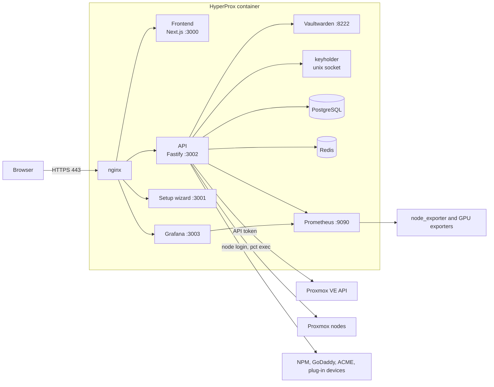

<p align="center">
  
</p>

<p align="center">
  <strong>Your Proxmox infrastructure, hypercharged.</strong>
</p>

<p align="center">
  <a href="https://www.gnu.org/licenses/agpl-3.0"></a>
  <a href="https://github.com/hyperprox/alpha/stargazers"></a>
</p>

---

HyperProx is a self-hosted control panel that sits on top of Proxmox VE. It puts the things a
homelab runs around the hypervisor (reverse proxy hosts, DNS records, TLS certificates, monitoring,
updates, SSH access and the services on your network) into one web interface, behind a built-in,
zero-knowledge vault.

It runs in a single container on your cluster, installs with one command, and talks to Proxmox
through its API.

## Highlights

| Area | What you get |
|---|---|
| Proxmox | Every VM and container with power actions, snapshots, migration, HA state and console; create guests from any template or ISO on any node |
| Dashboard | Real-time nodes, Ceph, HA and quorum, GPU, network, bandwidth and per-node power |
| Monitoring | Bundled Prometheus and Grafana with HyperProx dashboards and alert rules |
| Storage | Every storage on every node, Ceph health, OSDs and pools, and per-guest disks |
| Reverse proxy | Nginx Proxy Manager, Traefik, Caddy, HAProxy and Pangolin, several at once in one table; every change previewed, then read back |
| DNS | GoDaddy records with guided creation, domain expiry, WAN IP mismatch flags and DDNS |
| Certificates | Inventory of every endpoint's certificate, ACME DNS-01 issuance and renewal, delivery into guests |
| Updates | Pending packages everywhere, on every cluster, and a gated update run that respects HA and quorum, restarts Ceph one OSD at a time and refuses any restart or reboot that would take data offline; a daily read-only check tells you when something new needs updating |
| Terminal | Browser SSH with persistent tmux sessions, split panes and saved layouts |
| Catalogue | Guided installs of NPM, Ollama, Tautulli, Nextcloud, Jellyfin, Gitea and more: choose resources, see every node's free capacity with a recommended node, pick the ID and address |
| AI assistant | Questions about your cluster, and plain-language deploys run end to end after you confirm |
| Plug-ins | Arr Stack, Unmanic, MikroTik, Plex, Home Assistant and MeshCentral, with no access to credentials; Home Assistant also controls devices, in more than one house |
| Notifications | Discord, Slack, Teams, ntfy, Gotify, Telegram and generic webhooks |
| Security | Built-in Vaultwarden sign-in with 2FA, secrets in memory only, auto-lock, roles and API tokens |

## Quick start

| Requirement | Details |
|---|---|
| Proxmox VE | Shell access as `root` on one node |
| Container (bootstrap defaults) | 4 cores, 8 GB RAM, 100 GB disk, privileged with nesting and keyctl |
| Network | Outbound internet during install (Debian, Docker, NodeSource and GitHub) |
| Browser | Any current browser on Windows, macOS, Linux, iOS or Android |

Open a shell on a Proxmox node: **Node → Shell** in the Proxmox web interface, or `ssh root@<your-node>`
from Windows PowerShell, macOS Terminal or Linux. Then run:

```bash
curl -fsSL https://raw.githubusercontent.com/hyperprox/alpha/main/bootstrap.sh | bash
```

When it finishes, open the setup link it prints (`https://<container-ip>/setup?k=<setup key>`), finish
the wizard, then create the owner account at `https://<container-ip>/login`.

## Installation

### Option 1: bootstrap.sh (recommended)

`bootstrap.sh` sets up everything from one command on a Proxmox node, as root.

First it looks at every node and tells you what it found, for example: "Found 3 nodes. node-a: NVIDIA
GeForce GTX 1070 Ti (dedicated). node-b: Intel UHD Graphics 630 (built in)." Then it asks a few yes/no
questions, only the ones that apply to your hardware (see
[Monitoring, power, GPUs and more](#monitoring-power-gpus-and-more)). It shows the whole plan and asks once
before it changes anything.

Then it does the work:

- It creates a **privileged** container on the next free ID and the storage with the most free space,
  from the newest Debian template, with `nesting=1` and `keyctl=1` (Docker needs them), the TUN device for
  Tailscale, and start on boot.
- It makes the API token `root@pam!hyperprox` (privilege separation off, so it has root's rights) and,
  if you want Proxmox's own metrics, a read-only `root@pam!hyperprox-exporter` (`PVEAuditor` on `/`).
  A token named `hyperprox` that already exists is left alone, and the setup wizard makes its own.
- It carries out your answers on each node, one node at a time, over the cluster's own SSH trust, then
  checks them over the network from the node you ran it on: each exporter answers, and power reads above
  zero.
- It installs HyperProx in the container, then prints the address, the root password and a short list of
  what was done, skipped or failed, with the reason for each.

`-y` takes every default. `--dry-run` looks and asks, shows the plan, and changes nothing.

Pass options through `bash -s --`:

```bash
curl -fsSL https://raw.githubusercontent.com/hyperprox/alpha/main/bootstrap.sh | bash -s -- --ip 192.0.2.50/24 --gateway 192.0.2.1 -y
```

| Option | Default | Meaning |
|---|---|---|
| `--vmid N` | next free | Container ID |
| `--hostname NAME` | `hyperprox` | Container hostname |
| `--cores N` | `4` | CPU cores |
| `--memory MB` | `8192` | Memory |
| `--disk GB` | `100` | Root disk |
| `--storage NAME` | most free space | Storage for the root disk |
| `--bridge NAME` | `vmbr0` | Network bridge |
| `--ip CIDR` | `dhcp` | Static address, for example `192.0.2.50/24` |
| `--gateway IP` | | Gateway, required with `--ip` |
| `--password PASS` | generated | Container root password |
| `--skip-exporter` | | Answer no to watching node health |
| `--skip-rapl` | | Answer no to power monitoring |
| `--skip-gpu-exporter` | | Answer no to GPU monitoring |
| `--no-charts` | | Answer no to Prometheus and Grafana |
| `--no-pve-metrics` | | Answer no to reading Proxmox's own metrics |
| `--ai`, `--no-ai` | | Answer yes or no to a local AI assistant |
| `--dry-run` | | Look and ask, then show what would be done; change nothing |
| `-y`, `--yes` | | Take every default and do not ask |

### Option 2: install.sh on a machine you already have

Use this for your own container, a VM or bare metal. Supported systems are Debian 12 or 13 and
Ubuntu 22.04 or 24.04. As root:

```bash
apt update && apt install -y git curl
git clone https://github.com/hyperprox/alpha.git /opt/hyperprox
bash /opt/hyperprox/install.sh
```

The installer sets everything up in `/opt/hyperprox`: it installs what HyperProx runs on (Docker,
Node.js 20 and pnpm 9), builds HyperProx, creates its built-in vault and starts its services. If the
machine gets its address by DHCP, it offers to give it a fixed one. It asks first if you run it
directly on a Proxmox node rather than in a container. Inside a container it turns AppArmor off for
that container, because Docker cannot run there with it on.

Your credentials (Proxmox, node logins, proxies, DNS, app logins and everything else you add) are kept
in the vault, never in a file. The installer also writes `/opt/hyperprox/.env`, readable only by root. It
holds only the start-up keys HyperProx's own services need before anyone signs in: the database and cache
passwords, the vault's admin key, Grafana's encryption key and the key Prometheus uses to read plug-in
metrics.

Two more keys are there only for a short while. The setup key is removed when setup finishes. Grafana's
first admin password moves into the vault when you create the owner account. Until then there is no
vault to hold anything, so the access key HyperProx makes for itself in Proxmox waits in `.env` and also
moves into the vault at that first sign-in. Anything you type during setup, such as a node login or a DNS
key, is held in memory only until then. [docs/security.md](docs/security.md) lists every key and why.

If you create the container yourself, it must be privileged with nesting and keyctl, or Docker fails
with an overlay error:

```bash
pct create <ctid> <template-storage>:vztmpl/<debian-template>.tar.zst \
  --hostname hyperprox --cores 4 --memory 8192 --rootfs <storage>:100 \
  --net0 name=eth0,bridge=vmbr0,ip=dhcp \
  --unprivileged 0 --features keyctl=1,nesting=1 --onboot 1 --start 1
```

No API token is needed for this path: the setup wizard makes one from your Proxmox login. Re-running
`install.sh` is safe; it keeps an existing `.env`, certificates and data.

### HTTPS

HyperProx is served by its own nginx on `https://<container-ip>/`, and port 80 redirects there. The
API, frontend, setup wizard, Prometheus and Grafana listen on loopback only. nginx also serves
WebSockets and Grafana (at `/grafana/`) on the same origin, and lets a request through to Grafana only
with a valid HyperProx session while HyperProx is unlocked.

The installer makes a self-signed certificate, so the browser warns until you either accept it or
replace it. To use your own, put the full chain in `/opt/hyperprox/certs/cert.pem` and the key in
`/opt/hyperprox/certs/key.pem`, then run `docker restart hyperprox-nginx`. The Certificates page can
also issue and install a real certificate for HyperProx itself (see [Certificates](#certificates)).

To trust the self-signed certificate instead, copy it to your computer
(`scp root@<container-ip>:/opt/hyperprox/certs/cert.pem .` works on Windows, macOS and Linux) and:

| System | Command |
|---|---|
| Windows (admin PowerShell) | `certutil -addstore -f Root cert.pem` |
| macOS | `sudo security add-trusted-cert -d -r trustRoot -k /Library/Keychains/System.keychain cert.pem` |
| Debian or Ubuntu | `sudo cp cert.pem /usr/local/share/ca-certificates/hyperprox.crt && sudo update-ca-certificates` |
| Firefox (any system) | Settings → Privacy & Security → Certificates → Import |

**Behind another reverse proxy.** If a proxy such as Nginx Proxy Manager terminates TLS in front of
HyperProx, point it at `http://<container-ip>:80` and tell nginx to trust it. nginx believes
`X-Forwarded-Proto: https` only from loopback and the addresses you list:

```bash
echo '192.0.2.10 1;' > /opt/hyperprox/data/nginx/trusted-proxies/proxies.conf   # your proxy's address or CIDR
docker restart hyperprox-nginx
```

HSTS is not sent. With a real domain and certificate you can add a `Strict-Transport-Security`
header to the `:443` server in `config/nginx/conf.d/hyperprox.conf`.

### First-run setup

The installer prints a wizard link with a setup key: `https://<container-ip>/setup?k=<key>`. Keep it
private. If you lose it before setup is done, run `grep SETUP_SECRET /opt/hyperprox/.env` on the
HyperProx machine. The key is removed once setup finishes. The wizard saves its progress, so reloading it
resumes at the step you reached.

1. **Connect your Proxmox.** Sign in with your Proxmox web login (two-factor codes are supported).
   HyperProx uses it once to create its own API token, `hyperprox-<hostname>-<install id>`, and a
   read-only one for the PVE exporter (`<that token>-exporter`, `PVEAuditor` on `/`), and never stores
   the password. You can paste an existing token under **Advanced** instead. If bootstrap already
   configured a token, this step is skipped.
2. **Cluster detected.** Nodes, version, quorum, running guests and Ceph, and a line on what each node
   has: its GPUs, built in or dedicated.
3. **Services.** Finds Nginx Proxy Manager, Ollama and Proxmox Backup Server already on your network,
   and asks whether you want charts and dashboards (Prometheus and Grafana). To run Nginx Proxy Manager,
   install it from the [Catalogue](#catalogue) after setup.
4. **Options.** The same yes/no questions as `bootstrap.sh`, only those that apply (see
   [Monitoring, power, GPUs and more](#monitoring-power-gpus-and-more)). If you say yes to anything on
   your nodes, it asks once for the login you use to SSH to them (usually root), tests it on every node,
   then does the work one node at a time and shows what it did. If you ran `bootstrap.sh`, this step shows
   what it already did instead.
5. **Done.** The wizard starts your chosen services, writes Prometheus's list of nodes and GPUs, checks
   in Prometheus that each answer worked, restarts HyperProx, and exits for good. It ends with a list of
   what was done, skipped or failed, and why.

Then open `https://<container-ip>/login` and **create the owner account**: an email, a master password
and an authenticator app (two-factor is required for the owner). HyperProx has no password of its own;
you sign in with this vault account from now on.

> There is no recovery for a lost owner master password or two-factor device. Store both safely.

### Updating HyperProx

```bash
cd /opt/hyperprox && git pull && bash deploy.sh
```

`deploy.sh` brings per-install settings up to date (`bin/hyperprox-config`, the same step the
installer runs), checks the nginx config, installs dependencies and builds everything **before** it
applies database migrations, so a failed build leaves the database and the running HyperProx as they
were. It then restarts the API and frontend, reloads nginx, checks that `/grafana/` is gated (if it is
not, it stops Grafana and fails), and applies any changed Prometheus and Grafana container settings.
Sessions survive it because the keyholder keeps the unlocked state. If it says the install has no vault
yet, re-run `install.sh` first.

## Monitoring, power, GPUs and more

You do not set any of this up by hand. The installer asks a few plain questions, does what you say yes
to, and checks that it worked. Each question appears only when it applies to your hardware.

| Question | What saying yes does |
|---|---|
| Do you want HyperProx to watch the health of each of your nodes (CPU, memory, disks)? | Installs node_exporter on every node. |
| Do you want HyperProx to monitor the power on each of your nodes? | Lets HyperProx read the CPU energy counters. The trade-off: any local user on that node can then read energy use. Asked only if a node has power counters. |
| Do you want HyperProx to monitor your GPUs? | Intel and NVIDIA GPUs get a small exporter. AMD GPUs, built in or cards, are read by node_exporter, which HyperProx tells to collect them (so on those nodes this also needs the health question). It only reads the GPU; drivers are never touched. Asked only if a GPU was found. The dashboards show a vendor's GPU panels only when the cluster has that vendor. |
| Do you want containers on these nodes to be able to use their built-in graphics (for video transcoding)? | Lets any container on a node with built-in Intel or AMD graphics use them. The trade-off: any container on that node can then use its built-in graphics. Offered only on those nodes; the answer defaults to no. |
| Do you want charts and dashboards (Prometheus and Grafana)? | Runs Prometheus and Grafana on the HyperProx machine, reachable only through HyperProx. |
| Do you want HyperProx to read Proxmox's own metrics? | Makes a read-only Proxmox token for the metrics exporter. |
| Do you manage your domains at GoDaddy? Paste a key to let HyperProx manage DNS. | Tests the key and keeps it in the vault. You can skip it. |
| Do you want a local AI assistant? | Runs a small one (Ollama) on the HyperProx machine and downloads its model, about 2 GB. Or connect one later on the AI Assistant page. |

HyperProx also keeps Prometheus's list of nodes and GPUs up to date by itself, after setup and whenever a
node joins. There is nothing to ask.

**Changing an answer later.** Open **Settings → Setup checklist**. It shows each question, whether it is
done on each node right now, and a button to do it. Work on your nodes needs a login for them: you enter
it once, HyperProx tests it on every node and keeps it in the vault. Each node's identity (SSH host) key is
shown there too, as **verified automatically** with how. When you install with `bootstrap.sh` on a node, it reads
your cluster's own record of its nodes' keys right there, and HyperProx checks every key against it after you
first sign in; nodes added later are checked against the same record read through nodes already verified. Nodes
reached over Tailscale or WireGuard are checked by the tunnel instead. It does this after you sign in and whenever
it meets a new node, and **Verify automatically** runs it on demand. There is nothing to press when a key shows
verified. If HyperProx was not installed from a node, the checklist shows one command to run on any node's own
console (its screen, IPMI or iKVM, or an SSH session you already trust): paste what it prints (public keys only)
and it does the rest. Only a key it found no evidence for offers **Compare by
hand and confirm**. VPN installs on a node and maintenance mode only run
against a node whose key is verified or confirmed. How this works, and what it cannot check, is in
[docs/security.md](docs/security.md).

**What the node work changes.** It only adds packages and never upgrades or removes one. It does not touch
kernels, drivers or apt holds, so a node that pins its kernel for a GPU driver is safe. It runs one node at
a time and leaves alone anything already set up. Power figures are CPU and GPU draw, not wall power: drives,
fans and power-supply losses are not measured, and a node with nothing to read shows `no meter` rather than
zero. If you want to see or do the steps yourself, [docs/manual-setup.md](docs/manual-setup.md) has them.

### AI providers

Configure providers on the **AI Assistant** page. Keys are stored in the vault and never sent to the
browser.

| Provider | Needs | Default model |
|---|---|---|
| Anthropic | API key | `claude-opus-5-5` |
| OpenAI or compatible | API key, optional base URL (OpenRouter, Groq and similar) | `gpt-4o` |
| Ollama | A reachable Ollama server | `llama3.2:3b` |

Small local models answer more weakly; 8B models plan noticeably better than 3B ones. The bundled
Ollama (3 CPUs, 4 GB, bound to `127.0.0.1:11434`) is what the installer's local AI question starts, with
`llama3.2:3b`, and it is connected for you. HyperProx sets Ollama's thread count
from the container's CPU limit (`OLLAMA_CPUS`); `OLLAMA_NUM_THREAD` overrides it and
`OLLAMA_TIMEOUT_S` (default 300) sets how long a call may take.

### Plug-in metrics in Prometheus

Plug-ins publish metrics at `/api/plugins/metrics`, and a **HyperProx — Plug-ins** Grafana dashboard
is provisioned for them. The endpoint asks for a bearer token, `METRICS_TOKEN` in `.env`. The installer
generates it once and gives Prometheus the same value in `config/prometheus/secrets/metrics_token`;
an existing install gets it on its next `deploy.sh`. It is never rotated.

## Using HyperProx

### Finding your way around

A rail on the left groups the pages: Dashboard and Command center first, then **Cluster**
(Infrastructure, Storage, Monitoring, Updates, High availability), **Network** (Certificates, DNS,
Proxy, VPN & remote access), **Apps** (Plug-ins, Catalogue, Deck, AI assistant) and **System**
(Settings). Its foot shows the vault state, who is signed in with their role, and **Lock now** for
owners and admins. On a wide screen the rail folds to icons; under 900 px it becomes a bar with a menu
button that opens the same rail as a drawer. The top bar names the page, shows a live dot (whether your
browser can reach HyperProx), a **Find anything** box (press **/**) that jumps to any page by name or
topic, and the theme switch: Auto (follow your system), Light or Dark.

### Dashboard

A status header opens the page: guests running on the outer ring and memory on the inner, a verdict in
words (quorum, or nodes online when HA status cannot be read), and the numbers people look for first
(nodes online, CPU, memory, storage, and power or HA). Below it, each node as a tile with CPU and memory
rings plus its disk, uptime, GPU, power and guests; each Proxmox storage as a bar; the busiest guests
with a trace of their recent CPU; what is happening now (firing alerts, offline nodes, Ceph checks, HA
guests not started, services not answering); and your plug-ins with a health dot each. Further down
are the capacity dials and trend lines, GPU use and VRAM, connected services, bandwidth, network
throughput, Ceph capacity and OSDs, and HA quorum, fencing and resources. If a plug-in reports
bandwidth (MikroTik does), WAN and LAN dials show it, scaled to your plan speed when you set one in the
plug-in's settings.

### Command center: more than one cluster

**Command center** shows every cluster HyperProx manages side by side: your home cluster in teal and
each remote server or cluster in amber. Each panel has nodes online, quorum, guests running, CPU,
memory and storage bars (with one more bar for each NAS server: its Proxmox NFS and CIFS storages, named by their storage ids, plus any NFS, CIFS or SSHFS mount on the nodes that Proxmox does not list, which needs monitoring installed on that server; shares of one volume count once, and it shows how many shares and volumes there are and how full they are), a row for every GPU on every node, the last backup, and quick links. Each GPU
row starts with its node ("node2 · HD Graphics 630") and shows its load; under it, one short line:
video memory (or "shared memory" for built-in graphics, which use the system's memory), temperature,
fan, clock and power where monitoring reports them, and one line on HEVC, for example "HEVC decode:
likely yes (estimate)". Tap a row for the full name and the longer explanation. A GPU with no figures
says why instead: "not monitored · set up monitoring" (a link), "not supported on this GPU", "figures
stopped arriving" or "exporter not answering". One line under the rows says how many GPUs have measured
load, and that the HEVC lines are estimates from the model name (the hardware scan can check them with
vainfo). One
**Needs attention** list collects problems from every cluster, each tagged with where it came from.
Once a remote is added, the Dashboard shows the same panels at the top; with none, nothing changes.

A remote is never joined to your cluster. HyperProx talks to its Proxmox API at any address it can
reach: a Tailscale name or IP, a WireGuard address, or anything else routable.

**Add a server** (admin) is one form and one master password:

1. A name and its address (its Tailscale IP, owned by your own tailnet account, or a WireGuard address lets
   HyperProx verify it by itself, when the HyperProx machine runs Tailscale with its normal kernel interface).
   HyperProx looks at that address straight away, and before you press Connect
   the form says "Connecting to <device> owned by <owner>" and lists what monitoring would install.
2. Three `pveum` commands to paste into that server's Shell: they make a `hyperprox@pve` user with the
   Administrator role and an API token for it.
3. Paste the token. It goes straight into the vault when you press Connect.
4. Optionally, the login for its nodes (usually root), and two ticks, on by default: install monitoring,
   and check Send files.

Then **Connect** (your master password, once) does the rest, in the background while the page waits:

- **The certificate.** When the address is a Tailscale IP that `tailscale whois` says is an online device owned
  by the same account as the HyperProx machine (not shared in, not tagged), or a WireGuard peer on a link
  HyperProx set up, the tunnel to exactly that address proves which device answers. HyperProx then accepts the
  certificate if it is for that device, and, after the token, if the server's own API names itself as a node the
  certificate is for. On any other address it has nothing to check the certificate against, so nothing is saved:
  it shows the SHA-256 fingerprint and says so in one sentence, and you compare it once with the server's own
  page (the node, then System, then Certificates). From then on HyperProx accepts only that certificate; one
  that changes is never accepted by itself. If anything you were shown changed before Connect, nothing is done.
- **The token.** HyperProx checks it really has administrator rights. Your home cluster (or one of its nodes)
  cannot be added again as a remote.
- **The nodes.** The node that answered gets the address you typed. Another node gets an address only when the
  server's own cluster status reports a Tailscale IP for it that your account owns; its internal cluster
  addresses are never filled in (enter the rest on the Edit page). With a login given, every node's SSH host key
  is verified (over the private link, or against the cluster's record read through nodes already verified), and
  the login is tested and saved only for nodes whose key is verified. No login is sent to a node whose key is not
  verified. For a server reached over plain addresses, run the one-line command its Edit page shows on one of its
  nodes and paste the output; that is what its keys are checked against.
- **Monitoring and Send files**, if ticked: with a node login saved, monitoring installs exactly what the form
  showed (node_exporter only, nothing upgraded or removed), and Send files is checked and its answer shown.
- Pressing Connect again for the same server while it works joins the same run; after a stop part way it picks
  up where it stopped.
- Then the hardware scan (read-only). Anything left (a node with no evidence for its key, say) is on the
  server's **Edit** page.

**Opening a remote** turns the page amber, with "You are managing" and its name on every part of it.
There you can start, shut down, stop and restart guests, take snapshots, back up now, edit a guest's
settings with the same preview-and-check editor as at home, and delete a guest (type its name; it must
be stopped and not under HA). Every action is read back from Proxmox afterwards and the answer says
what Proxmox reported. Storage and recent tasks are listed too. **Updates** works on a remote too (see
Updates below). High availability and GPU sharing still work on the home cluster only, and are
labelled so.

**Edit server** holds its name, its address (a new address has its certificate verified again: by itself
over a private link, otherwise you compare it), the token (tested before it replaces the old one), node addresses and node logins, the folders
file copies may write into, its Plex (a Plex token is only ever sent to the address it was saved for;
plain http only to a private address), and Remove. Changing the address, node addresses or folders asks
for your master password; a rename does not. Remove (type its name) forgets the server and its secrets,
takes its sending keys off the nodes they were installed on (or shows the command to run where a node
cannot be reached), stops Prometheus collecting from it, and shows the two commands that delete the
token on the server too. Below the admin role, people see only each cluster's name and how it is doing,
never its addresses.

- **Node logins.** For the full hardware scan, monitoring and file copies, give the nodes' root login once
  and press **Verify keys**: HyperProx verifies each node's SSH host key by itself and saves the login for each
  node whose key is verified. When it has nothing trusted to check against yet, it shows one command to run on
  any of that server's nodes; paste the output and press Verify keys again. Only for a node it still found no
  evidence for does it show the key to compare with `ssh-keygen -lf` on the node. Only a verified or confirmed host key is used. Changing a node's address removes
  its saved login and pin, so the new address's key is verified before a login is sent there.
- **Hardware scan.** With the token alone: GPUs from Proxmox's PCI list and exporters asked over the
  network. With a node login: the full read-only probe, and `vainfo` (if it is installed there) to say
  what the GPU really decodes and encodes. Without vainfo the answer is an estimate, and says so. One
  line under the scan says which it is and what to do to check it (press Full scan, or install the
  vainfo package on the node).
- **Monitoring** (the Edit page). HyperProx scans first, asks yes or no questions, shows every step, and only
  then installs. Ticked on Add a server, it installs the same node_exporter step with no GPU extras, without
  asking (you ticked it), and the result lists what it did. It installs `prometheus-node-exporter` from the server's own packages (nothing is
  upgraded or removed), listening only on the address HyperProx reaches the node on, and only if that
  address is on a Tailscale or WireGuard interface; the setting is written before the package is
  installed, so it never listens on the home network. For an AMD GPU it switches on the GPU collector.
  For an Intel GPU (asked separately, and only where the node has python3) it adds `intel-gpu-tools`
  and a small root service that runs `intel_gpu_top` for each Intel GPU and writes the busy engines
  (3D, video, blitter, video enhance), clock and power into node_exporter's textfile folder, so
  node_exporter serves them on the same private address and no new port opens. Root is needed for the
  GPU's counters; `kernel.perf_event_paranoid` is not changed. apt is asked first and the package is
  installed only if that adds new packages and nothing else: no upgrade, no removal, no list refresh,
  and never a kernel, header, firmware, NVIDIA or Proxmox package. HyperProx refuses to send any
  monitoring script that would upgrade packages, change apt holds or boot kernels, install with dpkg,
  or name a kernel, header, firmware, NVIDIA or Proxmox package in an install. One sample is taken
  before the service is turned on: if `intel_gpu_top` does not support the GPU (an older tool on the
  newer xe driver, for example), nothing is left installed and the Command center says "not supported
  on this GPU".
  HyperProx's Prometheus then collects from it, and the result is checked from HyperProx's side. If
  HyperProx cannot reach the server, the scan says so and why: this HyperProx machine must be on the
  same tailnet (the VPN page can add Tailscale to it) or have a route. **Remove monitoring** puts
  everything back: the Intel service, script and figures go, and the packages HyperProx added are
  removed only if apt would remove nothing else with them (otherwise they stay, and the answer says
  why). The remote's nodes appear in Grafana under their own names (`node@cluster`); its Intel GPUs
  appear in the cluster board's Intel row, which also has a table saying, per Intel GPU, whether the
  collector is measuring and why not when it is not.
  Proxmox figures in Grafana for a remote (its own PVE exporter) are not built yet; the Command center
  reads them through the token.
- **Send files.** One **Send files** button on each remote server's panel in the Command center and at
  the top of that server's page (admins only). It asks two things, then you press Send:
  1. **What do you want to send?** Your home library, folder by folder, with sizes. Tick as many
     folders and files as you like (up to 20 at once), or search by name.
  2. **Where?** The other server's libraries by name ("Movies", "TV Shows"), with free space and how
     long the copy should take. HyperProx finds them itself: folders on the other server's node that
     sit on a writable network or local disk (never its system disk) and that a running container
     with Plex uses, each named after the Plex library that shows it. When Plex there cannot be asked,
     the folder's own name is used, and Proxmox storage folders are never offered. Your home library is
     found the same way on your home nodes, plus any folder you already allowed for copies. A folder that
     is really a link to somewhere else, or to a system folder, is left out.

  A preview line follows ("3 items, 14.2 GB, about 32 min; 1 already there and will be skipped").
  Files whose names are already there are skipped. Times use the speed of the last copies to that
  server, or 7.5 MB/s until one has finished. A copy that would not fit in the free space is refused.

  **The first time** for a library, Send says what it will set up, with the real folder paths, and asks
  for your master password once. In that one step HyperProx allows copies from the home libraries that
  hold what you picked and into the one library you picked, picks a home node that reaches the other
  server on port 22 at a private address (its Tailscale, WireGuard or NetBird address first), and makes
  that library's sending key. The setup is tied to what the preview showed: if anything changed since,
  it is refused and nothing is changed. If the other node's identity key was
  never confirmed, it is shown in the same dialog with the command to check it, and confirming it is
  part of that step. An API token cannot do this setup.

  After a copy has finished and been checked, Plex on the other server is asked to scan just that
  folder in that library, and the copy shows "Added to Movies". To do that HyperProx runs a command on
  that node: it reads the Plex token from Plex's own settings file in its container at that moment
  and hands it to `curl` inside the container on standard input. The token is not stored in
  HyperProx, is not part of any command line, and only the answer code comes back. Reading Plex's
  library names while looking for libraries works the same way, and the token is cut out of anything
  the node prints. Containers listed under Edit server, "Never look inside", on the Remote access
  exclusions, or tagged `hyperprox-ignore`, are not entered (see `docs/security.md` for every command
  this runs on your nodes). Copies show
  progress, speed and time left, can be cancelled and resumed, and explain failures in plain words.
  A finished copy (`files.copy.finished`) and a failed one (`files.copy.failed`) go to notification
  channels that take job messages.

  How a copy runs: rsync goes straight from a node of one cluster to a node of the other, never
  through HyperProx. It retries a dropped connection, resumes half-sent files, and checks every copied
  file by size and checksum afterwards (copying it again on a mismatch). A copy only adds files:
  HyperProx never replaces or deletes a file that was already there (the one exception is a file this
  same copy wrote that failed its check, which is copied again). Both ends must be inside that
  cluster's allowed folders, checked with links resolved at preview, at start and at resume (and the
  source again right before rsync runs). Each sending key is kept in the vault, installed on the
  destination restricted to rsync in its one folder (write-only, and it cannot delete), and put on the
  source node only while a copy runs. The key itself could overwrite files inside its folder;
  HyperProx's copy never asks it to.

  The **Files** tab on a server's page is the advanced way: any allowed folder on any node of any
  cluster, a speed limit, the allowed folders and keys set by hand, and a scan of every Plex library
  through a Plex address and token you save under Edit server (the token goes into the vault). Sync and Move are not built
  yet. Copying has not yet been tried against real servers: try a small folder first.

### Infrastructure

Every VM and container in one list: status, node, CPU, memory and disk, address, tags, HA state, and a
GPU tag on guests that have graphics passed through. Filter, search, or group by node; it works on a
phone too. **Create** builds a container from a template or a VM from an ISO. Deleting a guest asks for
your master password again.

Open a guest for its overview, snapshots, network, terminal, high availability and its **Config**:

- **Change settings on the fly**: cores, memory, swap, start-up order, tags, DNS, network cards, disks
  and mount points (a folder shared from the host is only marked as available on every node once
  HyperProx has checked it really exists on every node). Every change shows you exactly what will
  change first, is refused if someone else changed the guest in the meantime, and is checked
  afterwards. Changes that only apply after a restart say so, and offer the restart.
- **History and undo**: every change HyperProx makes is kept, and any earlier version can be put back
  in one click. Passwords and keys in a guest's settings are hidden in the history.
- **GPUs and other devices**: give a container a GPU, or switch its GPU access off and back on with one
  switch. **Portable GPU** lets a container use whichever node's graphics it ends up on, so a guest that
  moves to another node during a failover picks up that node's GPU by itself, and HyperProx tells you
  which one it is using. Settings Proxmox's own tools cannot change are written with extra checks, and
  only for real graphics and device entries.

Each node's **Devices** list shows its graphics cards, USB devices (Zigbee sticks, tuners and the like),
serial ports and cards that can be passed to a VM, each named in plain words, with who uses it now and
whether it can be shared.

### High availability

**High availability** keeps your guests running when a node fails. On each guest you choose, in plain
words:

- **Restart this on another node if its node fails.** One switch turns protection on or off, and says what
  turning it off means.
- **Its home**: "prefer this node, but run anywhere if needed", or "only ever run on this node, even if that
  means staying off". The strict choice is shown in red and needs a second confirmation.
- **Keep apart from** or **keep together with** other guests.

Each guest shows where it runs now and where it would go if its node failed, taking memory, CPUs and
devices into account. A grid shows which nodes it could move to and, for each one that it can't, why: a
local folder, a rule, missing storage, not enough memory, or a device only one node has.

The High availability page shows whether HA is armed, which guests are not protected (each with a
one-click **Protect**), guests with no home that may not come back after a failover, and guests that need
a node's GPU or other hardware. Its rule editor explains each rule by what it does and catches Proxmox's
rule conflicts before Proxmox refuses them. Maintenance mode moves a node's guests away before you work
on it.

Every change is previewed first, including what would move straight away. It is refused if the cluster
has lost quorum or the HA setup changed since the preview, and it goes through Proxmox's own HA tools.
Applying a change asks for your master password again.

### Terminal (the Deck)

SSH in the browser to every guest (addresses come from Proxmox) and to hosts you add by hand, such as
a router or a NAS. One shared login can cover every host that has none of its own. Sessions run in
tmux on the target, so they survive closing the tab; a host without tmux gets a plain shell and an
offer to install it. The **Sessions** menu opens a host's existing tmux sessions in their own panes.

Open hosts from the palette (**+** or **Ctrl+K** on Windows and Linux, **Cmd+K** on macOS). Panes can
be tabs, columns, rows or a grid, and layouts can be saved by name. Host keys are pinned on first
connect, and a changed key is refused with both fingerprints shown.

### Proxy and DNS

**Proxy** shows the hosts of every proxy you connect, in one table, each marked with the proxy that
serves it: Nginx Proxy Manager, Traefik (its dynamic file over SFTP, host key pinned), Caddy (admin
API), HAProxy (Data Plane API, config checked before every reload) and Pangolin (its API). Several at
once are fine, two of the same kind included. The first Nginx Proxy Manager login lives under
**Settings → Proxy**; add the others with **Add proxy** on the Proxy page. Each proxy is either one you
already run (bring your own) or one HyperProx installed (managed).

Every change is a preview first: it lists each setting that would change, in words, and warns when a
certificate, force-HTTPS, HSTS or HTTP/2 is being taken off. Applying it changes only what you edited,
refuses if the host changed since the preview, and reads the proxy back to confirm. Hosts that another
tool made on Traefik, Caddy, HAProxy or Pangolin are shown read-only. Scripts use the same preview and
apply calls (see [docs/proxy.md](docs/proxy.md)).

**DNS** lists your GoDaddy
domains with their expiry dates and every record. **Add record** starts from what you want to do
(point at this server, a subdomain, email, verification) or a custom record. A records that differ
from your current WAN IP are flagged, and **DDNS Update** rewrites them to it.

### Certificates

Probes every endpoint HyperProx knows the way a client would, issues and renews certificates over ACME
DNS-01 through GoDaddy, delivers them into guests or to HyperProx's own nginx, and checks each delivery
by fingerprint. Configure it in `config/certs.yaml` (copy `config/certs.example.yaml`), start with
`acme.directory: staging`, and press **Issue**. Admin-only. See [docs/certificates.md](docs/certificates.md).

### VPN

Installs and manages **Tailscale** or **NetBird** (cloud or self-hosted) on nodes, containers and VMs, so
you can reach them without opening a port. Add the provider under **Settings → Credentials → Remote
access** and press **Test**, then press **Install** on a machine (one click, with your defaults) or pick
several and **Install on selected**. Each machine's panel changes DNS, routes, SSH and exit nodes with a
preview, and new devices and sign-in links arrive as notifications. WireGuard is a third option: servers in a
container, phones and laptops by QR code (keys made in the browser and kept in the vault), machines as
clients, and the MikroTik router's WireGuard peers. On the router HyperProx only adds and removes WireGuard peers it created itself, using a separate router login you create for it; it never changes the router's firewall, addresses or routes, and shows you the exact command when a firewall rule is missing. Each install gets its own
single-use key, which is revoked when it is done. On a Proxmox node the client never takes over DNS or
routes; HyperProx checks the default route, resolver and quorum before and after, and undoes the install
if anything changed. Clients that are already installed are found with no API key. Each machine shows
whether it is connected, signed out or not installed, and **Manage it here** adopts a client HyperProx did not
install. The API key is needed only for installs, uninstalls, routing and approvals. Guests listed under **Never look inside
these guests**, or tagged `hyperprox-ignore` in Proxmox, are never checked or changed. Viewers see status; changes are
admin-only. See [docs/remote-access.md](docs/remote-access.md).

### Storage and Monitoring

**Storage** shows every storage on every node, including shared NFS and CIFS, Ceph health, OSDs (with
latency) and pools, and the disks of each guest. **Monitoring** shows node health, active Prometheus
alerts (node down, CPU, memory, disk, Ceph, GPU and hardware rules) and the embedded Grafana dashboards. If the
PVE exporter has no read-only token yet (an install from before this release), an admin can make one
from the Grafana tab with **Set up Proxmox metrics**, or with `hyperprox pve-exporter`.
Prometheus keeps 90 days or 40 GB, whichever comes first (`PROMETHEUS_RETENTION` and
`PROMETHEUS_RETENTION_SIZE` in `.env`).

**Alerts reach you as notifications.** Once a minute HyperProx asks Prometheus which alerts are firing.
When one starts, your notification channels get one message (the **Cluster health** family): what is
wrong in plain words, on which server (with the cluster's name for a server in another cluster), and
since when. When it clears, one more message says so. Nothing is repeated while an alert lasts, and a
restart of HyperProx does not send again what it already sent. If Prometheus does not answer for 5
minutes you get one "Monitoring is down" warning, and one message when it answers again (an install
without Prometheus never gets this one). This works while HyperProx is locked; channels whose secret
is in the vault get their messages after the next sign-in, as usual.

Alerts named in `ALERTS_NOT_FORWARDED` in `.env` (comma-separated) stay on the Monitoring page and are
never sent. If it is not set, that is `CephHealthWarning`, because a Ceph cluster can stay in
HEALTH_WARN on purpose (a pool kept at one copy, for example). Set it empty to send everything.

The hardware rules read each server's sensors through node_exporter:

| Alert | When | Severity |
|---|---|---|
| GPUNotResponding | an AMD or nouveau graphics card reads above 150 °C for 1 minute: no card runs that hot, so it has hung | critical |
| GPUHot | an AMD graphics card above 90 °C for 5 minutes | warning |
| CPUHot | a processor above 90 °C for 5 minutes | warning |
| FanStuckAtMax | a fan at full speed for 15 minutes | warning |
| MonitoringTargetDown | Prometheus cannot read a source (Proxmox, Ceph, GPU exporters) for 5 minutes; a node that stops answering is NodeDown | warning |

Intel's GPU exporter reports no temperature; a built-in Intel GPU shares the processor's sensor, so
CPUHot covers it. The plug-in metrics source is left out of MonitoringTargetDown: HyperProx refuses it
while locked, so it would alert on every lock.

### Updates

Shows pending packages and kernel pins on every node and guest, and runs a full update round: preflight
checks, guests in batches with a snapshot first, Ceph packages levelled across nodes, then nodes one at
a time with HA maintenance mode and `noout` around any reboot. It stops at the first failure.

Ceph is handled with care. OSDs restart one at a time, each checked healthy before the next. Before
restarting an OSD or rebooting a node, HyperProx asks Ceph whether it is safe to stop and checks every
pool's copies: if a pool has only one copy on that node, or a restart would leave too few copies, the
step is skipped for safety and says what would have gone offline. The plan shows this decision before
you run it, and it is checked again right before a reboot. If a restart fails, `noout` stays set and
you get an urgent notification, so Ceph never starts moving data because of it. A node update never upgrades Ceph by itself: HyperProx tries the update first without installing anything, and if any Ceph package would change, it stops and leaves Ceph to its own careful step. Rules
such as "this node only gets `apt upgrade`" or "check these package holds" go in
`config/updates.yaml` (copy `config/updates.example.yaml`). Without a policy file you get dry runs only.
Plug-ins can add app updates for software installed outside apt and Docker; MeshCentral is bundled.

**On a remote server or cluster** (its own Updates page, amber, with its name on every card): the
preview is apt's own simulation of the node upgrade (`dist-upgrade` by default, as Proxmox recommends),
showing versions, removals, kernel, firmware and Proxmox VE changes, held packages (never offered) and
whether a reboot will follow. Applying asks for your master password, and every package is read back
afterwards. A remote node is never rebooted on its own: **Reboot** is a separate action that first shows
which guests will stop. A guest that cannot be snapshotted is updated only when you tick "update without
a snapshot", which shows its newest backup. A remote's rules go in its own `clusters:` section of the
same policy file; without one, safe defaults apply.

**Daily check.** Once a day, and on **Check now**, HyperProx checks every cluster read-only (it refreshes
package lists and asks apt to simulate; nothing is installed) and sends one message to the channels that
take Updates events when it finds something new: per cluster, security fixes first, then package counts
and kernel or reboot flags. The same list is not repeated, except as a weekly reminder. Each Command
center panel shows the last check's count. The check stops for an Updates job, gives each cluster at most
20 minutes, and reads nothing while the policy file is rejected.

A node seen with held packages or a pinned kernel always gets `apt-get upgrade`, never `dist-upgrade`,
unless its policy names it for `dist-upgrade` by name, on every cluster.

Admin-only. See [docs/updates.md](docs/updates.md).

### AI Assistant

Type a question ("how many containers are running?") or a request ("deploy Gitea at
git.example.com"). Questions are answered from live summaries of the cluster, DNS, proxy, certificates
and plug-ins, and common ones are answered without calling a model. Requests become a plan built from
the real cluster (nodes, free memory, storage, DNS zones, free IDs) and checked before you see it; the
assistant asks for anything it is missing. After you confirm, it creates the container, installs the
service, adds the proxy host and DNS record, waits for DNS and requests the certificate through
Nginx Proxy Manager (using `LETSENCRYPT_EMAIL` from `.env`, or the NPM account email).

The assistant can install Nextcloud, Jellyfin, Gitea, Uptime Kuma and Homepage. Installing needs a
node login (see Catalogue); without one, it does everything else and shows the commands to run.

**More than one cluster.** The assistant answers about the cluster picked at the top of its page (the
home cluster unless you pick a remote, or open the page with `?cluster=<id>`). A question can name
another cluster ("how is Remote server doing?", "restart plex on the remote") or all of them ("what
GPUs does each cluster have?"). Each cluster's facts are read through that cluster's own connection and
labelled with its name, and an answer that is not about the home cluster alone starts with a line
saying which clusters it is about. For each cluster it knows the nodes, guests, storage, HA and Ceph,
the last backup run, the GPUs (whether load is measured, and whether the video line was checked with
vainfo or estimated from the model name), monitoring, Send files copy jobs and the hardware scan. DNS,
proxy hosts, certificates, plug-ins, updates and deploying a service belong to the home cluster; asked
about them on a remote, it says so. A cluster name it does not know, or "the remote" when you have
more than one, gets a question back listing your clusters.

**Actions on any cluster.** The assistant can prepare: start, stop, shut down, restart, snapshot,
back up now or delete a guest; install or remove monitoring on a remote; and start a Send files copy.
It reads the request with code, not the model, and asks for anything missing or not exact (which
guest, which backup storage, which node, which folder), offering the real choices; it never picks a
guest whose name only partly matches. Preparing only reads (a copy
runs its dry run, monitoring scans the nodes); nothing changes until you confirm the card, which names
the cluster (amber, marked REMOTE, for a remote). The server then runs its own copy of the plan through
the same code as the Command center's buttons and reads the result back. A plan works only on the
cluster it was made for: confirmed for another cluster, after that server's address, port, certificate
or API token changed, or after the guest's settings changed, it does nothing. Your role and the master-password
check are exactly what the same action needs by hand (deleting a guest and installing or removing
monitoring ask for the password; deleting also asks for the guest's name, typed, or its ID for a VM
with no name), the audit log records who did what on which cluster, including every refusal, and while
HyperProx is locked it does nothing. Editing a guest's
settings is not offered by the assistant: use the guest's Settings tab. Using the assistant needs the
admin role.

**What reaches the AI provider.** For a general question, the short summaries the assistant picks can
be sent to the AI provider you configured, which may be a cloud service: guest, node and storage names
of every cluster asked about, backup results, DNS zone and proxy host names, certificate names and
plug-in summaries. Status, GPU, monitoring, copy and hardware-scan answers are worked out by code, and
those summaries are not sent. API tokens, passwords, certificate fingerprints, the remote servers' addresses and the
copy folders HyperProx stores are never sent. A reason Proxmox gives for a failed backup, and what a plug-in
reports, are passed on as they were written.

### Catalogue

Installs a service you do not run yet into a new unprivileged container, checks that it answers, and
connects it to HyperProx: Nginx Proxy Manager, Ollama, Tautulli, Nextcloud, Jellyfin, Vaultwarden,
Gitea, Uptime Kuma, Homepage and Grafana.

Every install is a short wizard:

1. **The app**: what it is, what it needs, and its first login.
2. **Resources**: cores, memory, swap and disk, filled in from the app's recommended size, with a warning
   below its minimum.
3. **Placement**: every node with its CPU load, memory in use and memory already promised to its guests,
   and free space on each storage that can hold a container. HyperProx recommends a node and says why
   (for example, most memory left after the install, on shared storage, keeping the GPU node free). You
   can pick any node it has not ruled out; ruled-out nodes say why.
4. **Identity and network**: the container ID (the next free one, or your own rule, such as an ID made
   from the node number and the address), hostname, bridge, and DHCP or a static address. A static
   address is checked against your guests; if something could not be checked, you are asked to confirm.
5. **Review**: the exact plan. Installing it asks for your master password again.

Installs run with `pct exec` from the node, so they need one **node login** per node, entered at the
top of the Catalogue page. It is tested before it is stored, kept in the vault, and never borrowed from
the Terminal's shared guest login. An SSH key is better than a password. If an install fails, the
wizard offers to remove only the container it made. See [docs/catalogue-wizard.md](docs/catalogue-wizard.md).

### Plug-ins

| Plug-in | What it shows |
|---|---|
| Arr Stack | Sonarr, Radarr, Prowlarr and qBittorrent as one pipeline (search, grabbed, downloading, import, library) with live counts; imports that need a person as alert cards; download progress; indexer status dots and health warnings |
| Unmanic | One ring per worker with its slots, a caught-up (or stalled) banner, and what is encoding now with its progress |
| MikroTik | A live map of internet, uplinks, router and subnets; CPU, memory, temperature and input-voltage rings; top talkers; port forwards; the log with errors highlighted. Also the per-device and per-interface tables, firewall, WireGuard and neighbours; feeds the bandwidth dials and offers an SSH console |
| Plex activity | What is streaming now (progress, direct or transcode), internet and local bandwidth gauges, who watches most, what is watched most, and recent history, read through Tautulli |
| Home Assistant | Your house as tiles by room, with quick actions, a light dial and a climate dial; plus unavailable entities, low batteries, pending updates and log errors, for each of your Home Assistant instances (see below) |
| QNAP | Each NAS's drive bays with SMART health and temperature, volume rings, shares, temperature and load gauges, fans and firmware, with a quick SMART test, and restart and shut down behind the confirm step, for each of your NAS, a remote one included (see below) |
| MeshCentral | Finds npm installs in guests and adds them to Updates. Its page says what it would need to show your devices; it holds no MeshCentral login, so it shows none |

Each plug-in page opens with a summary header and a bar to jump between plug-ins (each with a health
dot), then the plug-in's own picture of what is happening. Every table it has always had is still there,
folded into **Details** at the bottom, filterable. The pages follow your light or dark theme, work on a
phone, and stop animating when your system asks for reduced motion. Names on the router page come from
the router (DHCP leases, ARP comments) and, where it has none, from HyperProx's own list of which cluster
guest has which address. On the Arr Stack page, an import blocked because the filenames carry no season
and episode offers **Map by filename**, the same rescue as before.

**Scan for services** finds qBittorrent, Sonarr, Radarr, Prowlarr, Unmanic and Tautulli on running
guests and offers to configure them; nothing is saved until you press **Use this**, and API keys are
never guessed. A plug-in declares the settings it needs and HyperProx makes its HTTP calls for it, so
the plug-in never reads a credential. The page also lists plug-ins that do not exist yet, each with a
button that opens a pre-filled GitHub issue in your browser.

#### Controlling Home Assistant devices

Open **Plug-ins, Home Assistant**. Each house you add (your own, a second home) gets its own tab with
**Devices**, **Health** and **Settings**. The Devices view shows what HyperProx can control as tiles,
grouped by the rooms (areas) set in Home Assistant. When Home Assistant does not share its rooms with
the token, rooms are worked out from device names (kitchen, living room, a person's room such as
"Alex Fan", and so on), with everything else under **Other**; rooms set in Home Assistant always win.
A header counts devices online, lights on, things playing and the climate target. Tap a tile to switch
it, play or pause it, or (for a security device) start its confirm step; **⋯** opens a light's
brightness ring and warmth slider, or any device's full controls. **All lights off** and **Pause all
audio** send the same per-device actions one by one, and leave security devices for you to confirm one
at a time. Offline devices are listed at the bottom. A switch named like another switch plus " LED"
(the status light some smart switches add) is hidden.

| Kind | Controls |
|---|---|
| Lights | on, off, brightness, colour temperature |
| Switches and input booleans | on, off |
| Fans | on, off, speed |
| Covers (blinds, shutters) | open, close, stop, position |
| Climate | target temperature, mode |
| Media players | play, pause, volume |
| Scenes and scripts | run |
| Buttons | press |
| Vacuums | start, return to dock |
| Locks, alarm panels, sirens | lock and unlock; arm (home or away) and disarm; on and off |

The page refreshes every few seconds. After each tap HyperProx reads the device back and shows what it
really says now; if it did not change (an offline plug, a slow lock), the card says so in plain words.

**Security devices** are, always: locks, alarm panels, sirens, and covers that Home Assistant calls a
garage, gate or door. By default, until you move them to **everyday** in Settings: any other cover except
blinds, curtains, shades, shutters, awnings and dampers; scenes, scripts and buttons (they can run
anything); switches and toggles, except plug sockets (outlets), switches whose name says light, lights or
lamp, and every switch from a TP-Link device. A plug socket is a switch Home Assistant marks as an outlet,
or whose device entry names a plug, outlet or strip (a TP-Link plug or power strip, say); TP-Link,
plugs and the router rule below are read from Home Assistant's device list, so they apply when it shares
that list with the token. Switches and buttons of routers, access points and firewalls (such as the
ASUS, MikroTik, UniFi, Omada and Deco integrations) always are, whatever their name or an everyday mark
says. Anything whose name sounds like a door, gate, lock or alarm (in English or the common European
languages) always is, everyday or not. Plus
anything you mark **protected** (or a whole kind, such as climate). An everyday mark is tied to the device
as it was when you marked it: rename it or change its class in Home Assistant and it needs the confirm
step again. They carry a lock icon and need all of these: the
admin role, your master password entered in the last 5 minutes, and a confirm step that names the device
and the house ("Unlock Front door at Second home") where you type the device's name. API tokens can never
use them. Everything else needs the operator role (you can raise that to admin per house). Viewers see
security devices listed but not their state, and their health view leaves out security devices,
automation times and the error log. Each action, refused ones included, is recorded in the audit
log with who did it, the house, the device, the action and the result; a security action (or a refused
one, at most once every 10 minutes per house) can also send a notification (the Home Assistant family).

HyperProx only sends the actions in the table above, each to one Home Assistant service, with values
checked against the device's own limits. It never passes a request straight through to Home Assistant.
An alarm panel or lock that needs a code is not supported yet. The AI assistant can read the first
house's state but cannot control anything.

**Adding a house.** In Home Assistant, make a dedicated user for HyperProx with administrator turned
off, sign in as it, and create a long-lived access token under Profile, Security. A token has every
right its user has, so do not use your own admin account; HyperProx warns you on the Home Assistant
page when a token belongs to an admin. Paste the address and token in **Add a house** (admin, asks for
your master password). The token is kept in the vault and never shown again. An `http://` address must be
on your own network, Tailscale or WireGuard; anything else needs `https://`, and HyperProx never sends a
token to this machine itself. Certificates are checked; for Home Assistant's own self-signed one, use
**Read certificate** and **Pin this certificate** in Settings. Changing a house's address to another host
or port needs its token again. The plug-in card's settings no longer take the address or token.
**After upgrading:** if your first house was set up before this change and uses a self-signed certificate,
a public `http://` address or a `.local` name that does not resolve from the HyperProx machine, its card and
controls stop until you pin its certificate or give it a LAN, Tailscale or `https://` address in Settings. Link the house to a
remote server and it also appears on that server's page (a **Home Assistant** tab, in amber) and in
the Command center. The Home Assistant you had already set up is the first house, called "Home", with
nothing to redo.

#### QNAP NAS

Open **Plug-ins, QNAP** and press **Add a NAS** (admins; the master password is asked again, because a
login is being stored). Each NAS you add gets its own tab. Its page opens with a header ring for how
full it is and four readings: health, used of total, temperature and uptime. Under it:

- **Drive bays**: one tile per disk with its bay, model, size, temperature and SMART word. The tile
  glows green, amber or red with the disk's health (and says it in words). Tap one for its serial,
  firmware and last self-test, and (operators and above) **Quick SMART test**.
- **Volumes**: a ring per volume (used of size, status, which disks), and the storage pools on firmware
  that has them.
- **Temperature and load**: system and CPU temperature, CPU load and memory as gauges, and the fans
  with their speed.
- **Firmware**: the version, whether the NAS knows of a newer one, and when the NAS last checked.
  HyperProx does not install firmware; do that on the NAS.
- **Network** (each port, its link speed, address and current traffic) and **Shares** (each shared
  folder with the space QTS counted for it).
- **Power** (admins): **Restart NAS** and **Shut down NAS**. Each needs the master password re-entered
  and the NAS's name typed. API tokens can never use them. Every attempt is in the audit log, and a
  notification goes to your channels after each one.
- **Details**: the same readings as plain tables.

Nothing on the page deletes data. A NAS that cannot be read says why, and the page tries again every
minute. Viewers see no serial numbers, host name, addresses or MAC addresses.

**The login.** HyperProx signs in the way the QNAP web page does (`authLogin.cgi`), reads, and signs out
again, every time. Give it a user of its own, not `admin` and not yours: a long unique password, 2-step
verification off for that user (HyperProx cannot answer it), and **No access** on every shared folder.
QTS lets only administrators read some details (SMART, firmware) and restart or shut down, so add the
user to the administrators group only if you want those; the page names any part the NAS would not
answer. If the NAS ever refuses the login, HyperProx stops asking (the page and the alerts both) until
you save the login again or HyperProx restarts, so it never locks the account by retrying.

**Addresses** follow the same rules as Home Assistant's: `http://` only to a private address (your
LAN, Tailscale, WireGuard), checked when saved and on every use, never loopback, link-local or a
metadata address. For `https://` with the NAS's own self-signed certificate, **Read certificate**,
compare it with what your browser shows, and pin it.

**A NAS beside a remote cluster.** Link it to that cluster under **Beside which server** and it turns
amber. If its address is a private LAN address on that cluster's side (one HyperProx has no route to),
HyperProx asks through the cluster: it opens one SSH session to a node of that cluster with the node
login it already has (the same pinned, confirmed host key file copies and updates use), runs curl
there, and gets only the answers back. A reading is two such sessions (sign in, then the reads and the
sign-out). Nothing is installed on the server, nothing keeps running and no port is opened. The script
goes in on stdin, and curl reads the address, the session id and the password from stdin too, so none
of them shows in the server's process list. Through a cluster, the address must be the NAS's IP
address (not a name), and certificate pins are not available (curl there cannot check one); use
`http://` on the LAN, which the SSH session encrypts. **How to reach it** can force either way, and
**Through which node** picks the node (the first one otherwise). Each use of the node login is audited
(reads at most once per node every 10 minutes).

**Alerts.** Every 5 minutes, while HyperProx is unlocked, each NAS with alerts on is read. You get one
message (family *resources*) when a disk's SMART health turns warning or bad, a volume or pool is
degraded or failed, a volume passes 90% full, a disk passes its warning temperature (the NAS's own,
your setting for that NAS, or 55 °C), the system passes its warning temperature (60 °C if the NAS
gives none) or the CPU 85 °C, or a fan stops; and one more when it clears. A temperature clears 3 °C
under where it fired, a full volume under 88%. A NAS that cannot be read keeps what it had: not
reading a disk is not the disk getting better.

**Firmware.** Tested against QTS 4.3 on an ARM model (`storage_v2` off: no pools, no fans, no CPU
sensor), where every read answered: `manaRequest.cgi?subfunc=sysinfo` (model, firmware, uptime, CPU,
memory, temperatures, ports), `sysHealth`, `chartReq.cgi?chart_func=disk_usage` (volumes and share
sizes), `qsmart.cgi?func=all_hd_data` (disks and SMART), `sysRequest.cgi?subfunc=firm_update`,
`QSM40bandwidth` and the File Station share list. QTS 5 is read with the same calls plus the pool list
(`disk_manage.cgi?store=poolInfo`); its answers are parsed from their documented shape and have not
been checked against a QTS 5 NAS yet. The quick SMART test, restart and shut down calls have not been
run against either firmware; when a NAS does not accept one, the page says so instead of claiming it
worked.

### Settings

- **Setup checklist**: the installer's questions, whether each is done on every node, and a button to
  do it now.
- **Credentials** for Proxmox, your first Nginx Proxy Manager and GoDaddy, each with a **Test** button
  (other proxies are added on the Proxy page).
- **Secrets**: names of everything in the vault. Owners and admins can reveal a value, send it as an
  expiring one-view link (a Bitwarden Send), or generate and store a new password.
- **API tokens** for scripts: see [Security model](#security-model).
- **Notifications**: channels for lock alerts, update runs, updates waiting to be applied, certificate changes, Prometheus alerts and Home Assistant security actions, with severity
  filters, quiet hours and a test button. See [docs/notifications.md](docs/notifications.md).

### On a phone

The interface is responsive and installs as an app: **Add to Home Screen** in Safari (iOS) or Chrome
(Android), or the install icon in Chrome and Edge on Windows and macOS. The service worker caches
static files only, never live data.

## Security model

HyperProx can change everything it manages, so it is built around a vault. Full details, and what is
not protected, are in [docs/security.md](docs/security.md).

- **Built-in vault.** Every install runs stock Vaultwarden, pinned by digest and bound to
  `127.0.0.1:8222` over TLS. The API does not start without it. Public sign-ups are off.
- **One login.** You sign in with your vault account: email, master password and two-factor code.
- **Locked by default.** After a reboot nothing is decrypted and every route except health and sign-in
  answers `423`. Signing in unlocks it. It locks again after `VAULT_IDLE_LOCK_MINUTES` (default 30)
  with no activity, or at once with **Lock now** or `hyperprox lock`.
- **Secrets in memory only.** Credentials are read from the vault into memory on unlock and never
  written to disk. A small `hyperprox-keyholder` service holds the unlocked state so `deploy.sh` does
  not lock you out; restarting the keyholder, or rebooting, locks.
- **Roles** come from the vault's "HyperProx" organization:

  | Vault role | HyperProx role | Can |
  |---|---|---|
  | Owner | owner | Everything, including role management |
  | Admin | admin | Everything except role management |
  | Manager | operator | View, start, stop and restart guests, open consoles |
  | User | viewer | View only |

- **Re-confirmation.** Revealing a secret, destroying a guest, creating or revoking an API token,
  changing roles, installing from the Catalogue (or removing a failed install), resetting Grafana's
  admin password, and changes on the Setup checklist ask for the master password again (valid five
  minutes). So do, for remote clusters: adding or removing one, replacing its token, confirming or verifying its
  certificate, verifying its node keys, saving or removing a node login, deleting a guest, installing or removing monitoring,
  changing a server's address, node addresses, copy folders or "never look inside" list, setting up a sending key (including
  the first-time setup of Send files), and saving a Plex address or token. The AI assistant asks for it in exactly the same cases.
- **Remote clusters.** Each remote's API token, node logins, sending keys and Plex token live only in
  the vault, one item per cluster (`hyperprox:proxmox/<id>` and so on): never in `.env`, the database,
  logs, audit entries or API answers. Its API is reached only over a connection that accepts the one
  certificate you confirmed (or HyperProx verified over a private link), and the token is not sent until that
  check passes. Node logins go only to host keys that are verified or confirmed. The audit log records who did what on which cluster, never a value. As a safety
  net (it is not a sandbox), every script sent to a remote cluster's node is checked first: one naming
  corosync, `pve-cluster` or `pmxcfs`, or any `/etc/pve` path other than a container's own config file
  (the config editor), reading `ceph.conf` (the hardware probe) and reading the cluster's record of its nodes'
  SSH host keys with `cat` (host-key verification, which also runs it for home nodes), is refused. A folder that copies may
  write into can never be a system folder or inside one (`/etc`, `/var`, `/tmp`, `/usr`, `/root` and
  the like).
- **API tokens** (`Authorization: Bearer hpx_...`) carry a role of viewer, operator or admin, stop
  working while HyperProx is locked, and can never read secrets, open the terminal or WebSockets, or
  manage tokens. Only a SHA-256 hash is stored.

From the HyperProx machine, as root:

```bash
hyperprox status                                   # vault, keyholder, locked or unlocked
hyperprox lock                                     # lock now: wipe memory, end every session
hyperprox token create ci --role admin --expires-days 90
hyperprox token list
hyperprox token revoke ci
hyperprox pve-exporter                             # give the PVE exporter its read-only token (unlocked)
hyperprox pve-exporter --fresh                     # replace one that is not read-only
```

**What is exposed on the network.** Only nginx, on 80 and 443. Everything else, the API, the frontend,
Prometheus and Grafana included, is bound to loopback (`deploy.sh` adds systemd drop-ins that move an
older install's API and frontend there too). Grafana's anonymous read-only viewer is reached only
through nginx at `/grafana/`, which checks for a HyperProx session first; every signed-in person sees
every metric (see [docs/security.md](docs/security.md)). Put HyperProx on a network you trust; access
over the internet needs your own TLS and access controls in front of it.

**Keep safe:** `/opt/hyperprox/.env` (readable only by root; it holds the internal start-up keys,
including `VAULT_ADMIN_TOKEN` and the database password, but none of your own credentials once the owner
account exists)
and the `vault_data` Docker volume, which holds every account. Back up the volume; losing it loses the
vault.

## Architecture



The API, frontend and keyholder run as systemd services; the setup wizard runs only until first-run
setup is finished. Everything else runs from the
single `docker-compose.yml`; `COMPOSE_PROFILES` in `.env` picks the optional parts.

| Container | Purpose | Listens on |
|---|---|---|
| `hyperprox-nginx` | TLS front door and routing (host network) | 80, 443 |
| `hyperprox-vault` | Vaultwarden: sign-in and secret store | 127.0.0.1:8222 |
| `hyperprox-postgres` | Configuration and state | 127.0.0.1:5432 |
| `hyperprox-redis` | Key-value store the API connects to at start-up | 127.0.0.1:6379 |
| `hyperprox-prometheus` | Metrics (profile `monitoring`, host network) | 127.0.0.1:9090 |
| `hyperprox-grafana` | Dashboards, served at `/grafana/` (profile `monitoring`, host network) | 127.0.0.1:3003 |
| `hyperprox-pve-exporter` | Proxmox metrics bridge (profile `monitoring`) | 127.0.0.1:9221 |
| `hyperprox-ollama` | Optional local AI (profile `ai`) | 127.0.0.1:11434 |

| Layer | Technology |
|---|---|
| Frontend | Next.js 14, React 18, Tailwind CSS, Radix UI, xterm.js |
| API | Node.js 20, Fastify 4, WebSockets, ssh2 |
| Data | PostgreSQL 16 with Prisma, Redis 7 |
| Secrets | Vaultwarden 1.37.4 and the Bitwarden protocol |
| Monitoring | Prometheus, Grafana, prometheus-pve-exporter |

## Troubleshooting

| Symptom | Cause and fix |
|---|---|
| Install fails with an overlay error | The container must be privileged with `nesting=1` and `keyctl=1`: `pct set <ctid> --features keyctl=1,nesting=1`, set **Unprivileged** to No, and reboot it. |
| Every page says HyperProx is locked | Expected after a reboot or idle timeout. Sign in at `/login`. `hyperprox status` shows the vault and keyholder state. |
| HyperProx will not start | The API waits for the vault. Check `docker logs hyperprox-vault` and `journalctl -u hyperprox-api -n 50`. |
| The setup page says a key is required | Use the link with `?k=`. While setup is unfinished, get the key with `grep SETUP_SECRET /opt/hyperprox/.env`. Once setup is done there is no key and no setup page: sign in at `/login`. |
| HA shows `n/a` | The Proxmox token needs `Sys.Audit` on `/` to read HA status. |
| A node shows `no meter` | Open **Settings → Setup checklist**: it shows, per node, whether health and power monitoring are on and why not. Some CPUs and all VMs have no power counters. |
| Monitoring has no node data | **Settings → Setup checklist → Check now** updates Prometheus's list of nodes. Check there that health monitoring is done on each node. |
| Grafana's Proxmox panels are empty | The PVE exporter has no token. Sign in, then press **Set up Proxmox metrics** on Monitoring → Grafana, or run `hyperprox pve-exporter`. |
| `/grafana/` sends you to the sign-in page | It needs a HyperProx session, and HyperProx unlocked. Sign in at `/login`. |
| Ceph views are empty on a Ceph cluster | The monitor node is detected automatically. To pin one, set `CEPH_MON_NODE` in `.env` and restart `hyperprox-api`. |
| The AI assistant does not install the service | Add a node login on the Catalogue page. |

## Roadmap

The full roadmap is in [ROADMAP.md](ROADMAP.md), and designs for upcoming work are in
[docs/superpowers/specs/](docs/superpowers/specs/). Not built yet:

- **Consoles**: noVNC and container text consoles as Terminal panes, for guests SSH cannot reach.
- **Ceph operations**: version-skew view, guided rolling restarts and slow-op history (restart and
  reboot safety in Updates is built).
- **More DNS providers**: Cloudflare, Namecheap, Route 53 and Porkbun.
- **Smart suggestions**, network-mount health and Proxmox Backup Server monitoring.
- **Vault phase 2**: temporary users, master password recovery, VPN and internet access modes, a
  tamper check and an audit timeline.
- **Releases**: versioned builds and `hyperprox update`, `rollback` and `uninstall`.
- **More for remote clusters**: high availability and GPU sharing on a remote (the Command center, guest
  management and Updates already work), Proxmox figures in Grafana for a remote, and Sync and Move for
  Send files.
- **Later**: migration from other hypervisors, LDAP and SSO.

## How it compares

HyperProx looks after the layer around your Proxmox clusters: apps, proxy, DNS, certificates, alerts, updates
and the services you run, all behind a vault. Most other tools cover one slice of that, and many people run
HyperProx next to one of them.

| | HyperProx | Proxmox Datacenter Manager | PegaProx | Pulse | Helper-Scripts | Coolify / Dokploy | Homepage / Homarr |
|---|---|---|---|---|---|---|---|
| Several Proxmox clusters | ✅ view and control | ✅ | ✅ | ◐ view only | — | — | ◐ widgets |
| Guests: create, power, migrate | ✅ within a cluster | ◐ no create yet | ✅ incl. cross-cluster | — | ◐ create | — | — |
| Installs apps | ✅ catalogue + AI wizard | — | ◐ templates | — | ✅ 700+ | ✅ hundreds | — |
| Proxy, DNS and certificates | ✅ all three | ◐ own cert | ◐ own cert | — | — | ◐ proxy + certs | — |
| Alerts to your channels | ✅ | ◐ planned | ✅ | ✅ | — | ✅ | — |
| Updates for hosts and guests | ✅ | ◐ hosts | ◐ hosts | ◐ alerts | ◐ per app | ◐ | — |
| Secrets in a vault | ✅ | — | — | — | — | — | — |
| App control panels | ✅ HA, Plex, Arr, QNAP… | — | ◐ | — | — | — | ✅ read-only widgets |
| VPN / remote access | ✅ WireGuard, Tailscale | — | — | — | ◐ add-on | — | — |

✅ yes · ◐ partly · — no. Checked 2026-11-11 against each project's own docs.

**What others do better:** Proxmox Datacenter Manager is the official tool, with enterprise support,
live migration between clusters and LDAP/OIDC sign-in. PegaProx adds load balancing and VMware/XCP-ng
import. Pulse has the widest monitoring coverage. Coolify and Dokploy deploy straight from git. HyperProx
does not yet support LDAP/OIDC, email notifications, DNS providers other than GoDaddy, or moving guests
between clusters.

The full table, with ProxMenux, Runtipi and Cockpit, and a source link for every cell, is in
[docs/comparison.md](docs/comparison.md).

## Contributing and licence

Bug reports, ideas and pull requests are welcome through
[GitHub Issues](https://github.com/hyperprox/alpha/issues).

HyperProx is free software under the [GNU AGPL v3](https://www.gnu.org/licenses/agpl-3.0).

---

<p align="center">
  Built by <a href="https://example.net">HyperProx</a> — running on a real 5-node Proxmox cluster so every feature solves a real problem.
</p>
